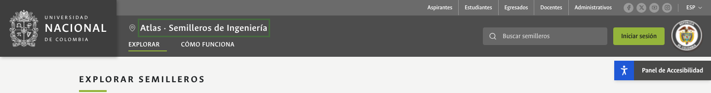
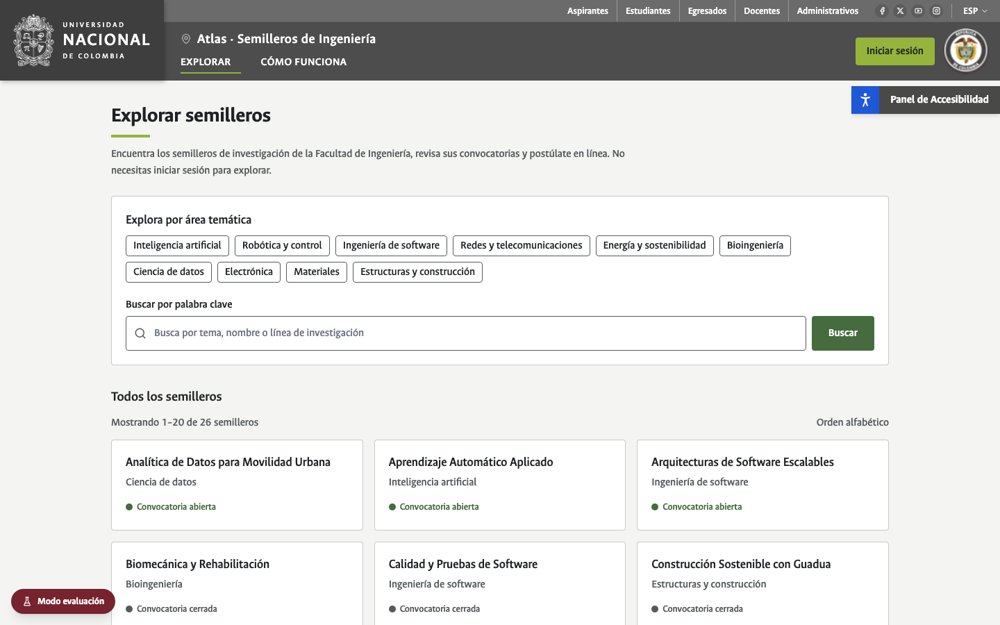
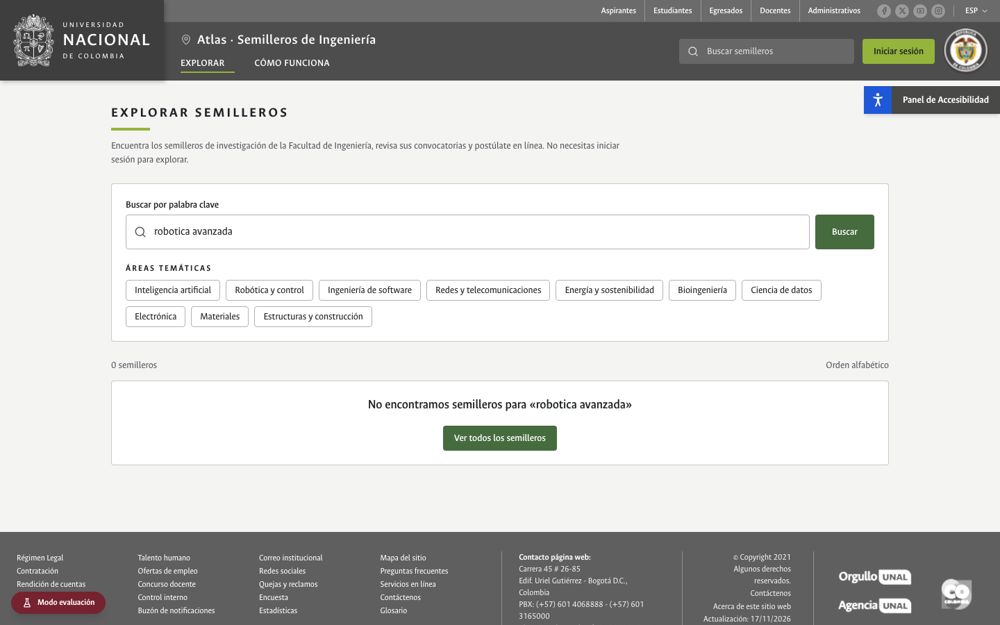
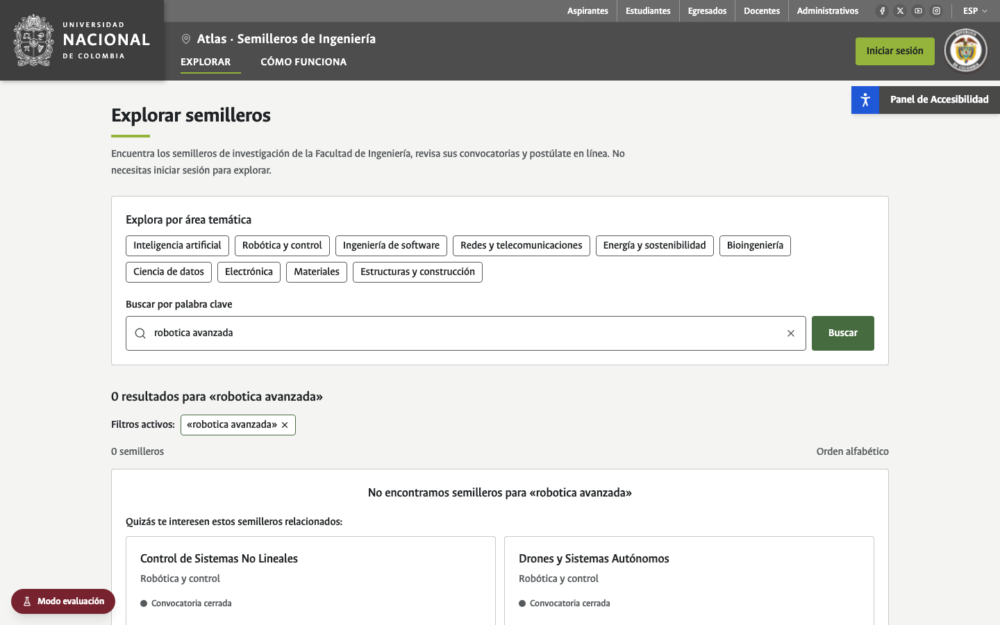
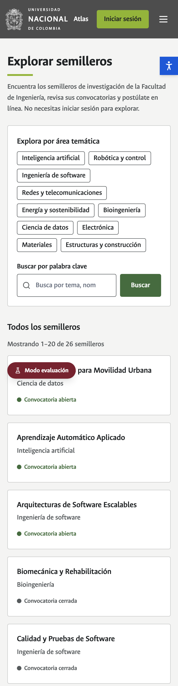
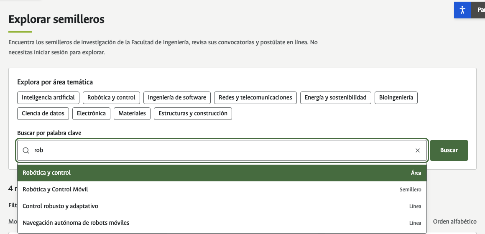
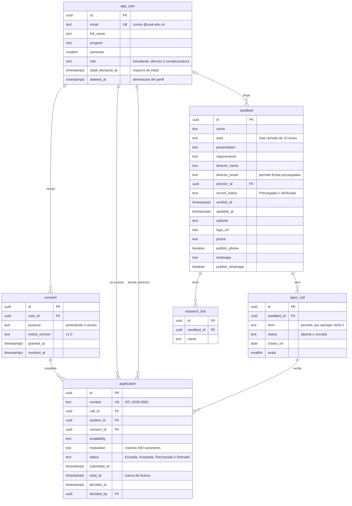
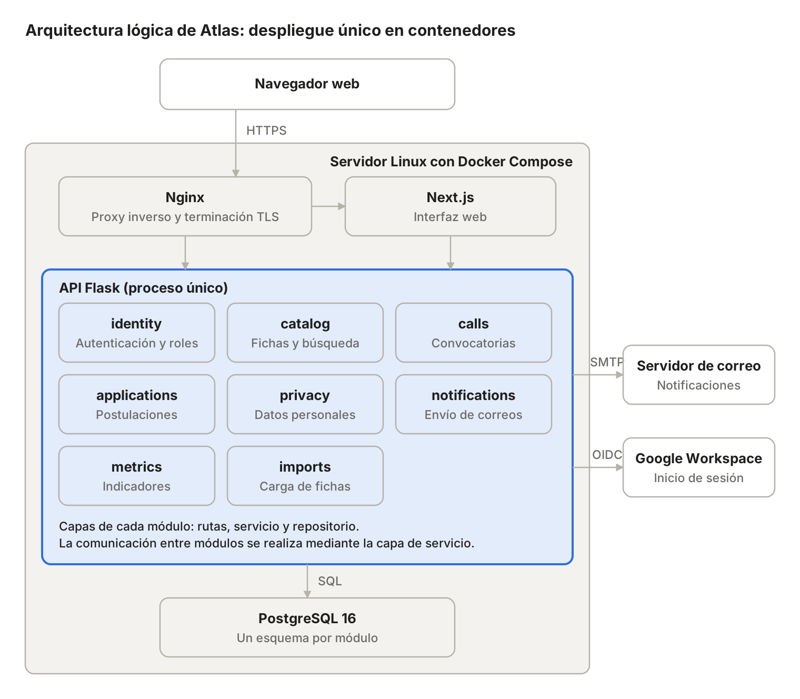
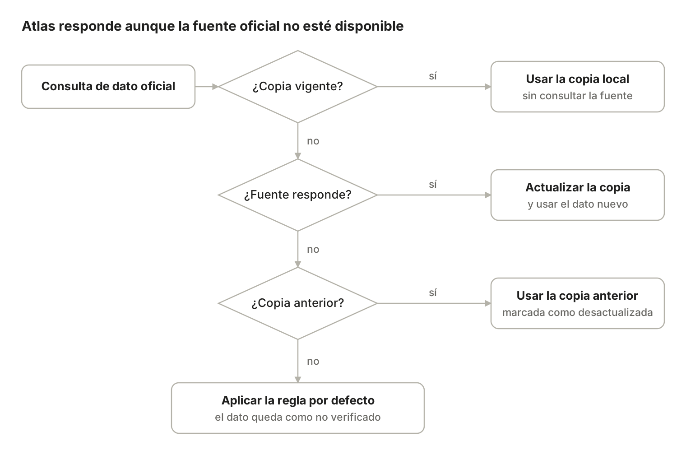

<div align="center">


# INFORME – HITO 2

## Atlas

*Tu mapa hacia la investigación*

<br />

Diego Alberto Romero Olmos · Diego Enrique Molina Sanchez · Juan Pablo Zuluaga Galindo · Diego Fernando Fandino Quintero · Jhonny Santiago Huerta Meicuaco · Samuel Ricardo Pardo Trujillo · Santiago Serrano González

<br />

**Presentado a:** Docente Jhon Alexander García Camargo

**Institución:** Universidad Nacional de Colombia – Sede Bogotá

**Fecha:** 17 de noviembre de 2026

Bogotá, Colombia

</div>

---

**Contenido**

- [Módulo I: Prototipo de Alta Fidelidad](#módulo-i-prototipo-de-alta-fidelidad)
- [Módulo II: Arquitectura de Frontend y Componentización](#módulo-ii-arquitectura-de-frontend-y-componentización)
- [Módulo III: QC de Usabilidad y Accesibilidad](#módulo-iii-qc-de-usabilidad-y-accesibilidad)
- [Módulo IV: Persistencia de soporte](#módulo-iv-persistencia-de-soporte)
- [Informe de uso de IA](#informe-de-uso-de-ia)

---

## Módulo I: Prototipo de Alta Fidelidad

### 1.1 Prototipo interactivo navegable

**Enlace al prototipo: [https://atlas-sisinfo.vercel.app](https://atlas-sisinfo.vercel.app)**

No es una imagen estática: es una aplicación web navegable (React 18 + Vite + TypeScript + Tailwind CSS) sin backend, cuyo estado vive en memoria con datos de ejemplo y se reinicia al recargar. Para recorrerla:

- El botón **Modo evaluación** (abajo a la izquierda) cambia de cuenta de demostración en un clic (estudiante, director, segundo director, Vicedecanatura y un correo externo que se rechaza), muestra la bandeja de correos simulados, reinicia los datos y activa las etiquetas de historias de usuario (por ejemplo «HU-04») sobre los componentes que las cumplen.
- La ruta **/evaluacion** relaciona cada historia con la pantalla, la ruta y la cuenta donde se comprueba.
- Para correrlo en local: `npm install` y `npm run dev` (http://localhost:5173). `npm test` ejecuta las 26 pruebas automáticas.

**Cobertura.** El prototipo **cubre el 100 % de las historias de usuario priorizadas en el Hito 1**: las 22 historias Must del MVP tienen una pantalla navegable (catálogo, búsqueda y ficha; aviso de privacidad e inicio de sesión; postulación en tres pasos; gestión de postulaciones, ficha y convocatoria del director; tablero de Vicedecanatura; y datos y autorizaciones del estudiante).

### 1.2 Uso de IA en el diseño

**Herramienta.** Claude (Anthropic), el mismo asistente descrito en el «Informe de uso de IA» de más abajo. El flujo fue: el equipo redactó el prompt inicial, Claude generó el prototipo y, después, el equipo detectó los problemas (con auditoría de accesibilidad, pruebas con usuarios y revisión del negocio) y decidió qué corregir; **Claude implementó esas correcciones** a partir de las instrucciones del equipo. Las capturas y los commits de esta sección son la evidencia.

#### Prompt inicial

El prompt tenía ocho secciones. El primer mensaje pedía solo la base del sistema y avisaba que las pantallas reales se construirían en mensajes posteriores.

| Sección | Qué exigía |
|---|---|
| Stack | React 18, Vite, TypeScript, React Router, Tailwind, shadcn/ui, lucide-react y recharts. Sin Next.js. |
| 1. Identidad visual | Seis colores UNAL con reglas de uso (verde = acción, rojo = error, sin otros colores ni degradados), Ancízar Sans, esquinas de 4 px, contraste WCAG AA y foco visible. |
| 2 y 3. Header y footer | Réplica de unal.edu.co a partir de capturas, con menú por rol, buscador y Panel de Accesibilidad. |
| 4. Roles y sesión | Visitante, estudiante, director y Vicedecanatura; inicio de sesión simulado con Google, sin contraseñas. |
| 5. Datos | 26 semilleros ficticios con una mezcla definida y 32 postulaciones (17 en 2026-2 y 15 en 2026-1), una sin autorización. |
| 6. Reglas transversales | Correos simulados con aviso, estados de carga, vacío y error, privacidad v1.0, ningún dato sensible, responsive y teclado. |
| 7. Modo evaluación | Cambio de cuenta, bandeja de correos, etiquetas de historias y reinicio de datos. |
| 8. Rutas | 14 rutas y pantalla «No tienes permiso» para las no autorizadas. |

<details>
<summary>Ver el prompt inicial completo</summary>

> Construye "Atlas", un prototipo web interactivo de alta fidelidad (React 18 con Vite, TypeScript, React Router, Tailwind CSS, shadcn/ui, lucide-react y recharts; NO uses Next.js). Atlas es el sistema de información de semilleros de investigación de la Facultad de Ingeniería de la Universidad Nacional de Colombia (UNAL): catálogo de semilleros, convocatorias y postulación en línea. Es complementario a Hermes (el sistema oficial de la universidad) y no lo reemplaza.
>
> Es un PROTOTIPO NAVEGABLE, no una imagen: no hay backend. Todo el comportamiento se simula con estado en el cliente (React Context) y datos de ejemplo. Toda la interfaz está en español de Colombia.
>
> **=== 1. IDENTIDAD VISUAL UNAL (obligatoria) ===**
> Tokens de color (variables CSS + extensión de Tailwind):
> - unal-verde (institucional): #94B43B (RGB 148,180,59 / Pantone 376 C)
> - unal-rojo (alterno): #A61C31 (RGB 166,28,49 / Pantone 187 C)
> - unal-verde-oscuro: #466B3F (RGB 70,107,63 / Pantone 7743 C)
> - unal-vino: #76232F (RGB 118,35,47 / Pantone 188 C)
> - unal-gris-oscuro: #565A5C (RGB 86,90,92 / Pantone 425 C)
> - unal-gris-claro: #B1B2B0 (RGB 177,178,176 / Pantone 421 C)
> - Texto: casi negro (#1F2224) y blanco. Fondo de página: blanco y gris muy claro (#F4F4F3).
>
> Reglas de uso:
> - Verde institucional = color de acción (botones primarios, indicadores positivos, estado "Abierta"). Para TEXTO verde sobre fondo claro usa unal-verde-oscuro (contraste AA).
> - Rojo alterno solo para errores, alertas, estados críticos y acciones destructivas.
> - Vino y grises para jerarquía secundaria, bordes y estados neutros ("Cerrada", "Precargada").
> - NO inventes otros colores de marca ni degradados.
>
> Tipografía: Ancízar Sans (tipografía institucional UNAL, disponible en Google Fonts como "Ancizar Sans"); si no carga, usa sans-serif del sistema. Títulos en semibold. Encabezados de sección en MAYÚSCULAS con tracking amplio y peso bold, como "COLOR INSTITUCIONAL" en la guía.
> Estilo: sobrio e institucional; esquinas poco redondeadas (4 px), sombras mínimas, iconos de línea, mucho espacio en blanco, contraste WCAG AA, foco de teclado visible.
>
> **=== 2. HEADER (replica el de unal.edu.co; ver imagen adjunta) ===**
> - Barra superior delgada en gris. Alineados a la derecha: Aspirantes | Estudiantes | Egresados | Docentes | Administrativos (separados por divisores finos) y selector "ESP" con flecha.
> - Barra principal en gris oscuro (#4D4D4D). A la izquierda, un bloque más oscuro y alto que sobresale hacia abajo con el escudo UNAL (usa la imagen adjunta; si no la hay, un placeholder circular claramente marcado) y el texto "UNIVERSIDAD NACIONAL DE COLOMBIA". A su derecha: icono de ubicación y el nombre "Atlas · Semilleros de Ingeniería" en tamaño grande.
> - Menú principal en MAYÚSCULAS, blanco, con flechita donde haya submenú. Cambia según el rol (ver sección 4).
> - A la derecha: campo "Buscar semilleros" con lupa (fondo gris claro; al enviar lleva al catálogo con la búsqueda) y el control de sesión ("Iniciar sesión" o menú de usuario).
> - Botón "Panel de Accesibilidad" flotante bajo el header, a la derecha (como en unal.edu.co), que abre un panel simple: aumentar/disminuir texto y alto contraste.
> - Header fijo al hacer scroll; en móvil, menú hamburguesa.
>
> **=== 3. FOOTER (replica el de unal.edu.co; ver imagen adjunta) ===**
> Fondo gris (#5F5F5F), texto blanco pequeño, enlaces sin subrayado (subrayan al pasar el cursor). Distribución en una fila:
> - Columna 1: Régimen Legal, Contratación, Rendición de cuentas, Pago virtual, Calidad
> - Columna 2: Talento humano, Ofertas de empleo, Concurso docente, Control interno, Buzón de notificaciones
> - Columna 3: Correo institucional, Redes sociales, Quejas y reclamos, Encuesta, Estadísticas
> - Columna 4: Mapa del sitio, Preguntas frecuentes, Servicios en línea, Contáctenos, Glosario
> - Separador vertical y bloque "Contacto página web:" Carrera 45 # 26-85, Edif. Uriel Gutiérrez - Bogotá D.C., Colombia / PBX: (+57) 601 4068888 - (+57) 601 3165000 / Línea Gratuita Nacional: 01 8000 912 597
> - Bloque derecho alineado a la derecha: "© Copyright 2021 Algunos derechos reservados." / Contáctenos / Acerca de este sitio web / "Actualización: 04/11/2026"
> - Al extremo derecho: badges "Orgullo UNAL" y "Agencia UNAL" (usa las imágenes adjuntas o placeholders marcados) y el sello gov.co.
>
> Los enlaces del footer pueden apuntar a "#". En móvil, las columnas se apilan.
>
> **=== 4. ROLES Y SESIÓN SIMULADA ===**
> Roles: visitante (sin sesión), estudiante, director de semillero, Vicedecanatura.
> - NUNCA muestres campos de contraseña: Atlas no almacena contraseñas. El inicio de sesión simula "Iniciar sesión con Google": un modal "Elige una cuenta" con estas cuentas de demostración y la opción "Usar otra cuenta" (campo de correo):
>   - estudiante.demo@unal.edu.co (estudiante)
>   - director.demo@unal.edu.co (director del semillero "Robótica y Control Móvil")
>   - director2.demo@unal.edu.co (director de otro semillero)
>   - vicedecanatura.demo@unal.edu.co (Vicedecanatura)
>   - externo.demo@gmail.com (dominio no institucional, para probar el rechazo)
> - El rol se deduce del correo: si coincide con el correo de director de alguna ficha es director; si es el correo de Vicedecanatura, ese rol; cualquier otro @unal.edu.co es estudiante; cualquier otro dominio se rechaza.
> - Menú del header por rol:
>   - visitante/estudiante: EXPLORAR · CÓMO FUNCIONA
>   - director: EXPLORAR · MI SEMILLERO · POSTULACIONES · CONVOCATORIA
>   - Vicedecanatura: TABLERO · EXPLORAR
> - Menú de usuario (avatar con correo y chip del rol): "Mis datos y privacidad" (solo estudiante), "Cerrar sesión".
>
> **=== 5. DATOS DE EJEMPLO (ficticios; nada de personas reales) ===**
> Crea /data/semilleros.ts con 26 semilleros de Ingeniería, ordenables alfabéticamente (tildes bien manejadas), para que el catálogo muestre 20 en la página 1 y 6 en la página 2. Cada uno:
> `{ id, nombre, descripcion, linea, area, director: { nombre (ficticio), correo (@unal.edu.co) }, requisitos, convocatoria: { abierta, cierre (fecha), cupos, aceptados }, estadoFicha: "Verificada" | "Precargada", actualizadoEn, contactoPublico?: { telefono?, whatsapp?, autorizadoPublicar } }`
> Lista cerrada de áreas: Inteligencia artificial, Robótica y control, Ingeniería de software, Redes y telecomunicaciones, Energía y sostenibilidad, Bioingeniería, Ciencia de datos, Electrónica, Materiales, Estructuras y construcción.
> Mezcla: ~12 con convocatoria abierta y ~14 cerrada; ~14 "Verificada" y ~12 "Precargada"; 2 fichas con campos vacíos (requisitos y línea); 3 fichas con actualizadoEn de más de 6 meses; solo 2 fichas Verificadas con contactoPublico autorizado; las demás sin teléfono ni WhatsApp. "Robótica y Control Móvil" pertenece a director.demo (convocatoria abierta, 5 cupos) y otro semillero a director2.demo.
> También crea postulaciones semilla (17 en el semestre actual 2026-2 y 15 en el anterior 2026-1, de estudiantes ficticios), autorizaciones registradas y 1 postulación semilla sin autorización registrada (para el tablero).
>
> **=== 6. ESTADO Y REGLAS TRANSVERSALES ===**
> - Un AppContext (sesión, perfil del estudiante, declaraciones de edad, registro de autorizaciones y revocaciones { usuario, finalidad, versionAviso, fechaHora, estado }, postulaciones, semilleros, bandeja de correos simulados, bitácora de accesos). Se reinicia al recargar.
> - "Correos": cuando una historia diga que se envía un correo, muestra un toast "Correo enviado a …" y guarda el correo en la bandeja simulada.
> - Todas las pantallas tienen estados de carga (skeleton máximo 300 ms), vacío y error.
> - Los dos textos de privacidad (aviso y autorización) tienen versión "v1.0".
> - Nunca muestres, pidas ni guardes datos sensibles (edad, género, origen, promedio, estrato, salud, religión).
> - Responsive (móvil, tablet, escritorio), navegación por teclado y etiquetas ARIA.
>
> **=== 7. PANEL DE DEMOSTRACIÓN (solo para evaluar el prototipo) ===**
> Botón flotante discreto abajo a la izquierda, con rótulo "Modo evaluación", que abre un panel con: (a) cambiar de cuenta de demostración en un clic, (b) bandeja de correos simulados, (c) interruptor "Mostrar etiquetas de historias de usuario" que dibuja chips pequeños (por ejemplo "HU-04") sobre los componentes que cumplen cada historia, (d) "Reiniciar datos".
>
> **=== 8. RUTAS ===**
> / (Explorar) · /semilleros/[id] · /ingresar · /postular/[id] · /postulacion/[numero] · /mi-cuenta · /director · /director/ficha · /director/convocatoria · /director/postulaciones · /director/postulaciones/[id] · /vicedecanatura/tablero · /como-funciona · /evaluacion (se completa al final)
> Una ruta sin permiso muestra una pantalla "No tienes permiso para ver esta página" con botón para volver al catálogo.
>
> **=== ENTREGA DE ESTE PRIMER MENSAJE ===**
> Construye SOLO: tokens, layout con header y footer, AppContext, datos de ejemplo, panel de demostración, inicio de sesión simulado (selector de cuenta, sin reglas de rechazo todavía) y las rutas con pantallas "En construcción". Las pantallas reales se construirán en los siguientes mensajes; no las anticipes.

</details>

#### Resultado de la IA

La primera versión (commit `fe315a0`) trajo 51 archivos y 8.253 líneas: 14 pantallas, 9 componentes, datos de ejemplo, estado global y 12 pruebas de flujo. Cumplió bien lo verificable en el código: 26 fichas con la mezcla pedida (14 verificadas, 3 con más de 180 días sin actualizar, solo 2 con contacto público), catálogo de 20 + 6 por página, 17 + 15 postulaciones con una sin autorización, roles y permisos por ruta, y el Modo evaluación. Además tomó decisiones propias que el equipo conservó: una convocatoria cuenta como abierta solo si la bandera está activa, la fecha de cierre no ha pasado y quedan cupos; y el contacto público se puede autorizar por separado para teléfono y WhatsApp.

#### Refactorización humana (decidida por el equipo, implementada con Claude)

| Qué entregó la IA | Problema detectado | Corrección del equipo | Commit |
|---|---|---|---|
| Anillo de foco verde oscuro en toda la aplicación | Casi invisible sobre el header y el footer (1,38:1 y 1,04:1; mínimo 3:1) | Anillo blanco en `header` y `footer`, verde dentro de menús blancos | `7fa4970` |
| `Dialog` con `aria-modal="true"` | No atrapaba el foco; Tab salía hacia la página de fondo | Tab y Shift+Tab ciclan dentro del diálogo, con prueba automática | `7fa4970` |
| Errores de formulario como texto suelto | Sin `aria-invalid` ni `aria-describedby` | El componente `Campo` vincula error y ayuda con el control | `7fa4970` |
| Menú de usuario y pestañas con roles ARIA | Sin flechas, Inicio, Fin ni Escape | Teclado completo según el patrón ARIA | `7fa4970` |
| Borde de campos y placeholder en gris claro | 2,13:1 y 2,54:1 | Gris oscuro (6,97:1) y `gray-500` (4,83:1) | `7fa4970`, `483ab7c` |
| Encabezados en mayúsculas de 16 a 20 px, cuerpo de 14 px y estados como cajas con aspecto de botón | Lectura difícil, jerarquía débil y estados confundibles con botones | Tres niveles de 30, 20 y 18 px, cuerpo de 16 px y estados como texto de color con un punto | `483ab7c` |
| Enlaces del header y footer a la portada de unal.edu.co | El prototipo debía replicar el sitio | URL oficiales de cada enlace y red social | `839f468` |
| Buscador «Buscar semilleros» en el header | Duplicaba la búsqueda de Explorar y su placeholder medía 4,33:1 | Se eliminó del header | `839f468` |
| Escudo de 38 KB y fuentes que bloqueaban el render | Carga lenta | Imagen de 19 KB, fuentes sin bloqueo y tablero de carga diferida | `593bdb3` |
| Búsqueda, filtros y estado vacío de Explorar | Pruebas con usuarios (P01, P03, P08) | Botón «×», fila de filtros activos y sugerencias en el estado vacío | `1ceb0f5` |
| Explorar con la búsqueda como elemento principal y sin ayuda para saber qué buscar | Pruebas con usuarios (P02, P04) | Áreas temáticas primero y sugerencias mientras se escribe | `dbb461a` |
| Botón «Reclamar ficha» y «Sin información» en requisitos | Pruebas con usuarios (P05, P06) | «Verificar mi ficha» y dos textos distintos para «sin requisitos» y «no cargados» | `1ceb0f5` |
| Formularios sin salida | Heurística 3 de Nielsen | «Cancelar» y aviso de cambios sin guardar | `3b8ecd6` |
| Ficha con descripción, líneas y contacto | Necesidad del negocio | Página web, logo y botón de WhatsApp del semillero | `956b068` |

Resultado medido tras las correcciones de accesibilidad: de 7 fallos reales de contraste a 0, y de 1 violación de axe-core en 10 pantallas a 0 en 11.

#### Evidencia visual: antes (primera versión generada, commit `fe315a0`) y después (versión actual)

Capturas tomadas con el mismo navegador y el mismo tamaño de ventana (1440 × 900), compilando cada versión del código.

**Foco de teclado en el header.** El prompt exigía «foco de teclado visible». En la primera versión el anillo verde oscuro casi no se distinguía sobre el gris del header (1,38:1); ahora es blanco (8,45:1).

| Antes | Después |
|---|---|
|  |  |

**Pantalla Explorar.** Cambios visibles: se quitó el buscador del header; las áreas temáticas pasaron arriba de la búsqueda (P02); los títulos pasaron de mayúsculas espaciadas a tres niveles legibles (30, 20 y 18 px); el cuerpo subió de 14 a 16 px; y los estados dejaron de ser cajas con aspecto de botón y son texto de color con un punto.

| Antes | Después |
|---|---|
|  |  |

**Búsqueda sin resultados (hallazgo P08 de las pruebas con usuarios).** Antes, la pantalla quedaba vacía; ahora aparecen botón para borrar, filtros activos y semilleros relacionados.

| Antes | Después |
|---|---|
|  |  |

#### Lecciones

- La IA acierta en estructura, volumen y coherencia entre archivos: en la primera versión entregó 14 pantallas, el estado global, los datos de ejemplo y 12 pruebas.
- Lo que el prompt exigía y requería medición (contraste AA, foco visible, comportamiento de teclado de diálogos, menús y pestañas) no se cumplía en la primera versión. Solo la auditoría lo reveló, así que conviene pedirle a la IA la evidencia junto con el entregable.
- Los roles ARIA llegaron sin el comportamiento de teclado que prometen; un rol sin comportamiento es peor que no ponerlo.
- Hallazgos como P05 («Reclamar ficha» se entendía como «crear ficha») solo aparecieron al observar a personas usando el prototipo.

---

## Módulo II: Arquitectura de Frontend y Componentización

El prototipo está construido en **React 18 + TypeScript + Vite + Tailwind CSS + React Router 6**. Esta sección muestra cómo se organiza en componentes, qué elementos se repiten, cómo se adapta la pantalla principal a escritorio y móvil, y cómo cumple 8 de las 10 heurísticas de Nielsen, con evidencia tomada del código.

---

### 2.1 Inventario de componentes

#### 2.1.1 Estructura en React

La aplicación se organiza en cinco capas. Cada página corresponde a una ruta; los elementos que se repiten viven en `components/`; el estado compartido está en un único contexto de React.

```text
src/
├── main.tsx                 Punto de entrada: crea el enrutador y monta el estado global
├── App.tsx                  Tabla de rutas (públicas y protegidas por rol)
├── store.tsx                Estado global (React Context): sesión, semilleros, postulaciones,
│                            autorizaciones, correos simulados y avisos. Se consume con useStore()
├── types.ts                 Tipos del dominio (Semillero, Postulacion, Rol, Area…)
├── data/seed.ts             Datos de ejemplo: 26 semilleros y 32 postulaciones
├── lib/utils.ts             Funciones puras: fechas, orden alfabético sin tildes, validación de URL y WhatsApp
├── components/              Piezas reutilizables
│   ├── Layout.tsx           Marco de todas las páginas
│   ├── Header.tsx           Encabezado institucional y menú por rol
│   ├── Footer.tsx           Pie de página institucional
│   ├── A11yPanel.tsx        Panel de accesibilidad (tamaño de texto y alto contraste)
│   ├── DemoPanel.tsx        «Modo evaluación» del prototipo
│   ├── RequireRole.tsx      Protección de rutas por rol
│   ├── NoPermiso.tsx        Pantalla de acceso denegado o página inexistente
│   ├── UI.tsx               Primitivos: PageTitle, Badge, Dialog, Campo, Alerta, Toasts, HU
│   ├── Semillero.tsx        Piezas del dominio: TarjetaSemillero, BadgeConvocatoria, SelloFicha, Resaltar
│   └── CambiosSinGuardar.tsx  Aviso al salir de un formulario con cambios sin guardar
└── pages/                   Una vista por ruta (14)
```

Jerarquía en tiempo de ejecución:

```text
RouterProvider
└── StoreProvider (estado global)
    └── AppRoutes
        └── Layout
            ├── Header ─ menú según el rol de la sesión
            ├── <main> ─ página de la ruta activa
            │     └── RequireRole (solo en rutas privadas)
            │           └── Página ─ usa PageTitle, TarjetaSemillero, Campo, Dialog, Alerta…
            ├── Footer
            ├── Toasts, A11yPanel, DemoPanel
```

**Decisiones de estructura**

- **Páginas delgadas, componentes reutilizables.** Las páginas combinan primitivos (`Campo`, `Dialog`, `Alerta`) en lugar de repetir marcado y estilos.
- **Un solo estado global.** Sin backend, `store.tsx` simula la persistencia y las reglas de negocio (aceptar una postulación descuenta un cupo, revocar una autorización queda en el historial). Lo consumen 17 archivos mediante `useStore()`.
- **Protección declarativa de rutas.** `RequireRole` envuelve cada ruta privada: sin sesión redirige a `/ingresar` y con un rol distinto muestra `NoPermiso`.
- **Carga diferida.** El Tablero, que incluye la biblioteca de gráficos `recharts`, se carga solo cuando alguien lo visita (`React.lazy`).
- **Estilos centralizados.** La paleta UNAL está en `tailwind.config.js` y las clases de botones, tarjetas y campos en `src/index.css`.

#### 2.1.2 Componentes reutilizables

| Componente | Archivo | Qué hace | Dónde se usa |
| --- | --- | --- | --- |
| `Layout` | `components/Layout.tsx` | Enlace «Saltar al contenido», `Header`, contenido de la ruta, `Footer`, avisos y paneles flotantes; vuelve al inicio de la página al cambiar de ruta. | Envuelve todas las rutas (`App.tsx`). |
| `Header` | `components/Header.tsx` | Encabezado fijo réplica de unal.edu.co: barra de perfiles y redes, escudo, menú principal según el rol, menú de usuario con teclado completo (flechas, Inicio, Fin, Escape) y menú hamburguesa en móvil. | `Layout` |
| `Footer` | `components/Footer.tsx` | Cuatro columnas de enlaces oficiales de la UNAL, contacto, derechos y sellos institucionales. | `Layout` |
| `A11yPanel` | `components/A11yPanel.tsx` | Diálogo para cambiar el tamaño del texto (85 % a 150 %) y activar alto contraste. | `Layout` |
| `DemoPanel` | `components/DemoPanel.tsx` | «Modo evaluación»: cambia de cuenta de demostración, muestra los correos simulados, activa las etiquetas de historias y reinicia los datos. | `Layout` |
| `RequireRole` | `components/RequireRole.tsx` | Deja pasar solo a los roles indicados; sin sesión, redirige a `/ingresar` y conserva la ruta de destino. | 9 rutas privadas en `App.tsx` |
| `NoPermiso` | `components/NoPermiso.tsx` | Mensaje de acceso denegado o página inexistente, con botón para volver al catálogo. | `RequireRole`, ruta `*` y 8 páginas que validan el recurso pedido |
| `PageTitle` | `components/UI.tsx` | Título `h1` de la página con la línea verde institucional y subtítulo opcional. | 12 páginas |
| `Badge` | `components/UI.tsx` | Indicador de estado: texto de color con un punto, sin caja, para que no parezca un botón. Cinco tonos. | Base de `BadgeConvocatoria`, `BadgeEstado` y `SelloFicha`; `DirectorPostulaciones`, `Tablero` |
| `Dialog` | `components/UI.tsx` | Ventana modal accesible: el foco entra al abrir, queda atrapado con Tab y Shift+Tab, Escape la cierra y el foco vuelve al botón de origen. | 8 diálogos: verificar ficha, cerrar convocatoria, decidir postulación, elegir cuenta, retirar postulación, revocar autorización, eliminar perfil y cambios sin guardar |
| `Campo` | `components/UI.tsx` | Etiqueta, control, ayuda y error de un campo; vincula error y ayuda al control con `aria-invalid` y `aria-describedby`. | `Postular`, `DirectorFicha`, `DirectorConvocatoria` |
| `Alerta` | `components/UI.tsx` | Mensaje informativo, de éxito o de error (`role="status"` o `role="alert"`). | 7 páginas |
| `Toasts` | `components/UI.tsx` | Avisos temporales («Correo enviado a…»), anunciados a lectores de pantalla (`aria-live`). | `Layout` |
| `HU` | `components/UI.tsx` | Etiqueta de historia de usuario (por ejemplo «HU-04»), visible solo con el Modo evaluación. | 10 archivos |
| `TarjetaSemillero` | `components/Semillero.tsx` | Tarjeta enlazada con nombre (resaltando el término buscado), área, logo opcional y estado de la convocatoria; recuerda la búsqueda de origen para poder volver a ella. | `Explorar` (catálogo y sugerencias), `Ficha` (relacionados) |
| `BadgeConvocatoria` | `components/Semillero.tsx` | «Convocatoria abierta» o «cerrada», calculado con bandera, fecha de cierre y cupos. | `TarjetaSemillero`, `Ficha`, `DirectorPanel`, `DirectorFicha`, `DirectorConvocatoria` |
| `BadgeEstado` | `pages/DirectorPostulaciones.tsx` | Estado de una postulación: Enviada, Aceptada, Rechazada o Retirada. | `DirectorPostulaciones`, `DirectorPostulacionDetalle`, `MiCuenta` |
| `SelloFicha` | `components/Semillero.tsx` | «Verificada» o «Precargada» (tomada de Hermes) con la fecha de actualización. | `Ficha`, `DirectorPanel`, `DirectorFicha` |
| `useCambiosSinGuardar` | `components/CambiosSinGuardar.tsx` | Avisa antes de salir de un formulario modificado: diálogo propio al navegar dentro de Atlas y aviso del navegador al cerrar o recargar. | `Postular`, `DirectorFicha`, `DirectorConvocatoria` |

#### 2.1.3 Páginas

| Ruta | Página | Rol | Qué hace |
| --- | --- | --- | --- |
| `/` | `Explorar` | Todos | Catálogo con áreas temáticas, búsqueda con sugerencias mientras se escribe, filtros activos, semilleros relacionados si no hay resultados y paginación de 20. |
| `/semilleros/:id` | `Ficha` | Todos | Datos del semillero, página web, contacto autorizado (con botón de WhatsApp), convocatoria y semilleros relacionados. |
| `/ingresar` | `Ingresar` | Visitante | Aviso de privacidad v1.0 e inicio de sesión simulado con Google; rechaza correos fuera de `@unal.edu.co`. |
| `/como-funciona` | `ComoFunciona` | Todos | Los cuatro pasos para postularse. |
| `/evaluacion` | `Evaluacion` | Todos | Las 22 historias Must con su pantalla; «Abrir» inicia sesión con la cuenta adecuada y navega. |
| `/postular/:id` | `Postular` | Estudiante | Postulación en tres pasos: mayoría de edad, autorización de datos y formulario. |
| `/postulacion/:numero` | `Confirmacion` | Estudiante | Comprobante con número de postulación. |
| `/mi-cuenta` | `MiCuenta` | Estudiante | Cuatro pestañas: mis datos, mis postulaciones, autorizaciones y eliminar perfil. |
| `/director` | `DirectorPanel` | Director | Resumen de ficha, convocatoria y postulaciones nuevas. |
| `/director/ficha` | `DirectorFicha` | Director | Verificar la ficha precargada y editarla (incluye página web, logo y WhatsApp). |
| `/director/convocatoria` | `DirectorConvocatoria` | Director | Abrir o cerrar la convocatoria, fecha de cierre y cupos. |
| `/director/postulaciones` | `DirectorPostulaciones` | Director | Tabla de postulaciones recibidas, con las nuevas marcadas. |
| `/director/postulaciones/:id` | `DirectorPostulacionDetalle` | Director | Detalle y decisión (aceptar o rechazar) con confirmación. |
| `/vicedecanatura/tablero` | `Tablero` | Vicedecanatura | Indicadores agregados: crecimiento de postulaciones, fichas verificadas y postulaciones con autorización. |
| `*` | `NoPermiso` | Todos | Página inexistente. |

#### 2.1.4 Elementos que se repiten

| Elemento | Implementación | Variantes y uso |
| --- | --- | --- |
| **Botones** | Clases `.btn-*` en `src/index.css` | `.btn-primary` (verde oscuro, acción principal; 12 archivos) · `.btn-outline` (secundaria, cancelar o volver; 13 archivos) · `.btn-danger` (rojo, acciones destructivas o de rechazo; 4 archivos) · `.btn-verde` (verde institucional, solo «Iniciar sesión» del header) |
| **Tarjetas** | Clase `.card` y componente `TarjetaSemillero` | `.card` agrupa contenido y formularios en 15 archivos; `TarjetaSemillero` se repite en el catálogo, las sugerencias y los relacionados |
| **Formularios** | Componente `Campo` y clases `.input` y `.label` | Postulación, edición de ficha, convocatoria, mis datos, inicio de sesión y búsqueda; los formularios largos usan además `useCambiosSinGuardar` |
| **Diálogos de confirmación** | Componente `Dialog` | 8 flujos (ver 2.1.2), siempre con una acción segura y una principal |
| **Indicadores de estado** | `Badge` y sus derivados | Convocatoria, verificación de ficha y estado de postulación con el mismo código de color: verde = positivo, gris = neutro, rojo = rechazo |
| **Mensajes** | `Alerta` y `Toasts` | Errores con salida, confirmaciones y correos simulados |

---

### 2.2 Diseño responsivo (pantalla principal: Explorar)

Se usan los puntos de quiebre de Tailwind: `sm` (640 px), `md` (768 px) y `lg` (1024 px). Por debajo de 640 px rige el diseño móvil.

#### 2.2.1 Explorar (`src/pages/Explorar.tsx`)

| Elemento | Clases | Móvil (< 640 px) | Escritorio |
| --- | --- | --- | --- |
| Grilla de semilleros | `grid gap-4 sm:grid-cols-2 lg:grid-cols-3` | 1 tarjeta por fila | 2 columnas desde 640 px y 3 desde 1024 px |
| Sugerencias sin resultados | `grid gap-3 sm:grid-cols-2` | 1 por fila | 2 columnas |
| Texto «Orden alfabético» | `hidden sm:block` | Oculto, para dejar espacio al contador | Visible a la derecha del contador |
| Contenedor | `mx-auto max-w-6xl px-4` | Ocupa todo el ancho con margen de 16 px | Se centra con un ancho máximo |
| Búsqueda | `flex gap-2` y `relative flex-1` | El campo se encoge y el botón «Buscar» conserva su tamaño | Campo ancho |
| Áreas temáticas, filtros activos y paginación | `flex flex-wrap gap-2` | Bajan a la línea siguiente | Caben en una o dos líneas |

#### 2.2.2 Marco común (`Header`, `A11yPanel`, `Footer`)

| Componente | Clases | Móvil | Escritorio |
| --- | --- | --- | --- |
| Barra de perfiles y redes | `hidden md:block` | Oculta | Visible desde 768 px |
| Escudo UNAL | `hidden md:flex` / `md:hidden` | Versión compacta junto al nombre corto «Atlas · Semilleros» | Bloque oscuro que sobresale, con el nombre completo |
| Menú principal | `hidden md:block` | Se reemplaza por el botón hamburguesa (`md:hidden`) | Menú horizontal |
| Sello de Colombia | `hidden md:block` | Oculto | Visible |
| Panel de Accesibilidad | `hidden sm:flex` en el texto | Solo el icono | Icono y texto |
| Pie de página | `sm:grid-cols-2 lg:grid-cols-[…]` | 1 columna | 2 columnas desde 640 px y 7 con separadores desde 1024 px |

#### 2.2.3 Evidencia visual

Capturas de la versión actual: escritorio a 1440 × 900 px y móvil a 390 px de ancho (iPhone 14), con la página desplazada hasta las primeras tarjetas.

| Escritorio (1440 px) | Móvil (390 px) |
| :---: | :---: |
|  |  |

---

### 2.3 Heurísticas de usabilidad de Jakob Nielsen

Se documentan **8 de las 10 heurísticas**, cada una con evidencia del código actual.

#### 1. Visibilidad del estado del sistema

La interfaz informa en qué paso está el usuario, cuántos resultados hay y qué acaba de pasar.

- **Progreso de la postulación** (`Postular.tsx`): marca el paso actual, los terminados con ✓ y lo anuncia con `aria-current="step"`.
```tsx
<li
  key={t}
  aria-current={n === actual ? 'step' : undefined}
  className={clsx('flex items-center gap-2 border-b-4 pb-1', n === actual ? 'border-unal-verde-oscuro text-unal-verde-oscuro' : hecho ? 'border-unal-verde text-unal-texto' : 'border-transparent text-unal-gris-oscuro')}
>
  {hecho ? <Check size={14} /> : <span>{n}.</span>} {t}
</li>
```
- **Contador de resultados en vivo** (`Explorar.tsx`): se actualiza mientras se escribe y lo anuncian los lectores de pantalla (`aria-live`).
```tsx
<div className="mt-3 flex items-center justify-between text-sm text-unal-gris-oscuro" aria-live="polite">
  <p data-testid="contador">
    {filtrados.length === 0
      ? '0 semilleros'
      : `Mostrando ${desde + 1}–${desde + visibles.length} de ${filtrados.length} semilleros`}
  </p>
```
- **Avisos temporales** (`UI.tsx`, `Toasts`): confirman acciones como «Correo enviado a…».

#### 2. Correspondencia entre el sistema y el mundo real

Usa el lenguaje de la universidad (Hermes, Vicedecanatura de Investigación y Extensión, programas curriculares, Ley 1581 de 2012) y fechas en formato colombiano (`dd/mm/aaaa`).

- **Origen de la ficha** (`Semillero.tsx`, `SelloFicha`): explica que una ficha precargada viene de Hermes y aún no la confirma el director.
```tsx
<Badge tone="gris" punto={false} title="Información tomada de fuentes públicas de Hermes; aún no confirmada por el director">
  <FileClock size={14} aria-hidden /> Precargada
</Badge>
```
- **Fechas** (`lib/utils.ts`):
```ts
export function fmtFecha(iso: string): string {
  const [datePart] = iso.split('T')
  const [y, m, d] = datePart.split('-')
  return `${d}/${m}/${y}`
}
```

#### 3. Control y libertad del usuario

Hay salida en cada flujo: «Cancelar» en los formularios, aviso antes de perder cambios, cierre de diálogos con Escape y acciones reversibles (retirar una postulación, revocar una autorización).

- **Aviso de cambios sin guardar** (`CambiosSinGuardar.tsx`): si el usuario intenta salir de un formulario modificado, puede seguir editando o salir sin guardar.
```tsx
<Dialog
  titulo="Tienes cambios sin guardar"
  onClose={() => blocker.reset()}
  acciones={
    <>
      <button className="btn-outline" onClick={() => blocker.reset()}>Seguir editando</button>
      <button className="btn-danger" onClick={() => blocker.proceed()}>Salir sin guardar</button>
    </>
  }
>
```
- **Retirar una postulación enviada** (`MiCuenta.tsx`):
```tsx
{p.estado === 'Enviada' && <button className="btn-outline" onClick={() => setRetirando(p.id)}>Retirar postulación</button>}
```
- **Volver a los resultados** (`Ficha.tsx`): la ficha recuerda la búsqueda, el filtro y la página de origen.

#### 4. Consistencia y estándares

Una sola paleta institucional (`tailwind.config.js`), las mismas clases para cada tipo de botón, tarjeta y campo, y el encabezado y pie oficiales de la UNAL.

- **Clases compartidas** (`src/index.css`):
```css
@layer components {
  .section-title { @apply text-xl font-semibold leading-snug text-unal-texto; }
  .btn { @apply inline-flex items-center justify-center gap-2 rounded px-4 py-2 text-sm font-semibold transition-colors disabled:cursor-not-allowed disabled:opacity-50; }
  .btn-primary { @apply btn bg-unal-verde-oscuro text-white hover:bg-[#3a5a34]; }
  .btn-verde { @apply btn bg-unal-verde text-unal-texto hover:bg-[#86a534]; }
  .btn-outline { @apply btn border border-unal-gris-oscuro bg-white text-unal-texto hover:bg-gray-100; }
  .btn-danger { @apply btn bg-unal-rojo text-white hover:bg-[#8e1829]; }
  .card { @apply rounded border border-unal-gris-claro/70 bg-white p-5; }
  .input { @apply w-full rounded border border-unal-gris-oscuro bg-white px-3 py-2 text-sm placeholder:text-gray-500; }
  .label { @apply mb-1 block text-sm font-semibold; }
}
```
- El rojo se reserva para acciones destructivas y errores, y el verde para la acción principal, en todas las pantallas.

#### 5. Prevención de errores

Se deshabilitan las acciones que no proceden, se pide confirmación antes de lo irreversible y se advierte antes de que el usuario cometa el error.

- **Confirmación escrita para eliminar el perfil** (`MiCuenta.tsx`):
```tsx
<button
  className="btn-danger"
  disabled={confirmacion !== 'ELIMINAR'}
  onClick={() => { setEliminando(false); navigate('/'); eliminarPerfil() }}
>
  Eliminar definitivamente
</button>
```
- **No se puede aceptar sin cupos** (`DirectorPostulacionDetalle.tsx`), y se explica cómo resolverlo:
```tsx
<button className="btn-primary" disabled={sinCupos} onClick={() => setConfirmar('Aceptada')}>Aceptar</button>
// …
{p.estado === 'Enviada' && sinCupos && (
  <p className="mt-2 text-right text-sm text-unal-gris-oscuro" role="note">
    No puedes aceptar: los cupos están llenos. Aumenta los cupos en <Link to="/director/convocatoria">Convocatoria</Link> para aceptar más postulaciones.
  </p>
)}
```
- **Límite de caracteres y advertencia sobre datos sensibles** (`Postular.tsx`):
```tsx
<textarea id="f-msg" rows={5} maxLength={MAX_MENSAJE} value={form.mensaje}
  onChange={(e) => set('mensaje', e.target.value.slice(0, MAX_MENSAJE))} className="input" aria-describedby="msg-ayuda" />
<div id="msg-ayuda" className="mt-1 flex flex-wrap justify-between gap-2 text-xs">
  <span className="text-unal-gris-oscuro">No incluyas datos sensibles (salud, religión, origen étnico, orientación sexual, situación económica).</span>
  <span data-testid="contador-mensaje" className="font-semibold">{form.mensaje.length}/{MAX_MENSAJE}</span>
</div>
```

#### 6. Reconocimiento antes que recuerdo

El usuario elige en lugar de recordar: el formulario llega prellenado, los programas y la disponibilidad son listas cerradas, el término buscado se resalta y los filtros activos quedan a la vista.

- **Prellenado con los datos del perfil** (`Postular.tsx`):
```tsx
const [form, setForm] = useState({
  nombre: perfil?.nombre ?? sesion?.nombre ?? '',
  programa: perfil?.programa ?? '',
  semestre: perfil?.semestre ?? '',
  disponibilidad: '',
  mensaje: '',
})
```
- **Sugerencias mientras se escribe** (`Explorar.tsx`): desde la segunda letra se proponen áreas, semilleros y líneas, para que el usuario reconozca lo que existe en vez de adivinar términos.
- **Filtros activos visibles y removibles** (`Explorar.tsx`): «Filtros activos: «robótica» × · Robótica y control ×».
- **Resaltado del término buscado** (`Semillero.tsx`, `Resaltar`):
```tsx
<mark className="bg-unal-verde/40 px-0.5">{texto.slice(i, i + nq.length)}</mark>
```

#### 7. Ayudar a reconocer, diagnosticar y recuperarse de errores

Los mensajes dicen qué pasó y ofrecen una salida inmediata.

- **Correo fuera del dominio institucional** (`Ingresar.tsx`):
```tsx
<Alerta tono="error">
  <p className="font-semibold">Solo puedes entrar con tu correo @unal.edu.co</p>
  <div className="mt-3 flex flex-wrap gap-2">
    <button className="btn-outline" onClick={() => { setRechazo(false); setSelector(true) }}>Intentar con otra cuenta</button>
    <Link to="/" className="btn-outline">Volver al catálogo</Link>
  </div>
</Alerta>
```
- **Ficha de otro director** (`DirectorFicha.tsx`): explica a quién pedir la corrección y abre el correo ya redactado.
```tsx
<p className="font-semibold">Tu correo no coincide con el del director de esta ficha.</p>
<p className="mt-2 text-unal-texto">
  Solo el director registrado puede verificarla. Si crees que hay un error, pide la corrección a la Vicedecanatura de Investigación y Extensión…
</p>
<a className="btn-primary" href={`mailto:${CORREO_VICE}?subject=${encodeURIComponent(`Corrección de ficha: ${s.nombre}`)}`}>Escribir a la Vicedecanatura</a>
```
- **Búsqueda sin resultados** (`Explorar.tsx`): en lugar de una pantalla vacía, propone hasta 4 semilleros relacionados y las áreas temáticas.

#### 8. Ayuda y documentación

Una página «Cómo funciona», textos de ayuda junto a los campos (`Campo` con `hint`) y orientación a un director que entra con un correo no asociado.

- **Guía en cuatro pasos** (`ComoFunciona.tsx`):
```tsx
const PASOS = [
  ['Explora', 'Revisa el catálogo de semilleros de Ingeniería sin iniciar sesión y busca por tema o palabra clave.'],
  ['Revisa la ficha', 'Mira la línea de investigación, los requisitos y si el semillero tiene convocatoria abierta.'],
  ['Postúlate', 'Inicia sesión con tu correo @unal.edu.co, autoriza el uso de tus datos y envía el formulario.'],
  ['Recibe respuesta', 'El director acepta o rechaza desde Atlas y te avisamos por correo.'],
]
```

---

> **Declaración de uso de IA:** El análisis de código, el inventario de componentes, la revisión del diseño responsivo y la verificación de las heurísticas de Nielsen de este módulo se realizaron con la herramienta de inteligencia artificial **Antigravity (Google DeepMind · modelo Gemini)**, a partir de la inspección de los archivos en `src/`.
>
> **Actualización con Claude (Anthropic).** Después de las correcciones de accesibilidad y de las pruebas con usuarios, el código cambió y el análisis original quedó desactualizado. Con Claude se actualizó esta sección contra el código vigente: se retiró el buscador del header (eliminado en `839f468`), se agregaron `CambiosSinGuardar` y el árbol de estructura del proyecto, se reemplazaron los fragmentos de código que habían cambiado (indicadores de estado, diálogo con foco atrapado, clases CSS, pasos de la postulación, verificación de ficha), se quitaron los números de línea para que las referencias no se rompan con cada cambio y se tomaron de nuevo las capturas de escritorio y móvil.

---
## Módulo III: QC de Usabilidad y Accesibilidad

### 3.1 Reporte de validación RITE

**Documentos completos:** [REPORTE DE VALIDACIÓN DE USABILIDAD.pdf](REPORTE%20DE%20VALIDACI%C3%93N%20DE%20USABILIDAD.pdf) · [Prueba de prototipo - Atlas .xlsx](Prueba%20de%20prototipo%20-%20Atlas%20.xlsx) (registros, cuestionario y cálculos)

**Videos de las sesiones:** [carpeta en Google Drive](https://drive.google.com/drive/folders/1zzHP633ZDwt_1zEWPy7KW0j9YW8DsSB1?usp=sharing)

#### 3.1.1 Diseño de la prueba

| Aspecto | Detalle |
|---|---|
| Participantes | **11 usuarios reales** (el mínimo pedido es 2): 10 estudiantes de pregrado (U1 a U11; el código U8 no se asignó) y 1 docente director de semillero (D1). Los estudiantes cursaban octavo semestre, salvo uno de décimo, y 6 de los 10 habían participado antes en un semillero. |
| Fechas | 12 y 15 de noviembre de 2026 |
| Modalidad | Mixta: sesiones presenciales y remotas, sobre el prototipo desplegado (`atlas-sisinfo.vercel.app`) |
| Consentimiento | Cada participante dio su consentimiento verbal, al inicio de la grabación, para ser grabado y para el uso de sus respuestas. Los participantes se identifican solo por código. |
| Protocolo | Tareas sin pistas. Por tarea se registraron el tiempo, los clics y si el usuario necesitó ayuda; la ficha RITE recogió las frases literales. Al final, cada estudiante respondió un cuestionario Likert de 1 a 5. |
| Regla RITE | Un hallazgo de gravedad 4 (catástrofe) se corrige antes del siguiente usuario; los de gravedad 1 a 3 se priorizan para la siguiente iteración. |

**Rúbrica de gravedad:** 1 = problema estético · 2 = problema pequeño de usabilidad · 3 = problema importante de usabilidad · 4 = catástrofe de usabilidad.

#### 3.1.2 Tareas

| Tarea | Instrucción al usuario | Se considera completada cuando… | Historias |
|---|---|---|---|
| T1. Buscar | Encuentra un semillero relacionado con un tema que te interese (por ejemplo, robótica). | Abre la ficha de un semillero desde el catálogo o el buscador. | HU-01, HU-02 |
| T2. Informarse | Averigua quién dirige ese semillero, cómo contactarlo y qué requisitos pide. | Identifica en la ficha al director, su correo y los requisitos. | HU-04 |
| T3. Convocatoria | Averigua si tiene convocatoria abierta, hasta cuándo puedes aplicar y cuántos cupos hay. | Dice la fecha de cierre y los cupos, o reconoce que está cerrada. | HU-12 |
| T4. Postularse | Postúlate al semillero. | Pasa por el inicio de sesión, la mayoría de edad y la autorización de datos, envía el formulario y ve «Postulación enviada» con un número. | HU-08, HU-15, HU-16, HU-17 |
| TD1. Verificar ficha | Entra como director y confirma que la ficha de tu semillero es correcta. | Ve el panel de su semillero y la ficha pasa a «Verificada» con fecha. | HU-09, HU-29 |
| TD2. Editar | Actualiza la descripción y los requisitos de tu semillero. | Guarda y ve el cambio reflejado en la ficha. | HU-30 |
| TD3. Convocatoria | Abre una convocatoria de dos semanas con 5 cupos. | La convocatoria queda abierta con la fecha y los cupos correctos. | HU-32 |
| TD4. Decidir | Revisa la postulación que llegó y responde al estudiante. | Abre la postulación, ve solo los datos del formulario y registra aceptar o rechazar. | HU-19 |

#### 3.1.3 Resultados

**Estudiantes (n = 10).** Todos completaron las 4 tareas sin ayuda.

| Tarea | Completada sin ayuda | Tiempo: mediana (mín.–máx.) | Clics: mediana (mín.–máx.) |
|---|---|---|---|
| T1. Buscar | 10 de 10 | 38,5 s (10–98) | 3,5 (1–21) |
| T2. Informarse | 10 de 10 | 5 s (1–12) | 0 (0–1) |
| T3. Convocatoria | 10 de 10 | 3 s (2–10) | 0 (0–0) |
| T4. Postularse | 10 de 10 | 55 s (25–82) | 16 (15–20) |

**Director (n = 1).** Completó las 4 tareas; necesitó ayuda en 2.

| Tarea | Resultado | Tiempo | Clics |
|---|---|---|---|
| TD1. Verificar ficha | Con ayuda | 120 s | 7 |
| TD2. Editar | Con ayuda | 40 s | 4 |
| TD3. Convocatoria | Sin ayuda | 50 s | 12 |
| TD4. Decidir | Sin ayuda | 30 s | 5 |

**Cuestionario (estudiantes, escala 1 a 5).** Mide cuatro constructos: facilidad de uso y utilidad percibidas, del modelo de aceptación tecnológica (TAM), y calidad y satisfacción, del modelo de éxito de sistemas de información de DeLone y McLean, siguiendo la integración de ambos propuesta por Legramante et al. (2023).

| Constructo | Media |
|---|---|
| Facilidad de uso percibida | 4,50 |
| Utilidad percibida | 4,57 |
| Calidad percibida | 4,33 |
| Satisfacción | 4,50 |

#### 3.1.4 Análisis

- **Ningún hallazgo fue de gravedad 4**, así que, según la regla RITE, no hubo que modificar el prototipo entre un usuario y el siguiente.
- **La búsqueda concentró los problemas.** De los 8 hallazgos, 6 corresponden a T1 (P01, P02, P03, P04, P07 y P08). La mitad de los estudiantes tardó más de 45 s en T1, y cada uno de ellos originó un hallazgo de búsqueda. Su facilidad de uso percibida promedió **4,23**, frente a **4,77** de los otros cinco.
- **Más clics, menos facilidad percibida.** La correlación de Spearman entre los clics totales y la facilidad de uso percibida fue **ρ = −0,74 (p = 0,014; n = 10)**, significativa al 5 %. Se eligió Spearman porque la muestra es pequeña y las respuestas son ordinales. Las demás correlaciones no fueron significativas: clics con calidad (ρ = −0,42; p = 0,23), con utilidad (ρ = −0,39; p = 0,26) y con satisfacción (ρ = 0,06; p = 0,88), y tiempo con facilidad (ρ = 0,11; p = 0,76).
- **El director aportó hallazgos cualitativos valiosos.** Necesitó ayuda en las dos tareas sobre su ficha, lo que originó P05.

**Limitaciones.** Es una prueba piloto: con 10 estudiantes y un solo director, los resultados cuantitativos son exploratorios y no se pueden generalizar. Las respuestas del director al cuestionario no se incluyeron en el análisis estadístico.

---

### 3.2 Problema detectado vs. cambio aplicado en el prototipo

Los cambios se implementaron después de la ronda de pruebas, en dos tandas: P01, P03, P05, P06 y P08 en el commit `1ceb0f5`, y P02 y P04 en el commit `dbb461a`. Todos se verificaron con las pruebas automáticas del proyecto (`npm test`), que incluyen una prueba específica para P02 y otra para P04.

| ID | Usuario · tarea | Problema detectado | Grav. | HU | Cambio aplicado en el prototipo | Estado |
|---|---|---|---|---|---|---|
| P01 | U2 · T1 | Al hacer una nueva búsqueda, la consulta anterior seguía en el campo y no sabía cómo empezar de nuevo. *«Si busco algo acá, de pronto que se eliminen las anteriores».* | 2 | HU-02 | Botón «×» dentro del campo que borra la búsqueda y devuelve el foco al campo. | **Aplicado** |
| P02 | U4 · T1 | No sabía si buscar por tema o por nombre; la barra de búsqueda pesa más que las áreas. *«Que la barra de búsqueda sea algo secundario y no lo principal».* | 3 | HU-01, HU-02 | Las áreas temáticas pasaron arriba, como forma principal de explorar («Explora por área temática»), y la búsqueda por palabra quedó debajo como alternativa. El texto de ejemplo del campo dice ahora «Busca por tema, nombre o línea de investigación», lo que resuelve la duda de si buscar por tema o por nombre. | **Aplicado** |
| P03 | U6 · T1 | Creía que elegir un área anulaba la palabra clave. *«Que cuando uno selecciona por área no invalide el filtro por palabra».* | 3 | HU-01, HU-02 | El prototipo ya combinaba ambos filtros; el problema era que no se veía. Se agregó una fila «Filtros activos» que muestra la palabra y el área a la vez, con un botón para quitar cada una y la nota «se aplican los dos a la vez». La hipótesis inicial (panel lateral) se descartó porque no atacaba la causa. | **Aplicado** |
| P04 | U7 · T1 | Buscaba «a ciegas» sin saber qué términos existen. *«Que con solo escribir algunas palabras ya empiece a mostrar, como Google».* | 2 | HU-02 | Desde la segunda letra, una lista muestra hasta 6 sugerencias (áreas, semilleros y líneas de investigación) que coinciden desde el inicio de una palabra y sin importar las tildes. Elegir un área la aplica como filtro, un semillero abre su ficha y una línea la busca. Se maneja con el mouse o con el teclado (flechas, Enter y Escape), según el patrón ARIA de combobox. | **Aplicado** |
| P05 | D1 · TD1 | No entendía «Reclamar ficha» (*«creo que es crear ficha… la palabra suya fue verificar»*) y el teléfono que guardó no aparecía en la ficha. | 2 | HU-29, HU-30 | Se usó la palabra del propio director: el botón, el título y el diálogo dicen ahora **«Verificar mi ficha»**. El teléfono no aparecía porque no había marcado «Autorizo publicar este dato»; ahora, al guardar, un aviso explica que el dato quedó registrado pero no es público hasta autorizarlo. | **Aplicado** |
| P06 | U10 · T2 | «Sin información» en Requisitos no dejaba saber si no hay requisitos o si no se cargaron. | 2 | HU-04 | Dos textos distintos: en una ficha verificada, «Sin requisitos previos: entrada libre»; en una precargada, «El director aún no ha cargado esta información». | **Aplicado** |
| P07 | U10 · T1 | Las áreas ocupan mucho espacio y «te pierdes los semilleros»; el diseño le parece muy sobrio. | 2 | HU-01 | No se cambia. Se clasifica como 2 y no como 1 (estético) porque el usuario también señaló que las áreas le restaban visibilidad a los semilleros; esa parte se atendió junto con P02: los botones de área son ahora más compactos y ocupan menos espacio. La sobriedad visual se mantiene a propósito, por coherencia con la identidad institucional de la UNAL. | **Descartado con justificación** |
| P08 | U11 · T1 | Una búsqueda sin coincidencia exacta mostraba una pantalla vacía. *«Tampoco hay. ¿Qué hago?».* | 3 | HU-02 | En lugar de la pantalla vacía, se sugieren hasta 4 semilleros relacionados (coincidencia parcial sin tildes) y las áreas temáticas. | **Aplicado** |

**Resumen:** 7 hallazgos aplicados (incluidos los 3 de gravedad 3) y 1 descartado con justificación.

**Evidencia visual (P02 y P04).** Las áreas aparecen antes que la búsqueda, y al escribir «rob» se sugieren el área, el semillero y las líneas relacionadas:



**Evidencia visual (P01, P03 y P08).** Búsqueda sin coincidencia exacta antes y después del cambio:

| Antes | Después |
|---|---|
|  |  |

**Segunda ronda pendiente.** Los cambios se verificaron con pruebas automáticas, pero todavía no con usuarios. Para cerrar el ciclo RITE, se propone repetir T1 y T2 con 2 estudiantes nuevos y TD1 con el mismo director, y comparar con la ronda 1 (T1: mediana de 38,5 s y 3,5 clics; TD1: 120 s con ayuda).

---

### 3.3 Auditoría de accesibilidad (WCAG 2.2, nivel AA)


**Inclusión (ABET Student Outcome 2).** La auditoría busca que Atlas pueda usarlo cualquier estudiante de la Facultad, incluidas personas con baja visión, daltonismo o que no usan mouse. Es un factor de bienestar y de contexto social en el diseño del sistema de información.

**Método.** Se calculó la razón de contraste (fórmula WCAG) de 35 combinaciones de texto, componentes y fondos. Se revisó la escala tipográfica. Se inspeccionó el código de cada patrón interactivo (diálogos, menús, pestañas, formularios, foco) y se ejecutó axe-core 4.10 sobre 10 pantallas públicas y con sesión. 

#### 3.3.1 Resultado: antes y después de corregir

| Indicador | Antes | Después |
|---|---|---|
| Violaciones automáticas (axe-core) | 1 en 10 pantallas | **0 en 11 pantallas** |
| Fallos de contraste | 7 | **0** |
| Hallazgos de prioridad alta | 4 | **0** |
| Hallazgos de prioridad media | 4 | **0** corregidos de esos 4; 1 nuevo pendiente (M5) |
| Texto de cuerpo / mínimo | 14 px / 12 px | **16 px / 14 px** (excepto los ejes del gráfico del Tablero, B3) |

#### 3.3.2 Contraste de color

Todo el texto de lectura supera 4,5:1; el valor más bajo es 4,83:1 (texto de ejemplo de los campos).

| Elemento | Antes | Después | Criterio |
|---|---|---|---|
| Anillo de foco sobre el header y el pie | 1,38:1 y 1,04:1 | 8,45:1 y 6,39:1 (anillo blanco) | 2.4.7, 1.4.11 |
| Borde de los campos | 2,13:1 | 6,97:1 | 1.4.11 |
| Texto de ejemplo de los campos | 2,54:1 | 4,83:1 | 1.4.3 |
| Iconos de redes sociales | 2,38:1 | 6,69:1 | 1.4.11 |
| Texto principal, enlaces, botones, errores, header y pie | — | Entre 5,33:1 y 16:1 | 1.4.3 |

#### 3.3.3 Tamaños de fuente

- Cuerpo, botones y campos a **16 px**; texto secundario a **14 px**; títulos en tres niveles (30, 20 y 18 px).
- Unidades relativas: el zoom del navegador funciona y el viewport no lo bloquea.
- El Panel de Accesibilidad escala el texto del 85 % al 150 % y ofrece un modo de alto contraste.
- Excepciones: el logotipo del header (9 y 11 px; WCAG exime los logotipos) y los ejes del gráfico del Tablero (10 y 11 px; pendiente B3).

#### 3.3.4 Navegación por teclado

| Comprobación | Estado |
|---|---|
| Enlace «Saltar al contenido», regiones con nombre (`header`, `nav`, `main`, `footer`), un `h1` por página y títulos sin saltos | Cumple |
| Foco visible en todo el sitio, también sobre el header y el pie | Cumple (corregido) |
| Diálogos: el foco entra, queda atrapado con Tab, Escape cierra y el foco vuelve | Cumple (corregido) |
| Menú de usuario y pestañas de «Mis datos» con flechas, Inicio, Fin y Escape | Cumple (corregido) |
| Errores de formulario vinculados al campo (`aria-invalid`, `aria-describedby`) | Cumple (corregido) |
| Sin `tabindex` positivos; controles nativos (`button`, `a`, `input`) | Cumple |
| Al pasar de un paso a otro en la postulación, el foco va al nuevo paso | **Pendiente (M5)** |

#### 3.3.5 Pendientes

1. **M5** (2.4.3): al cambiar de paso en la postulación, el foco vuelve al inicio de la página en lugar de ir al título del nuevo paso.
2. **B3**: los ejes del gráfico del Tablero miden 10 y 11 px; conviene subirlos a 12 px o más.
3. **B2**: la navegación y las pestañas en mayúsculas sostenidas cuestan más de leer (no es un criterio WCAG; decisión del equipo).
4. **Pruebas manuales**: recorrido completo con teclado, VoiceOver o NVDA, zoom al 200 % y ventana de 320 px.

---

## Módulo IV: Persistencia de soporte

Este módulo presenta el esquema de datos mínimo y el mapa de API que soportan el prototipo de Atlas, junto con la arquitectura que los sustenta. Atlas se plantea como un monolito modular sobre PostgreSQL, desplegado en contenedores y dimensionado para 100 usuarios concurrentes.El límite de 100 usuarios concurrentes se estima a partir de la población de la Facultad de Ingeniería, cerca de 10.000 estudiantes según sus más de 1.000 admitidos por semestre. Si el 30 % entra durante una convocatoria de dos semanas, con tres sesiones de 10 minutos cada uno y el 20 % del tráfico diario en la hora pico, resultan unos 30 usuarios simultáneos. Con toda la sede Bogotá (28.064 estudiantes de pregrado en 2024-2) serían 84, de modo que 100 deja margen incluso en ese escenario.

### 4.1 Esquema de datos mínimo

Seis tablas alimentan todas las pantallas del prototipo. El diagrama muestra solo esas tablas y los campos que cada pantalla lee o escribe.



| Tabla | Pantallas que alimenta | Contenido |
| --- | --- | --- |
| `app_user` | Inicio de sesión, menú por rol, Mis datos, postulación (datos prellenados) | Correo, nombre, programa, semestre, rol, declaración de mayoría de edad y fecha de eliminación |
| `seedbed` | Explorar, Ficha, Panel y Editar ficha del director, Tablero | Ficha completa: área temática, presentación, requisitos, director, estado (precargada o verificada), página web, logo y contacto con su autorización de publicación |
| `research_line` | Ficha, Editar ficha, búsqueda | Líneas de investigación del semillero |
| `open_call` | Ficha (bloque de convocatoria), Convocatoria del director | Periodo, estado, fecha de cierre y cupos. Los cupos ocupados se calculan contando las postulaciones aceptadas. |
| `application` | Postulación, Comprobante, Mis postulaciones, Postulaciones del director, Tablero | Número, disponibilidad, mensaje, estado, fechas de envío, lectura y decisión, y la autorización que la respalda |
| `consent` | Postulación (paso 2), Autorizaciones de Mis datos, Tablero | Finalidad, versión del aviso, fecha de otorgamiento y de revocación |

**Fuera del diagrama.** Tres tablas de soporte no alimentan pantallas pero las necesita el backend: `outbox_email` (correos pendientes), `audit_event` (auditoría de accesos y acciones) y `change_log` (historial de cambios, ver 4.1.1). Cuatro tablas de extensión dejan listo el esquema para información que la universidad ya registra en Hermes y que el MVP aún no muestra: `member` (integrantes), `project`, `product` y `classification` (sede, dependencia, planes de estudio y áreas OCDE). Atlas no se conecta a Hermes; las fichas se cargan por archivo. Además, `seedbed` conserva tres campos de la carga institucional que ninguna pantalla muestra: sigla (`acronym`), dependencia (`department`) y código de registro (`col_code`); la capa analítica usa los dos primeros.

#### Reglas de integridad de la base de datos

**Control de postulaciones.** La base de datos impide que un estudiante se postule más de una vez a la misma convocatoria (índice único parcial sobre `call_id` y `student_id` para las postulaciones enviadas o aceptadas; tras un retiro o un rechazo puede volver a postularse) y que un semillero tenga más de una convocatoria abierta al mismo tiempo.

**Validación de autorizaciones.** Al registrar una postulación, el sistema verifica en la misma transacción que `consent_id` corresponda a una autorización vigente del estudiante, con finalidad «postulación». Así no puede existir una postulación sin consentimiento.

**Registro de revocaciones.** Las autorizaciones no se eliminan al revocarlas: se registra la fecha en `revoked_at`. Revocar la autorización de postulación retira además las postulaciones que aún no tienen decisión. El historial sirve como soporte del cumplimiento de la Ley 1581 de 2012.

**Valores cerrados.** El área temática, el rol, el estado de la ficha y el de la postulación solo admiten los valores definidos (restricciones `CHECK`).

**Uso de JSONB.** Se usa solo donde la información no tiene estructura fija, como los atributos adicionales de `seedbed.extra` (columnas de extensión) y los valores registrados en `change_log`.

#### 4.1.1 Capa analítica

El modelo transaccional conserva solo el estado actual de cada registro, lo que no basta para analizar tendencias. Se proponen dos mecanismos complementarios.

**Historial de cambios.** Un disparador registra en `change_log` cada modificación de `seedbed`, `open_call` y `application`: entidad, campo, valor anterior, valor nuevo y fecha. La tabla solo admite inserciones. Con ella se reconstruye, por ejemplo, cuánto tiempo permanece una postulación en cada estado o cómo evoluciona una ficha. No se registran cambios de datos personales, para respetar el derecho de supresión.

**Esquema estrella.** Un esquema `analytics`, en la misma base, expone vistas materializadas con una tabla de hechos por postulación y cuatro dimensiones. `dim_seedbed` se construye desde `change_log` como dimensión de cambio lento de tipo 2, de modo que cada postulación se analiza con los atributos que el semillero tenía en ese momento.


Los indicadores del cuadro de mando se calculan sobre este esquema: crecimiento de postulaciones, tiempo de respuesta del director y postulaciones con autorización. Las vistas se refrescan cada noche y no contienen nombres ni correos. Al residir en la misma base no requieren un proceso de carga adicional; si el volumen crece, el mismo modelo se traslada a una bodega de datos para separar la capa transaccional de la analítica.

### 4.2 Mapa de API

La API expone 28 puntos de contacto REST bajo `/api/v1`, en formato JSON. La sesión se mantiene en una cookie HttpOnly. La columna «Pantalla» indica dónde la usa el prototipo.

| Método y ruta | Función | Rol | Pantalla |
| --- | --- | --- | --- |
| **Sesión** | | | |
| `GET /auth/login` | Redirige a Google para autenticar | Público | Ingresar |
| `GET /auth/callback` | Valida la respuesta de Google, verifica el dominio `unal.edu.co` y crea la sesión | Público | Ingresar |
| `GET /me` | Devuelve el perfil y el rol | Autenticado | Header (menú por rol) |
| `POST /auth/logout` | Cierra la sesión | Autenticado | Menú de usuario |
| **Catálogo y fichas** | | | |
| `GET /seedbeds` | Lista el catálogo con búsqueda (`q`), área (`area`) y página (`page`) | Público | Explorar |
| `GET /search/suggestions` | Devuelve hasta 6 sugerencias (áreas, semilleros y líneas) para el texto escrito (`q`) | Público | Explorar |
| `GET /seedbeds/{id}` | Devuelve la ficha con su convocatoria vigente y semilleros relacionados | Público | Ficha |
| `POST /seedbeds/{id}/verification` | Verifica la ficha precargada (pasa a «Verificada») | Director | Verificar mi ficha |
| `PATCH /seedbeds/{id}` | Actualiza la ficha: descripción, líneas, requisitos, página web y contacto con su autorización | Director | Editar ficha |
| `PUT /seedbeds/{id}/logo` | Sube o reemplaza el logo (PNG, JPG o WebP, máximo 2 MB) | Director | Editar ficha |
| **Convocatorias** | | | |
| `POST /seedbeds/{id}/calls` | Abre una convocatoria | Director | Convocatoria |
| `PATCH /calls/{id}` | Cierra la convocatoria o modifica fecha y cupos | Director | Convocatoria |
| **Postulación** | | | |
| `POST /me/adult-declaration` | Registra la declaración de mayoría de edad | Estudiante | Postulación, paso 1 |
| `POST /me/consents` | Registra una autorización (postulación o avisos) | Estudiante | Postulación, paso 2 |
| `POST /calls/{id}/applications` | Crea la postulación; falla si no hay autorización vigente | Estudiante | Postulación, paso 3 |
| `GET /me/applications` | Lista las postulaciones del estudiante | Estudiante | Mis postulaciones |
| `GET /me/applications/{number}` | Devuelve el comprobante de una postulación | Estudiante | Comprobante |
| `POST /applications/{id}/withdrawal` | Retira una postulación aún sin decidir | Estudiante | Mis postulaciones |
| **Revisión del director** | | | |
| `GET /seedbeds/{id}/applications` | Lista las postulaciones recibidas, con las no leídas marcadas | Director | Postulaciones |
| `GET /applications/{id}` | Devuelve el detalle de una postulación (solo los datos del formulario) | Director | Detalle de postulación |
| `PATCH /applications/{id}` | Marca la postulación como leída (`read_at`) | Director | Detalle de postulación |
| `POST /applications/{id}/decision` | Registra la aceptación o el rechazo y encola el correo al estudiante | Director | Detalle de postulación |
| **Privacidad** | | | |
| `GET /me/data` | Devuelve los datos personales y el historial de autorizaciones | Estudiante | Mis datos |
| `PATCH /me/data` | Corrige nombre, programa y semestre | Estudiante | Mis datos |
| `POST /me/consents/{id}/revocation` | Revoca una autorización; el registro se conserva con `revoked_at` | Estudiante | Autorizaciones |
| `DELETE /me` | Elimina el perfil | Estudiante | Eliminar perfil |
| **Vicedecanatura** | | | |
| `GET /metrics` | Devuelve los indicadores agregados, sin datos personales | Vicedecanatura | Tablero |
| `POST /admin/seedbeds/import` | Carga fichas desde un archivo CSV | Vicedecanatura | (fuera del prototipo) |

#### 4.2.1 Uso de los verbos HTTP

| Verbo | Uso en Atlas | Idempotente |
| --- | --- | --- |
| `GET` | Consulta sin efectos sobre los datos. Por eso marcar una postulación como leída es un `PATCH` aparte y no un efecto de abrirla. | Sí |
| `POST` | Crea un recurso o registra una acción del negocio: postular, verificar, decidir, retirar, revocar | No; las restricciones de unicidad y de estado impiden duplicados |
| `PATCH` | Actualiza parte de un recurso | Sí en Atlas, porque asigna valores absolutos y no incrementos |
| `PUT` | Reemplaza el logo completo | Sí |
| `DELETE` | Elimina el perfil | Sí |

Las acciones con reglas propias (verificar, decidir, retirar, revocar) se modelan como `POST` a un subrecurso y no como `DELETE` o `PATCH` genéricos. Así quedan explícitas, se auditan y conservan su historial: revocar una autorización no la borra, porque el registro es soporte legal.

Para la ficha se usa `PATCH` y no `PUT` porque las actualizaciones son parciales. `PUT` reemplaza el recurso completo: obligaría al cliente a enviar todos los campos y sobrescribiría los que administra otro actor, como los que provienen de la carga institucional. `PUT` es idempotente por definición y `PATCH` no lo garantiza; Atlas conserva esa propiedad al restringir `PATCH` a asignaciones de valor. El logo sí usa `PUT`, porque siempre se reemplaza el archivo completo.

### 4.3 Arquitectura de soporte

El navegador se comunica únicamente con Nginx, que enruta las peticiones bajo `/api` hacia Flask y las demás hacia Next.js. El backend es un solo proceso dividido en ocho módulos de dominio. Cada módulo es dueño de sus tablas y solo accede a los datos de otro a través de su capa de servicio, lo que permite extraerlo como servicio independiente sin reescribirlo.



#### 4.3.1 Decisiones y compromisos

| Decisión | Alternativa | Justificación | Costo asumido |
| --- | --- | --- | --- |
| Monolito modular | Microservicios | La carga se atiende en una máquina y las operaciones críticas se resuelven en una transacción local. | Los módulos escalan en conjunto. |
| Flask | Django | No impone ORM: permite SQL explícito y un Blueprint por módulo. El equipo domina Python. | Sin panel de administración ni autenticación incluidos. |
| PostgreSQL | Base documental | El dominio es relacional y exige integridad y unicidad. Ofrece JSONB y búsqueda insensible a tildes. | El equipo administra respaldos y actualizaciones. |
| Next.js | Aplicación de página única estática | El catálogo es público; el renderizado en servidor reduce el tiempo de carga. | Un contenedor adicional. |
| Nginx y Docker Compose | Kubernetes | Entrada única con TLS y despliegue reproducible en cualquier nube o en servidores de la universidad. | Una sola máquina es un punto único de falla. |
| Autenticación con Google Workspace | Contraseñas propias | Atlas no almacena credenciales y reutiliza la cuenta institucional. | Dependencia de Google. |

Todos los componentes son software libre y el diseño no asume una nube específica, lo que mantiene bajo el costo de operación y evita la dependencia de un proveedor.

**Prototipo y producción.** El prototipo del Módulo I está hecho con React y Vite, sin backend, para iterar rápido. En producción se propone Next.js para que el catálogo público se renderice en el servidor (carga inicial más rápida e indexable por buscadores). Como Next.js también usa React, los componentes y páginas del prototipo se reutilizan; lo que cambia es el enrutamiento y que el estado simulado de `store.tsx` se reemplaza por llamadas a esta API.

#### 4.3.2 Principios SOLID

| Principio | Aplicación en Atlas |
| --- | --- |
| Responsabilidad única | Cada capa tiene una sola razón de cambio: `routes` traduce HTTP, `service` aplica las reglas del negocio y `repository` ejecuta SQL. |
| Abierto/cerrado | Un nuevo proveedor de identidad o canal de notificación se agrega como una clase que implementa la interfaz, sin modificar las existentes. |
| Sustitución de Liskov | Toda implementación de `IdentityProvider` cumple el mismo contrato: devuelve un correo verificado o un error. Google, el directorio de la universidad o un doble de prueba son intercambiables. |
| Segregación de interfaces | Las interfaces son pequeñas y específicas (`IdentityProvider`, `EmailSender`). Cada módulo expone a los demás solo las funciones de servicio que necesitan. |
| Inversión de dependencias | Los servicios dependen de interfaces y reciben las implementaciones al construir la aplicación, lo que permite probarlos sin base de datos ni servicios externos. |

#### 4.3.3 Estructura de carpetas

```text
atlas/
├── docker-compose.yml
├── nginx/
│   └── nginx.conf
├── frontend/                      # Next.js
│   ├── app/                       
│   ├── components/
│   └── lib/api.ts                
├── backend/                       # Flask
│   ├── app/
│   │   ├── __init__.py          
│   │   ├── config.py
│   │   ├── shared/             
│   │   └── modules/
│   │       ├── identity/
│   │       │   ├── routes.py
│   │       │   ├── service.py
│   │       │   ├── repository.py
│   │       │   └── providers/     
│   │       ├── catalog/
│   │       ├── calls/
│   │       ├── applications/
│   │       ├── privacy/
│   │       ├── notifications/
│   │       ├── metrics/
│   │       └── imports/
│   ├── migrations/                # versioned SQL, including analytics views
│   └── tests/
└── infra/  
```

Todos los módulos repiten la estructura de `identity`.

#### 4.3.4 Autenticación y control de acceso

La autenticación se delega en Google Workspace mediante OpenID Connect, con la cuenta institucional; el equipo validó el flujo en una prueba de concepto. El backend verifica la firma del token y que el dominio sea `unal.edu.co`, porque el filtro de dominio que presenta Google puede omitirse. 

#### 4.3.5 Escalabilidad

La arquitectura escala por etapas y ninguna exige reescribir el sistema. El criterio para avanzar es que el catálogo responda en 500 ms o menos en el percentil 95. Las etapas, en orden, son: escalar verticalmente la máquina; trasladar PostgreSQL a una máquina dedicada o a un servicio administrado; replicar el backend detrás de un balanceador, posible porque la API no conserva estado; y separar módulos en servicios, empezando por notificaciones, que ya opera desacoplado. La alta disponibilidad y el ambiente de producción se excluyen de este hito porque no son necesarios para validar el MVP.

#### 4.3.6 Interoperabilidad con fuentes oficiales (posterior al MVP)

Si la universidad habilita el acceso a datos oficiales, por ejemplo para confirmar si una persona es estudiante o docente, Atlas los consulta con una copia local de respaldo. El diseño asume que la fuente puede fallar o actualizarse con poca frecuencia, y garantiza que Atlas siempre responda.



Solo se acude a la fuente cuando la copia local venció. Si la fuente no responde, se usa la última copia disponible; si nunca hubo una, se aplica la regla actual, que deduce el rol a partir del correo registrado en la ficha.

## Informe de uso de IA

El equipo usó inteligencia artificial en todas las etapas del hito, siempre con la misma división del trabajo: **la IA propuso, generó o implementó; el equipo decidió qué se aceptaba y verificó el resultado** con pruebas automáticas, mediciones, revisión de código y pruebas con usuarios. Este informe resume ese uso; cada módulo tiene además su propia declaración.

### Herramientas

| Herramienta | Para qué se usó | Módulos |
| --- | --- | --- |
| **Claude (Anthropic)** en el editor de código (Claude Code) | Generar el prototipo, implementar las correcciones decididas por el equipo (accesibilidad, hallazgos RITE, mejoras de navegación), revisar la documentación contra el código, tomar las capturas y correr las pruebas | I, II, III, IV |
| **Claude** conectado a **Jira** (MCP de Atlassian) | Crear el proyecto, las épicas, las historias, los vínculos de dependencia y las fechas | Planeación |
| **Claude** conectado a **Figma** (MCP oficial) | Leer el mockup, reutilizar sus variables de color y crear vistas y componentes | Diseño |
| **Documentos de Claude** | Redactar e iterar la arquitectura y la persistencia | IV |
| **Antigravity** (Google DeepMind · Gemini) | Análisis del código para el inventario de componentes, el diseño responsivo y las heurísticas de Nielsen; lo usó un integrante del equipo | II |

### Resumen por etapa

| Etapa | Qué hizo la IA | Qué decidió, corrigió o verificó el equipo | Detalle |
| --- | --- | --- | --- |
| Planeación (Jira) | Sincronizó el backlog: 7 épicas, historias renombradas, 45 vínculos «bloquea» y fechas | Corrigió el cronograma, revirtió un cambio que la IA aplicó al revés y unificó las etiquetas de entrega | Caso 1 |
| Diseño (Figma) | Creó 7 vistas y un encabezado institucional reutilizable | Rehízo vistas genéricas con el estilo real del equipo; el escudo y el pie de página quedaron como trabajo manual | Caso 2 |
| Módulo I: prototipo | Generó el prototipo navegable a partir de un prompt de ocho secciones: 14 pantallas, estado global, datos de ejemplo y 12 pruebas | Detectó con auditoría, pruebas con usuarios y revisión del negocio lo que la IA no cumplía (contraste, foco, teclado, terminología) y decidió cada corrección, que Claude implementó | [1.2](#12-uso-de-ia-en-el-diseño) |
| Módulo II: arquitectura frontend | Antigravity analizó el código; después Claude actualizó el análisis cuando el código cambió | Revisó que inventario, fragmentos y capturas correspondieran a la versión vigente | Declaración al final del Módulo II |
| Módulo III: usabilidad y accesibilidad | Claude implementó los 7 cambios aplicados de la ficha RITE y las correcciones de accesibilidad, contrastó el reporte con el Excel y redactó la sección | Condujo las pruebas con 11 usuarios, clasificó los hallazgos, decidió qué cambiar y qué descartar (P07), y confirmó los datos de la prueba (consentimiento, modalidad, códigos) | [3.2](#32-problema-detectado-vs-cambio-aplicado-en-el-prototipo) |
| Módulo IV: persistencia | Propuso la arquitectura, el esquema y el mapa de API; después Claude los cruzó con las pantallas del prototipo | Descartó los supuestos de la IA (AWS, enlace por correo, identificadores en español), fijó Google Workspace y PostgreSQL, y aprobó los campos y endpoints que faltaban | Caso 3 |

### Lo que la IA hizo mal y cómo se detectó

| Tipo de error | Ejemplo | Cómo se detectó |
| --- | --- | --- |
| Dar por cumplido lo que exige medición | El prompt del prototipo pedía contraste AA y foco visible; la primera versión tenía 7 fallos de contraste y diálogos sin trampa de foco | Cálculo de contraste y axe-core (Módulo III) |
| Supuestos propios sin respaldo del negocio | Despliegue en AWS, inicio de sesión por enlace al correo, fechas del cronograma | Revisión del equipo contra sus decisiones previas |
| Patrones a medias | Roles ARIA (`dialog`, `menu`, `tab`) sin el comportamiento de teclado que prometen | Revisión de código en la auditoría |
| Instrucciones entendidas al revés | Modificó el documento del backlog para igualarlo a Jira, cuando la fuente de verdad era el documento | Revisión del resultado en Jira |
| Documentación que queda desactualizada | El análisis del Módulo II describía un buscador y unos estilos que ya no existían | Comparación de la documentación con el código vigente |
| Datos que no coinciden entre fuentes | El reporte RITE decía p = 0,019; el Excel da p = 0,014 | Cotejo con la hoja de cálculo |

### Límites de las herramientas

- **Figma:** el plan Starter agotó la cuota de llamadas dos veces y parte del trabajo quedó sin aplicar.
- **Jira:** la conexión no permite borrar vínculos ni renombrar el proyecto; esas acciones se hicieron a mano.
- **Documentos de Claude:** los diagramas no se exportan a Markdown; se pasaron a imágenes y el diagrama entidad-relación se rehízo en Mermaid dentro del README.

### Conclusiones

1. La IA acelera lo que es volumen y estructura: un prototipo de 14 pantallas, un backlog completo o un primer borrador de arquitectura en horas.
2. La calidad depende de la verificación del equipo: los errores más importantes solo aparecieron al medir (contraste, estadística), al comparar con el código o al observar a personas usando el prototipo (terminología, búsqueda).
3. Las decisiones de negocio fueron siempre del equipo: qué historias priorizar, qué hallazgo corregir o descartar, qué tecnología usar y qué supuestos rechazar.

### Casos detallados

#### Caso 1. Sincronización de Jira por MCP

**Prompt inicial.** "Aplica estos cambios: renombra el proyecto a Atlas, sincroniza el ambiente de Jira con lo que tenemos ahora en el documento del backlog y agrega las dependencias. Ajusta los vínculos 'bloquea' y reprograma las fechas según el nuevo cronograma."

**Resultado de la IA.** El proyecto quedó con 7 épicas, las historias renombradas con sus identificadores definitivos, 45 vínculos "bloquea" y fechas por historia del MVP.

**Refactorización humana.**

- Jira no admitió las features como nivel padre de las historias; el equipo aceptó representarlas como etiquetas.
- Se corrigió el cronograma: la IA había interpretado mal las fechas; el equipo fijó el inicio el 19 de octubre y el cierre en la primera semana de diciembre.
- La IA entendió al revés una instrucción y modificó el documento para igualarlo a Jira. El equipo aclaró que el documento es la fuente de verdad; la IA revirtió el cambio y ajustó Jira.
- Las etiquetas de entrega (R1, R2, R3) se reemplazaron por una sola etiqueta MVP, que es la clasificación que usa el documento.

#### Caso 2. Mockup en Figma

**Prompt inicial.** "Usa el MCP de Figma para agregar más vistas al mockup de Atlas, basadas en las historias de usuario obligatorias, y aplica el estilo institucional de la universidad que aparece en esta captura." Se adjuntó la captura del encabezado del sitio de la universidad.

**Resultado de la IA.** Siete vistas nuevas en el archivo de Figma, una por cada grupo de historias obligatorias, enlazadas a las variables de color del archivo, y un componente reutilizable con el encabezado institucional.

**Refactorización humana.**

- En un intento anterior Figma bloqueó el acceso por cuota y la IA produjo vistas genéricas, en formato móvil, sin haber visto el avance del equipo. El equipo compartió una captura del mockup real, de escritorio y con la paleta verde institucional, y las vistas se rehicieron en ese estilo.
- El escudo de la universidad quedó como marcador: lo inserta el equipo desde el manual de marca.
- Se pidió un pie de página y ajustar las vistas al sistema de diseño de Google (Material 3). No se aplicó porque la cuota se agotó de nuevo; queda como trabajo manual.

#### Caso 3. Arquitectura y persistencia (Módulo IV)

**Prompt inicial.** "Para el Módulo IV, que pide el esquema de datos mínimo y el mapa de API, pensamos en un backend dividido por capas de dominio. No creemos necesaria por ahora una arquitectura de microservicios ni hexagonal: no se estiman más de 100 usuarios concurrentes, que caben en una sola máquina, y si el sistema escala debe poder separarse fácilmente en microservicios. La base de datos sería relacional, en PostgreSQL, normalizada y con algunos campos JSON para lo no estructurado. Habría dos ambientes, uno de pruebas y otro de UAT. Ayúdanos a formalizar de manera robusta esta arquitectura, justificando las decisiones, con base en las historias de usuario."

**Resultado de la IA.** Un documento de ocho secciones con monolito modular, diagrama entidad-relación y mapa de API. Incluía supuestos propios de la IA: despliegue en AWS, inicio de sesión por enlace al correo e identificadores en español.

**Refactorización humana.**

- Código, tablas y rutas en inglés; el texto en español.
- Diseño independiente de la nube, porque no hay garantía de una cuenta de AWS institucional.
- Inicio de sesión con la cuenta de Google de la universidad, que el equipo validó con una prueba de concepto, en lugar del enlace por correo.
- Sin conexión directa a Hermes: las fichas se cargan por archivo. Las tablas sí incorporan los campos que Hermes registra, para extender el sistema sin migraciones.
- Interoperabilidad con fuentes oficiales como lógica de servicio y no como columnas en las tablas, y fuera del MVP.
- Se pidió agregar los principios SOLID, la estructura de carpetas, el esquema estrella con historial de cambios y la justificación de PATCH frente a PUT.
- Redacción: la primera versión era demasiado extensa y la segunda demasiado coloquial; se ajustó a un registro formal y breve.


