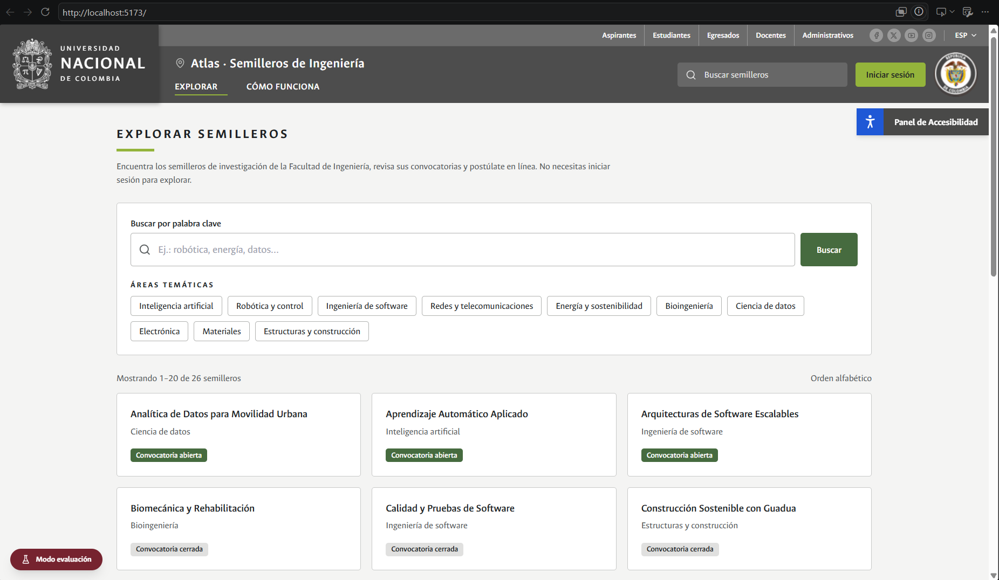

## Módulo II: Arquitectura de Frontend y Componentización

Esta sección documenta la arquitectura del frontend del prototipo de **Atlas** (React 18 + TypeScript + Vite + Tailwind CSS + React Router v6), incluyendo el inventario exhaustivo de componentes y páginas, los patrones visuales e interactivos reutilizados, el análisis de diseño responsivo en la vista principal y la evaluación de las heurísticas de usabilidad de Jakob Nielsen respaldadas directamente por el código fuente.

---

### 2.1 Inventario de componentes y páginas

#### 2.1.1 Componentes transversales y de interfaz (`src/components/`)

| Archivo y líneas | Componente(s) exportado(s) / interno(s) | Qué hace | Dónde se importa y se usa (archivo y línea verificada) |
| --- | --- | --- | --- |
| `src/components/A11yPanel.tsx` (L1–L58) | `A11yPanel` (default, L4–L57) | Renderiza un botón flotante lateral y un diálogo de accesibilidad (`role="dialog"`) que permite ajustar el tamaño de fuente raíz (`document.documentElement.style.fontSize` entre `85%` y `150%`, L9–L11 y L46–L48), alternar el modo de alto contraste (`.hc` en `document.documentElement.classList`, L18–L20 y L50–L53) y cerrar con la tecla `Escape` (L12–L17). | **Importado en:** `src/components/Layout.tsx` (L7: `import A11yPanel from './A11yPanel'`).<br>**Usado en:** `src/components/Layout.tsx` (L29: `<A11yPanel />`). |
| `src/components/DemoPanel.tsx` (L1–L117) | `DemoPanel` (default, L15–L116) | Panel flotante («Modo evaluación») con dos pestañas (`cuentas` y `correos`, L18 y L47–L51): permite cambiar rápidamente entre cuentas de demostración o cerrar sesión (L59–L73), activar/desactivar la visualización de etiquetas de historias de usuario (`showHU`, L75–L78), navegar al mapa de historias (`/evaluacion`, L80) o a una ficha precargada ajena para probar HU-29 (L81–L85), reiniciar los datos de semilla (`resetear()`, L87–L89) e inspeccionar los correos simulados enviados por el sistema (L93–L112). | **Importado en:** `src/components/Layout.tsx` (L6: `import DemoPanel from './DemoPanel'`).<br>**Usado en:** `src/components/Layout.tsx` (L30: `<DemoPanel />`). |
| `src/components/Footer.tsx` (L1–L62) | `Footer` (default, L15–L61) | Pie de página institucional con las 4 columnas de enlaces normativos e institucionales de la UNAL (`COLUMNAS`, L6–L11; «Mapa del sitio» enlaza internamente a `/evaluacion`, L23–L24), dirección física y PBX (L36–L42), derechos de autor y fecha de actualización dinámica (`fmtFecha(hoyISO())`, L44–L50) y logos institucionales (`orgullo-unal.png`, `agencia-unal.png`, `gov-co.png`, L52–L58). | **Importado en:** `src/components/Layout.tsx` (L4: `import Footer from './Footer'`).<br>**Usado en:** `src/components/Layout.tsx` (L27: `<Footer />`). |
| `src/components/Header.tsx` (L1–L264) | `Header` (default, L52–L263)<br>*Internos:* `Redes` (L11–L29), `XIcon` (L30–L36), `Marca` (L39–L50) | Encabezado institucional fijo (`sticky top-0 z-50`, L109) con barra superior gris de perfiles UNAL y redes sociales (L111–L128), bloque de escudo oficial (`Marca`, L132–L143), navegación principal dinámica según el rol activo (`director`, `vicedecanatura` o estudiante/visitante, L74–L90 y L153–L173), buscador global por palabra clave (`/?q=...`, L92–L96 y L176–L188), menú desplegable de cuenta autenticada o botón «Iniciar sesión» (L190–L233) y menú hamburguesa colapsable para móvil (`menuMovil`, L239–L260). | **Importado en:** `src/components/Layout.tsx` (L3: `import Header from './Header'`).<br>**Usado en:** `src/components/Layout.tsx` (L23: `<Header />`). |
| `src/components/Layout.tsx` (L1–L34) | `Layout` (default, L17–L33)<br>*Interno:* `ScrollToTop` (L9–L15) | Estructura maestra de la aplicación: incluye enlace de salto accesible (`Saltar al contenido`, L20–L22), `Header` (L23), contenedor `<main id="contenido">` con `<Outlet />` de React Router (L24–L26), `Footer` (L27), notificaciones `<Toasts />` (L28), `<A11yPanel />` (L29), `<DemoPanel />` (L30) y reseteo de scroll al cambiar de ruta (`ScrollToTop`, L31). | **Importado en:** `src/App.tsx` (L2: `import Layout from './components/Layout'`).<br>**Usado en:** `src/App.tsx` (L23: `<Route element={<Layout />}>`). |
| `src/components/NoPermiso.tsx` (L1–L15) | `NoPermiso` (default, L4–L14) | Pantalla de bloqueo o recurso no encontrado con ícono de candado (`Lock`, L7), mensaje parametrizable (`mensaje`, L4 y L8) y enlace `.btn-primary` para «Volver al catálogo» (`to="/"`, L10–L12). | **Importado y usado en:**<br>• `src/App.tsx` (import L4; uso L41 para ruta comodín `path="*"`)<br>• `src/components/RequireRole.tsx` (import L5; uso L13)<br>• `src/pages/Confirmacion.tsx` (import L5; uso L11)<br>• `src/pages/DirectorConvocatoria.tsx` (import L6; uso L92)<br>• `src/pages/DirectorFicha.tsx` (import L7; uso L95 y L117)<br>• `src/pages/DirectorPanel.tsx` (import L7; uso L12)<br>• `src/pages/DirectorPostulacionDetalle.tsx` (import L6; uso L22)<br>• `src/pages/DirectorPostulaciones.tsx` (import L5; uso L16)<br>• `src/pages/Ficha.tsx` (import L7; uso L30)<br>• `src/pages/Postular.tsx` (import L9; uso L52) |
| `src/components/RequireRole.tsx` (L1–L15) | `RequireRole` (default, L7–L15) | Guardián de rutas por rol: si el usuario es `visitante`, redirige a `/ingresar?next=...` conservando la ruta destino (L10–L12); si su rol no está en la lista `roles`, renderiza `<NoPermiso />` (L13); de lo contrario, renderiza `children` (L14). | **Importado en:** `src/App.tsx` (L3: `import RequireRole from './components/RequireRole'`).<br>**Usado en:** `src/App.tsx` (L30–L40, protegiendo las 9 rutas privadas de estudiante, director y vicedecanatura). |
| `src/components/Semillero.tsx` (L1–L67) | • `BadgeConvocatoria` (L7–L9)<br>• `SelloFicha` (L11–L27)<br>• `Resaltar` (L29–L49)<br>• `TarjetaSemillero` (L51–L66) | • `BadgeConvocatoria`: muestra insignia verde («Convocatoria abierta») o gris («Convocatoria cerrada») según `convocatoriaAbierta(s)`.<br>• `SelloFicha`: muestra si la ficha está «Verificada» (con ícono `CheckCircle2`) o «Precargada» desde Hermes (con `FileClock` y `title` explicativo) junto a la fecha de actualización.<br>• `Resaltar`: subraya con `<mark>` las coincidencias de búsqueda ignorando tildes y mayúsculas (`normalize('NFD')`).<br>• `TarjetaSemillero`: tarjeta clicable (`Link` con clase `.card`) que resume nombre (con `Resaltar`), área temática y `BadgeConvocatoria`. | • `BadgeConvocatoria`: importado y usado en `src/components/Semillero.tsx` (L63), `src/pages/DirectorConvocatoria.tsx` (import L5; uso L97), `src/pages/DirectorFicha.tsx` (import L6; uso L57), `src/pages/DirectorPanel.tsx` (import L6; uso L35), `src/pages/Ficha.tsx` (import L6; uso L76, L102, L117).<br>• `SelloFicha`: importado y usado en `src/pages/DirectorFicha.tsx` (import L6; uso L123), `src/pages/DirectorPanel.tsx` (import L6; uso L26), `src/pages/Ficha.tsx` (import L6; uso L59).<br>• `Resaltar`: usado internamente en `TarjetaSemillero` (`src/components/Semillero.tsx`, L59).<br>• `TarjetaSemillero`: importado y usado en `src/pages/Explorar.tsx` (import L8; uso L141) y `src/pages/Ficha.tsx` (import L6; uso L132). |
| `src/components/UI.tsx` (L1–L142) | • `HU` (L6–L17)<br>• `Badge` (L20–L33)<br>• `PageTitle` (L35–L46)<br>• `Dialog` (L48–L87)<br>• `Toasts` (L89–L100)<br>• `Campo` (L102–L129)<br>• `Alerta` (L131–L141) | Biblioteca base de primitivos de interfaz:<br>• `HU`: etiqueta visual de historia de usuario visible cuando `showHU` está activo.<br>• `Badge`: insignia con 5 tonos (`verde`, `gris`, `rojo`, `vino`, `outline`).<br>• `PageTitle`: encabezado `<h1>` con barra decorativa verde (`bg-unal-verde`), subtítulo opcional y etiquetas `HU`.<br>• `Dialog`: modal accesible (`role="dialog"`, `aria-modal="true"`) con gestión de foco y cierre con `Escape`.<br>• `Toasts`: contenedor `aria-live="polite"` de notificaciones emergentes temporales.<br>• `Campo`: envoltorio de campo de formulario con `<label>`, texto de ayuda (`hint`) y mensaje de error (`role="alert"`).<br>• `Alerta`: bloque informativo, de éxito o de error (`role="alert"` o `role="status"`). | • `HU`: usado en `UI.tsx` (L40), `DirectorConvocatoria.tsx` (import L4; uso L34), `DirectorFicha.tsx` (import L5; uso L46), `DirectorPanel.tsx` (import L5; uso L50), `DirectorPostulacionDetalle.tsx` (import L5; uso L75), `DirectorPostulaciones.tsx` (import L4; uso L57), `Ficha.tsx` (import L5; uso L14, L60, L99), `MiCuenta.tsx` (import L8; uso L75, L139, L145, L173, L210), `Postular.tsx` (import L8; uso L101, L119, L151), `Tablero.tsx` (import L6; uso L52, L79, L93).<br>• `Badge`: usado en `Semillero.tsx` (import L5; uso L8, L14, L21), `DirectorPostulaciones.tsx` (import L4; uso L10, L46), `Tablero.tsx` (import L6; uso L59).<br>• `PageTitle`: usado en `ComoFunciona.tsx` (L2, L14), `DirectorConvocatoria.tsx` (L4, L95), `DirectorFicha.tsx` (L5, L103, L122), `DirectorPanel.tsx` (L5, L19), `DirectorPostulacionDetalle.tsx` (L5, L30), `DirectorPostulaciones.tsx` (L4, L24), `Evaluacion.tsx` (L3, L53), `Explorar.tsx` (L7, L48), `Ingresar.tsx` (L6, L54), `MiCuenta.tsx` (L8, L56), `Postular.tsx` (L8, L84), `Tablero.tsx` (L6, L47).<br>• `Dialog`: usado en `DirectorConvocatoria.tsx` (L4, L72), `DirectorFicha.tsx` (L5, L137), `DirectorPostulacionDetalle.tsx` (L5, L78), `Ingresar.tsx` (L6, L101), `MiCuenta.tsx` (L8, L217, L232, L253).<br>• `Toasts`: usado en `Layout.tsx` (import L5; uso L28).<br>• `Campo`: usado en `DirectorConvocatoria.tsx` (L4, L52, L55), `DirectorFicha.tsx` (L5, L48–L56), `Postular.tsx` (L8, L152–L179).<br>• `Alerta`: usado en `DirectorConvocatoria.tsx` (L4, L65), `DirectorFicha.tsx` (L5, L104, L127), `DirectorPostulacionDetalle.tsx` (L5, L37, L73), `Ficha.tsx` (L5, L52, L118), `Ingresar.tsx` (L6, L84), `MiCuenta.tsx` (L8, L79), `Postular.tsx` (L8, L87, L194). |

#### 2.1.2 Vistas y páginas (`src/pages/`)

| Archivo y líneas | Componente(s) exportado(s) / interno(s) | Qué hace | Dónde se importa y se usa (archivo y línea verificada) |
| --- | --- | --- | --- |
| `src/pages/ComoFunciona.tsx` (L1–L26) | `ComoFunciona` (default, L11–L25) | Página informativa pública que explica en una lista ordenada de 4 pasos numerados (`PASOS`, L4–L9 y L15–L22) el flujo de exploración y postulación en Atlas, con un botón para ir al catálogo (L23). | **Importado en:** `src/App.tsx` (L17: `import ComoFunciona from './pages/ComoFunciona'`).<br>**Usado en:** `src/App.tsx` (L27: `<Route path="/como-funciona" element={<ComoFunciona />} />`). |
| `src/pages/Confirmacion.tsx` (L1–L31) | `Confirmacion` (default, L7–L30) | Muestra el comprobante de postulación enviada tras completar el formulario: presenta el código único (`p.numero`, L18), el resumen en `<dl>` (semillero, fecha/hora y estado, L19–L23) y enlaces a «Ver mis postulaciones» o «Volver al catálogo» (L25–L28). | **Importado en:** `src/App.tsx` (L9: `import Confirmacion from './pages/Confirmacion'`).<br>**Usado en:** `src/App.tsx` (L31: `<Route path="/postulacion/:numero" element={<RequireRole roles={['estudiante']}><Confirmacion /></RequireRole>} />`). |
| `src/pages/DirectorConvocatoria.tsx` (L1–L103) | `DirectorConvocatoria` (default, L89–L102)<br>*Interno:* `Formulario` (L9–L87) | Permite al director abrir o cerrar la convocatoria de su semillero mediante un interruptor (`role="switch"`, L40–L49), definir la fecha de cierre y el número de cupos con validaciones (L19–L29 y L51–L58), y ofrece un cierre anticipado con diálogo de confirmación cuando los cupos están llenos (L63–L85). | **Importado en:** `src/App.tsx` (L13: `import DirectorConvocatoria from './pages/DirectorConvocatoria'`).<br>**Usado en:** `src/App.tsx` (L36: `<Route path="/director/convocatoria" element={<RequireRole roles={['director']}><DirectorConvocatoria /></RequireRole>} />`). |
| `src/pages/DirectorFicha.tsx` (L1–L164) | `DirectorFicha` (default, L87–L163)<br>*Interno:* `FormularioFicha` (L12–L85) | Permite al director reclamar una ficha precargada desde Hermes revisando los 7 campos en un modal de confirmación (`reclamando`, L125–L161) y editar la descripción, línea, nombre del director, requisitos y datos de contacto opcionales con autorización expresa por cada dato (L12–L85). Si un usuario intenta reclamar una ficha cuyo correo no coincide, muestra una alerta de error con enlace `mailto:` a la Vicedecanatura (L99–L118). | **Importado en:** `src/App.tsx` (L12: `import DirectorFicha from './pages/DirectorFicha'`).<br>**Usado en:** `src/App.tsx` (L35: `<Route path="/director/ficha" element={<RequireRole roles={['director', 'estudiante']}><DirectorFicha /></RequireRole>} />`). |
| `src/pages/DirectorPanel.tsx` (L1–L53) | `DirectorPanel` (default, L9–L52) | Panel resumen del director con tres tarjetas de acceso rápido (`grid gap-4 md:grid-cols-3`, L23): estado de «Mi ficha» (L24–L31), estado y cupos de «Convocatoria» (L33–L40) y contador de «Postulaciones» nuevas sin revisar y pendientes de decisión (L42–L47). | **Importado en:** `src/App.tsx` (L11: `import DirectorPanel from './pages/DirectorPanel'`).<br>**Usado en:** `src/App.tsx` (L34: `<Route path="/director" element={<RequireRole roles={['director']}><DirectorPanel /></RequireRole>} />`). |
| `src/pages/DirectorPostulacionDetalle.tsx` (L1–L97) | `DirectorPostulacionDetalle` (default, L9–L96) | Muestra al director los datos enviados en una postulación específica (o un aviso si fue retirada, L36–L59), registra la lectura al abrirla (`abrirPostulacion(id)`, L17–L20) y permite aceptarla o rechazarla con diálogo de confirmación (`Dialog`, L61–L94), bloqueando la aceptación si no hay cupos disponibles (`sinCupos`, L25 y L67–L71). | **Importado en:** `src/App.tsx` (L15: `import DirectorPostulacionDetalle from './pages/DirectorPostulacionDetalle'`).<br>**Usado en:** `src/App.tsx` (L38: `<Route path="/director/postulaciones/:id" element={<RequireRole roles={['director']}><DirectorPostulacionDetalle /></RequireRole>} />`). |
| `src/pages/DirectorPostulaciones.tsx` (L1–L60) | `DirectorPostulaciones` (default, L13–L59)<br>`BadgeEstado` (exportado, L8–L11) | Lista en una tabla ordenada por fecha de recepción (`sort` ascendente, L18–L20) las postulaciones del semillero del director, marcando con insignia `Nueva` las no revisadas (L46). Además exporta `BadgeEstado` para representar visualmente el estado (`Aceptada`, `Rechazada`, `Retirada`, `Enviada`). | • `DirectorPostulaciones`: importado en `src/App.tsx` (L14) y usado en `src/App.tsx` (L37: `<Route path="/director/postulaciones" ... />`).<br>• `BadgeEstado`: importado y usado en `src/pages/DirectorPostulacionDetalle.tsx` (import L7; uso L32), `src/pages/DirectorPostulaciones.tsx` (uso L49) y `src/pages/MiCuenta.tsx` (import L9; uso L160). |
| `src/pages/Evaluacion.tsx` (L1–L86) | `Evaluacion` (default, L38–L85) | Tabla interactiva de las 22 historias de usuario Must del MVP (`FILAS`, L13–L36): al pulsar «Abrir» en cualquier fila, autentica automáticamente la cuenta de demostración requerida (`loginAs` o `logout`, L42–L49) y navega a la pantalla donde se verifica esa historia. | **Importado en:** `src/App.tsx` (L18: `import Evaluacion from './pages/Evaluacion'`).<br>**Usado en:** `src/App.tsx` (L28: `<Route path="/evaluacion" element={<Evaluacion />} />`). |
| `src/pages/Explorar.tsx` (L1–L170) | `Explorar` (default, L12–L169) | Pantalla principal del catálogo público de semilleros: incluye buscador en tiempo real por palabra clave sincronizado con el query param `?q=` (L67–L96), filtro por 10 áreas temáticas (`?area=`, L97–L110), contador de resultados en orden alfabético (L113–L120), grilla responsiva de tarjetas `<TarjetaSemillero />` paginadas de a 20 por página (`POR_PAGINA = 20`, L10 y L138–L145) y controles de paginación (L147–L167). | **Importado en:** `src/App.tsx` (L5: `import Explorar from './pages/Explorar'`).<br>**Usado en:** `src/App.tsx` (L24: `<Route path="/" element={<Explorar />} />`). |
| `src/pages/Ficha.tsx` (L1–L139) | `Ficha` (default, L23–L138)<br>*Internos:* `Dato` (L9–L19), `SinInfo` (L21) | Vista pública de detalle de un semillero: presenta migas de pan (L47–L49), título y `<SelloFicha />` (L55–L62), lista descriptiva `<dl>` con los 7 datos del semillero y contacto autorizado (L65–L96), panel lateral `<aside>` con el estado de la convocatoria, cupos y botón «Quiero unirme» o «Administrar convocatoria» (L98–L124), y hasta 4 semilleros relacionados de la misma área (L35 y L127–L136). | **Importado en:** `src/App.tsx` (L6: `import Ficha from './pages/Ficha'`).<br>**Usado en:** `src/App.tsx` (L25: `<Route path="/semilleros/:id" element={<Ficha />} />`). |
| `src/pages/Ingresar.tsx` (L1–L134) | `Ingresar` (default, L21–L133)<br>*Interna:* `destinoSeguro` (L16–L19) | Flujo de autenticación en dos pasos: primero presenta el «Aviso de privacidad (v1.0)» conforme a la Ley 1581 de 2012 (L61–L77) y luego habilita el inicio de sesión con Google institucional (`@unal.edu.co`, L78–L98) mediante un diálogo selector de cuentas de demostración o ingreso manual con validación de dominio (L100–L131). | **Importado en:** `src/App.tsx` (L7: `import Ingresar from './pages/Ingresar'`).<br>**Usado en:** `src/App.tsx` (L26: `<Route path="/ingresar" element={<Ingresar />} />`). |
| `src/pages/MiCuenta.tsx` (L1–L280) | `MiCuenta` (default, L24–L279) | Centro de privacidad y datos del estudiante estructurado en 4 pestañas (`role="tablist"`, L58–L70): «Mis datos» (consulta y edición de nombre, programa y semestre; correo bloqueado, L72–L141), «Mis postulaciones» (historial y retiro de postulaciones abiertas, L143–L169 y L216–L229), «Autorizaciones» (consulta, historial de eventos y revocación con diálogo, L171–L206 y L231–L250) y «Eliminar perfil» (borrado definitivo previa confirmación escribiendo `ELIMINAR`, L208–L214 y L252–L277). | **Importado en:** `src/App.tsx` (L10: `import MiCuenta from './pages/MiCuenta'`).<br>**Usado en:** `src/App.tsx` (L32: `<Route path="/mi-cuenta" element={<RequireRole roles={['estudiante']}><MiCuenta /></RequireRole>} />`). |
| `src/pages/Postular.tsx` (L1–L205) | `Postular` (default, L34–L204)<br>*Interno:* `Pasos` (L13–L32) | Asistente paso a paso para postularse a un semillero: verifica si ya existe una postulación activa (L57 y L86–L90) y guía al estudiante por el Paso 1 (declaración de mayoría de edad, L99–L115), Paso 2 (autorización obligatoria de datos para postulación y opcional para avisos, L117–L147) y Paso 3 (formulario validado con contador de 500 caracteres y advertencia de no incluir datos sensibles, L149–L200). | **Importado en:** `src/App.tsx` (L8: `import Postular from './pages/Postular'`).<br>**Usado en:** `src/App.tsx` (L30: `<Route path="/postular/:id" element={<RequireRole roles={['estudiante']}><Postular /></RequireRole>} />`). |
| `src/pages/Tablero.tsx` (L1–L109) | `Tablero` (default, L22–L108)<br>*Interno:* `Progreso` (L13–L20) | Cuadro de mando analítico para la Vicedecanatura con tres indicadores agregados sin datos personales (L48): (1) crecimiento porcentual de postulaciones entre semestres con gráfico de barras en `recharts` (`BarChart`, L51–L76), (2) porcentaje de fichas verificadas y listado de fichas con más de 6 meses sin actualizar (L78–L90), y (3) porcentaje de postulaciones con autorización vigente (L92–L105). | **Importado en:** `src/App.tsx` (L16: `import Tablero from './pages/Tablero'`).<br>**Usado en:** `src/App.tsx` (L40: `<Route path="/vicedecanatura/tablero" element={<RequireRole roles={['vicedecanatura']}><Tablero /></RequireRole>} />`). |

#### 2.1.3 Elementos visuales e interactivos que se repiten

El sistema evita la duplicación de estilos combinando clases utilitarias declaradas en `@layer components` dentro de `src/index.css` (L17–L27) y componentes reutilizables en `src/components/UI.tsx` y `src/components/Semillero.tsx`:

1. **Botones (`.btn`, `.btn-primary`, `.btn-verde`, `.btn-outline`, `.btn-danger` en `src/index.css`, L19–L23):**
   - `.btn-primary` (fondo verde oscuro institucional `#466B3F`): usado para la acción principal en `NoPermiso.tsx` (L10), `ComoFunciona.tsx` (L23), `Confirmacion.tsx` (L26), `DirectorConvocatoria.tsx` (L60), `DirectorFicha.tsx` (L82, L110, L129, L143), `DirectorPanel.tsx` (L30), `DirectorPostulacionDetalle.tsx` (L64, L84), `Explorar.tsx` (L93, L128), `Ficha.tsx` (L106), `Ingresar.tsx` (L76, L126), `MiCuenta.tsx` (L120), `Postular.tsx` (L113, L137, L197).
   - `.btn-outline` (borde gris oscuro sobre fondo blanco): usado para acciones secundarias, cancelar o regresar en `A11yPanel.tsx` (L46–L48), `DemoPanel.tsx` (L87), `Confirmacion.tsx` (L27), `DirectorConvocatoria.tsx` (L77), `DirectorFicha.tsx` (L111, L142), `DirectorPanel.tsx` (L39, L46), `DirectorPostulacionDetalle.tsx` (L83), `Explorar.tsx` (L149, L163), `Ficha.tsx` (L109, L120), `Ingresar.tsx` (L87, L88, L93, L101), `MiCuenta.tsx` (L76, L119, L161, L187, L222, L237, L258), `Postular.tsx` (L196).
   - `.btn-danger` (fondo rojo `#A61C31`): reservado para acciones destructivas o de rechazo en `DirectorConvocatoria.tsx` (L67, L78), `DirectorPostulacionDetalle.tsx` (L63, L84), `MiCuenta.tsx` (L212, L223, L238, L260).
   - `.btn-verde` (fondo verde claro `#94B43B`): usado en el encabezado para «Iniciar sesión» (`Header.tsx`, L230).
2. **Tarjetas (`.card` en `src/index.css`, L24, y `<TarjetaSemillero />` en `src/components/Semillero.tsx`, L51–L66):**
   - La clase `.card` (`rounded border border-unal-gris-claro/70 bg-white p-5`) envuelve contenedores de información y formularios en `Semillero.tsx` (L55), `ComoFunciona.tsx` (L17), `Confirmacion.tsx` (L19), `DirectorConvocatoria.tsx` (L33), `DirectorFicha.tsx` (L45), `DirectorPanel.tsx` (L24, L33, L42), `DirectorPostulacionDetalle.tsx` (L42), `DirectorPostulaciones.tsx` (L28, L30), `Evaluacion.tsx` (L56), `Explorar.tsx` (L73, L123), `Ficha.tsx` (L65, L98), `Ingresar.tsx` (L62, L79), `MiCuenta.tsx` (L73, L147, L153, L175, L179, L196, L209), `Postular.tsx` (L100, L118, L150) y `Tablero.tsx` (L51, L78, L92).
   - `<TarjetaSemillero />` se repite en las grillas de `Explorar.tsx` (L141) y de semilleros relacionados en `Ficha.tsx` (L132).
3. **Formularios y controles de entrada (`<Campo />` en `src/components/UI.tsx`, L102–L129; `.input` y `.label` en `src/index.css`, L25–L26):**
   - `<Campo />` estandariza etiquetas `<label className="label">`, ayudas (`hint`) y errores (`role="alert"`) en `DirectorConvocatoria.tsx` (L52–L57), `DirectorFicha.tsx` (L48–L58) y `Postular.tsx` (L152–L193).
   - Las clases `.input` y `.label` también se aplican directamente en los formularios de `Explorar.tsx` (L75, L90), `Ingresar.tsx` (L123, L125), `DirectorFicha.tsx` (L65–L74) y `MiCuenta.tsx` (L94–L116, L274–L275).
4. **Modales de confirmación (`<Dialog />` en `src/components/UI.tsx`, L48–L87):**
   - Se reutiliza en 7 flujos críticos: cerrar convocatoria anticipadamente (`DirectorConvocatoria.tsx`, L72), reclamar ficha precargada (`DirectorFicha.tsx`, L137), aceptar/rechazar postulación (`DirectorPostulacionDetalle.tsx`, L78), selector de cuenta institucional (`Ingresar.tsx`, L101), retirar postulación (`MiCuenta.tsx`, L217), revocar autorización (`MiCuenta.tsx`, L232) y eliminar perfil (`MiCuenta.tsx`, L253).
5. **Insignias y alertas (`<Badge />`, `<BadgeConvocatoria />`, `<BadgeEstado />`, `<SelloFicha />`, `<Alerta />`):**
   - Unifican la representación de estados de convocatoria, verificación de ficha, estado de postulaciones y mensajes de retroalimentación en todas las vistas.

---

### 2.2 Diseño responsivo (Pantalla principal: Explorar)

El análisis responsivo se divide entre el componente de la página principal (`src/pages/Explorar.tsx`) y los componentes de estructura global (`Header.tsx`, `A11yPanel.tsx`, `Footer.tsx`) que se renderizan junto con ella a través de `src/components/Layout.tsx`.

#### 2.2.1 Clases responsivas en `src/pages/Explorar.tsx`

| Elemento en `Explorar.tsx` | Línea | Clases de Tailwind verificadas | Comportamiento en Mobile (`< 640px`) vs. Desktop (`sm: >= 640px`, `lg: >= 1024px`) |
| --- | --- | --- | --- |
| Indicador «Orden alfabético» | L119 | `hidden sm:block` | **Mobile:** Permanece oculto (`hidden`) para despejar la barra de estado junto al contador de resultados.<br>**Desktop (`sm:` >= 640px):** Se muestra como bloque (`sm:block`) alineado a la derecha del contador. |
| Grilla de tarjetas de semilleros (`<ul>`) | L138 | `mt-3 grid gap-4 sm:grid-cols-2 lg:grid-cols-3` | **Mobile (`< 640px`):** Muestra **1 tarjeta por fila** (`grid gap-4` en una sola columna).<br>**Tablet / Desktop pequeño (`sm:` >= 640px):** Cambia a **2 columnas** (`sm:grid-cols-2`).<br>**Desktop amplio (`lg:` >= 1024px):** Cambia a **3 columnas** (`lg:grid-cols-3`). |
| Contenedor principal, filtros de área y paginación | L47, L78, L98, L148 | `mx-auto max-w-6xl px-4 py-8` (L47)<br>`flex gap-2` / `relative flex-1` (L78–L79)<br>`flex flex-wrap gap-2` (L98)<br>`flex flex-wrap items-center justify-center gap-2` (L148) | Se adaptan de forma fluida sin prefijos de breakpoint: el contenedor limita el ancho a `max-w-6xl` con relleno horizontal `px-4`, el campo de búsqueda se estira con `flex-1`, y tanto los botones de áreas temáticas como los de paginación hacen salto de línea automático en pantallas angostas gracias a `flex-wrap`. |

#### 2.2.2 Clases responsivas en el `Layout` que enmarca la pantalla principal (`Header.tsx`, `A11yPanel.tsx`, `Footer.tsx`)

| Archivo y línea | Elemento | Clases de Tailwind verificadas | Qué cambia entre Mobile y Desktop |
| --- | --- | --- | --- |
| `src/components/Header.tsx` (L111) | Barra superior institucional (`Aspirantes`, `Estudiantes`, redes, idioma) | `hidden h-8 ... md:block` | Oculta en móvil (`hidden`); visible únicamente desde `md:` (`>= 768px`). |
| `src/components/Header.tsx` (L135, L140, L141) | Escudo UNAL (`Marca`) y relleno izquierdo de la barra principal | `hidden ... md:flex md:-translate-y-8` (L135)<br>`md:pl-[260px] md:pr-4` (L140)<br>`shrink-0 md:hidden` (L141) | En móvil se oculta el escudo saliente de `236px × 116px` y se muestra `<Marca compacto />` (`md:hidden`, L141–L142). En `md:` (`>= 768px`) aparece el bloque flotante izquierdo (`md:flex md:-translate-y-8`) y el contenedor principal reserva `260px` a la izquierda (`md:pl-[260px]`). |
| `src/components/Header.tsx` (L146, L152, L153) | Título del sitio y barra de navegación `<nav>` | `hidden items-center gap-2 md:flex` (L146)<br>`truncate text-sm font-semibold md:hidden` (L152)<br>`mt-2 hidden md:block` (L153) | En móvil se muestra el título abreviado «Atlas · Semilleros» (`md:hidden`) y se oculta la navegación horizontal. En `md:` se muestra el título completo «Atlas · Semilleros de Ingeniería» con ícono `MapPin` y la lista horizontal de enlaces (`md:block`). |
| `src/components/Header.tsx` (L176) | Buscador rápido del encabezado | `hidden ... lg:flex` | Oculto en móvil y tablet; solo se muestra integrado en la barra superior en pantallas grandes (`lg: >= 1024px`). En móvil se incluye dentro del menú desplegable (L246). |
| `src/components/Header.tsx` (L235, L239, L245) | Sello de Colombia, botón hamburguesa y panel móvil | `hidden shrink-0 md:block` (L235)<br>`... md:hidden` (L239, L245) | En `md:` se muestra el escudo de Colombia (`md:block`) y se ocultan tanto el botón de menú hamburguesa como el panel colapsable (`md:hidden`). |
| `src/components/A11yPanel.tsx` (L36) | Texto del botón flotante de accesibilidad | `hidden items-center px-4 sm:flex` | En móvil solo se ve el ícono azul de accesibilidad (`40px × 40px`); desde `sm:` (`>= 640px`) se despliega la etiqueta «Panel de Accesibilidad» (`sm:flex`). |
| `src/components/Footer.tsx` (L18, L36, L44, L52) | Cuadrícula del pie de página institucional | `sm:grid-cols-2 lg:grid-cols-[repeat(4,minmax(0,1fr))_1.6fr_1.1fr_auto]` (L18)<br>`sm:col-span-2 lg:col-span-1 lg:border-l ... lg:pl-6` (L36) | Pasa de 1 columna en móvil a 2 columnas en `sm:` y a 7 columnas asimétricas con separadores verticales (`lg:border-l`) en `lg:`. |

#### 2.2.3 Evidencias visuales (Desktop vs. Mobile)

| Vista Desktop (`lg:` >= 1024px) | Vista Mobile (`< 640px`) |
| :---: | :---: |
|  |  |

---

### 2.3 Heurísticas de usabilidad de Jakob Nielsen

A continuación se documentan **8 heurísticas de Nielsen** verificadas con fragmentos textuales del código fuente:

#### 1. Visibilidad del estado del sistema
El sistema informa en todo momento qué está ocurriendo mediante indicadores de paso actual, insignias de estado, contadores en vivo y notificaciones emergentes (`aria-live="polite"`).

- **Evidencia 1 — Barra de progreso por pasos en la postulación (`src/pages/Postular.tsx`, L13–L31):**
```tsx
function Pasos({ actual }: { actual: 1 | 2 | 3 }) {
  const items = ['Mayoría de edad', 'Autorización de datos', 'Formulario']
  return (
    <ol className="mb-6 flex flex-wrap gap-2 text-sm font-semibold" aria-label="Progreso de la postulación">
      {items.map((t, i) => {
        const n = (i + 1) as 1 | 2 | 3
        const hecho = n < actual
        return (
          <li
            key={t}
            aria-current={n === actual ? 'step' : undefined}
            className={clsx('flex items-center gap-2 rounded px-3 py-1', n === actual ? 'bg-unal-verde-oscuro text-white' : hecho ? 'bg-unal-verde/40' : 'bg-unal-gris-claro/50')}
          >
            {hecho ? <Check size={14} /> : <span>{n}.</span>} {t}
          </li>
        )
      })}
    </ol>
  )
}
```
- **Evidencia 2 — Notificaciones temporales y contador dinámico de resultados (`src/components/UI.tsx`, L89–L100 y `src/pages/Explorar.tsx`, L113–L118):**
```tsx
export function Toasts() {
  const { toasts } = useStore()
  return (
    <div className="pointer-events-none fixed bottom-4 right-4 z-[80] flex w-80 max-w-[calc(100vw-2rem)] flex-col gap-2" aria-live="polite">
      {toasts.map((t) => (
        <div key={t.id} role="status" className="pointer-events-auto rounded border-l-4 border-unal-verde bg-unal-gris-oscuro px-4 py-3 text-sm text-white shadow-lg">
          {t.texto}
        </div>
      ))}
    </div>
  )
}
```

#### 2. Correspondencia entre el sistema y el mundo real
La interfaz emplea el lenguaje institucional y normativo propio de la Universidad Nacional de Colombia (sistema Hermes, Vicedecanatura de Investigación y Extensión, programas curriculares reales, Ley 1581 de 2012) y formatea las fechas en español (`dd/mm/aaaa`).

- **Evidencia 1 — Terminología institucional y referencia a Hermes (`src/components/Semillero.tsx`, L20–L25):**
```tsx
    <span className="inline-flex flex-wrap items-center gap-2 text-sm">
      <Badge tone="gris" title="Información tomada de fuentes públicas de Hermes; aún no confirmada por el director">
        <FileClock size={12} /> Precargada
      </Badge>
      <span className="text-unal-gris-oscuro">Actualizada el {fmtFecha(s.actualizadoEn)}</span>
    </span>
```
- **Evidencia 2 — Formato de fecha y hora local y comparación alfabética en español (`src/lib/utils.ts`, L20–L33 y L60–L62):**
```ts
export function fmtFecha(iso: string): string {
  const [datePart] = iso.split('T')
  const [y, m, d] = datePart.split('-')
  return `${d}/${m}/${y}`
}
```

#### 3. Control y libertad del usuario
Los usuarios disponen de salidas claras («Cancelar», «Volver», cierre con tecla `Escape`) y pueden revertir decisiones importantes como retirar una postulación enviada o revocar una autorización de tratamiento de datos.

- **Evidencia 1 — Retiro de postulación abierta y revocación de autorizaciones (`src/pages/MiCuenta.tsx`, L160–L162 y L186–L190):**
```tsx
<BadgeEstado e={p.estado} />
{p.estado === 'Enviada' && <button className="btn-outline" onClick={() => setRetirando(p.id)}>Retirar postulación</button>}
```
- **Evidencia 2 — Cierre de modales con tecla `Escape` y devolución del foco (`src/components/UI.tsx`, L62–L72):**
```tsx
  useEffect(() => {
    // Se ejecuta una sola vez al abrir: el foco va al diálogo y se devuelve al cerrar.
    const prev = document.activeElement as HTMLElement | null
    ref.current?.focus()
    const onKey = (e: KeyboardEvent) => e.key === 'Escape' && cerrarRef.current()
    document.addEventListener('keydown', onKey)
    return () => {
      document.removeEventListener('keydown', onKey)
      prev?.focus?.()
    }
  }, [])
```

#### 4. Consistencia y estándares
Todo el proyecto utiliza una paleta institucional única en `tailwind.config.js` (`unal-verde`, `unal-verde-oscuro`, `unal-rojo`, `unal-vino`, `unal-header`, `unal-footer`, L6–L18), clases de componentes estandarizadas en `src/index.css` (L17–L27) y el encabezado/pie oficial de la UNAL.

- **Evidencia — Sistema de clases reutilizables en `src/index.css` (L17–L27):**
```css
@layer components {
  .section-title { @apply text-sm font-bold uppercase tracking-[0.18em] text-unal-texto; }
  .btn { @apply inline-flex items-center justify-center gap-2 rounded px-4 py-2 text-sm font-semibold transition-colors disabled:cursor-not-allowed disabled:opacity-50; }
  .btn-primary { @apply btn bg-unal-verde-oscuro text-white hover:bg-[#3a5a34]; }
  .btn-verde { @apply btn bg-unal-verde text-unal-texto hover:bg-[#86a534]; }
  .btn-outline { @apply btn border border-unal-gris-oscuro bg-white text-unal-texto hover:bg-gray-100; }
  .btn-danger { @apply btn bg-unal-rojo text-white hover:bg-[#8e1829]; }
  .card { @apply rounded border border-unal-gris-claro/70 bg-white p-5; }
  .input { @apply w-full rounded border border-unal-gris-claro bg-white px-3 py-2 text-sm placeholder:text-gray-400; }
  .label { @apply mb-1 block text-sm font-semibold; }
}
```

#### 5. Prevención de errores
El sistema previene acciones inválidas o accidentales deshabilitando botones hasta cumplir condiciones previas, bloqueando la edición del correo institucional (`readOnly`), impidiendo publicar teléfonos sin consentimiento activo, exigiendo confirmación escrita (`ELIMINAR`) antes de borrar el perfil y bloqueando aceptaciones cuando no hay cupos.

- **Evidencia 1 — Confirmación explícita escribiendo `ELIMINAR` antes de borrar el perfil (`src/pages/MiCuenta.tsx`, L259–L265 y L274–L275):**
```tsx
<button
  className="btn-danger"
  disabled={confirmacion !== 'ELIMINAR'}
  onClick={() => { setEliminando(false); navigate('/'); eliminarPerfil() }}
>
  Eliminar definitivamente
</button>
```
- **Evidencia 2 — Bloqueo del botón «Aceptar» cuando los cupos de la convocatoria están llenos (`src/pages/DirectorPostulacionDetalle.tsx`, L25 y L61–L71):**
```tsx
const sinCupos = s.convocatoria.aceptados >= s.convocatoria.cupos
// ...
{p.estado === 'Enviada' && (
  <div className="mt-6 flex flex-wrap justify-end gap-3">
    <button className="btn-danger" onClick={() => setConfirmar('Rechazada')}>Rechazar</button>
    <button className="btn-primary" disabled={sinCupos} onClick={() => setConfirmar('Aceptada')}>Aceptar</button>
  </div>
)}
```
- **Evidencia 3 — Límite de caracteres (`maxLength={500}`) y advertencia preventiva sobre datos sensibles (`src/pages/Postular.tsx`, L180–L192):**
```tsx
<textarea
  id="f-msg"
  rows={5}
  maxLength={MAX_MENSAJE}
  value={form.mensaje}
  onChange={(e) => set('mensaje', e.target.value.slice(0, MAX_MENSAJE))}
  className="input"
  aria-describedby="msg-ayuda"
/>
<div id="msg-ayuda" className="mt-1 flex flex-wrap justify-between gap-2 text-xs">
  <span className="text-unal-gris-oscuro">No incluyas datos sensibles (salud, religión, origen étnico, orientación sexual, situación económica).</span>
  <span data-testid="contador-mensaje" className="font-semibold">{form.mensaje.length}/{MAX_MENSAJE}</span>
</div>
```

#### 6. Reconocimiento antes que recuerdo
En lugar de obligar al usuario a recordar opciones o términos buscados, la interfaz prellena el formulario de postulación con los datos del perfil/sesión, ofrece listas cerradas (`<select>`) de programas curriculares y disponibilidad, resalta visualmente con `<mark>` el término buscado en las tarjetas y muestra migas de pan (`Ruta de navegación`).

- **Evidencia 1 — Prellenado de datos del estudiante y listas `<select>` (`src/pages/Postular.tsx`, L43–L49 y L159–L164):**
```tsx
  const [form, setForm] = useState({
    nombre: perfil?.nombre ?? sesion?.nombre ?? '',
    programa: perfil?.programa ?? '',
    semestre: perfil?.semestre ?? '',
    disponibilidad: '',
    mensaje: '',
  })
```
- **Evidencia 2 — Resaltado visual de términos de búsqueda en las tarjetas (`src/components/Semillero.tsx`, L42–L48):**
```tsx
  return (
    <>
      {texto.slice(0, i)}
      <mark className="bg-unal-verde/40 px-0.5">{texto.slice(i, i + nq.length)}</mark>
      {texto.slice(i + nq.length)}
    </>
  )
```

#### 7. Ayuda a los usuarios a reconocer, diagnosticar y recuperarse de errores
Los mensajes de error están redactados en lenguaje claro, indican exactamente cuál fue el problema y ofrecen enlaces o botones de acción inmediata para resolverlo.

- **Evidencia 1 — Recuperación ante intento de ingreso con correo fuera del dominio `@unal.edu.co` (`src/pages/Ingresar.tsx`, L82–L91):**
```tsx
{rechazo && (
  <div className="mb-4">
    <Alerta tono="error">
      <p className="font-semibold">Solo puedes entrar con tu correo @unal.edu.co</p>
      <div className="mt-3 flex flex-wrap gap-2">
        <button className="btn-outline" onClick={() => { setRechazo(false); setSelector(true) }}>Intentar con otra cuenta</button>
        <Link to="/" className="btn-outline">Volver al catálogo</Link>
      </div>
    </Alerta>
  </div>
)}
```
- **Evidencia 2 — Recuperación cuando el correo no coincide al reclamar una ficha precargada (`src/pages/DirectorFicha.tsx`, L104–L113):**
```tsx
<Alerta tono="error">
  <p className="font-semibold">Tu correo no coincide con el del director de esta ficha.</p>
  <p className="mt-2 text-unal-texto">
    Solo el director registrado puede reclamarla. Si crees que hay un error, pide la corrección a la Vicedecanatura de Investigación y Extensión indicando el semillero «{s.nombre}» y tu correo institucional ({sesion.correo}).
  </p>
  <div className="mt-4 flex flex-wrap gap-2">
    <a className="btn-primary" href={`mailto:${CORREO_VICE}?subject=${encodeURIComponent(`Corrección de ficha: ${s.nombre}`)}`}>Escribir a la Vicedecanatura</a>
    <Link to={`/semilleros/${s.id}`} className="btn-outline">Volver a la ficha</Link>
  </div>
</Alerta>
```

#### 8. Ayuda y documentación
El prototipo incorpora una página dedicada («Cómo funciona») con pasos concisos para nuevos usuarios, textos de ayuda contextuales (`hint`) en los campos y sugerencias de contacto cuando un director entra con rol de estudiante.

- **Evidencia — Guía paso a paso en `src/pages/ComoFunciona.tsx` (L4–L9 y L14–L23):**
```tsx
const PASOS = [
  ['Explora', 'Revisa el catálogo de semilleros de Ingeniería sin iniciar sesión y busca por tema o palabra clave.'],
  ['Revisa la ficha', 'Mira la línea de investigación, los requisitos y si el semillero tiene convocatoria abierta.'],
  ['Postúlate', 'Inicia sesión con tu correo @unal.edu.co, autoriza el uso de tus datos y envía el formulario.'],
  ['Recibe respuesta', 'El director acepta o rechaza desde Atlas y te avisamos por correo.'],
]
```

---

> **Declaración de uso de IA:** Se solicitó realizar este análisis de código, inventario de componentes, revisión de diseño responsivo y verificación de heurísticas de Nielsen utilizando la herramienta de inteligencia artificial **Antigravity (Google DeepMind · modelo Gemini)** a partir de la inspección estática directa de los archivos en `src/`.

---
## Módulo III: QC de Usabilidad y Accesibilidad

> Aspectos 2 y 3. El aspecto 1 (reporte RITE) está en `REPORTE DE VALIDACIÓN DE USABILIDAD.pdf` y `Prueba de prototipo - Atlas .xlsx`.

### 3.2 Evidencia: problema detectado vs. cambio aplicado en el prototipo

**Base.** Entre el 12 y el 15 de noviembre de 2026 se probó el prototipo desplegado (`atlas-sisinfo.vercel.app`) con 10 estudiantes de pregrado (U1–U11; el código U8 no se usó) y 1 docente director de semillero (TD1). Todos los estudiantes completaron las 4 tareas sin ayuda; el director necesitó ayuda en 2 de 4. La ficha RITE registró 8 hallazgos (P01–P08), ninguno de gravedad 4, con frase literal del usuario e hipótesis de solución. El cuestionario TAM puntuó entre 4,33 y 4,57 sobre 5 en sus cuatro constructos, y la correlación de Spearman entre clics y facilidad de uso percibida fue −0,74 (p = 0,014).

**Lo que falta para cumplir el aspecto 2.** La ficha RITE tiene la columna "Hipótesis de solución", pero no la columna que pide la entrega, "Cambio aplicado en el prototipo", y en los 8 hallazgos la casilla "¿Corregido antes del siguiente usuario?" dice **No**. El código en el commit `2919d85` (16 de noviembre) lo confirma: ninguna de las 8 hipótesis está implementada. Según la regla RITE del propio reporte, un hallazgo de gravedad 1 a 3 no obliga a corregir antes del siguiente usuario, así que el procedimiento fue correcto; pero el criterio "Validación con usuarios" (30 %) califica la **iteración**, y hoy no hay ninguna.

**Tabla 3.2.** Las columnas "Cambio aplicado" y "Estado" quedan en *Pendiente* hasta que se implemente el cambio; cada fila indica el archivo exacto para hacerlo.

| ID | Usuario · tarea | Problema detectado (resumen y cita) | Grav. | HU | Cambio aplicado en el prototipo | Dónde (archivo) | Estado |
|---|---|---|---|---|---|---|---|
| P01 | U2 · T1 | El campo de búsqueda conserva la consulta anterior; el usuario no sabe cómo empezar de nuevo. *"Que se eliminen las anteriores…"* | 2 | HU-02 | Botón "×" dentro del campo que borra el texto y el parámetro `q`, y devuelve el foco al campo. | `src/pages/Explorar.tsx` L75–L93 | Pendiente |
| P02 | U4 · T1 | No sabe si buscar por tema o por nombre; la barra de búsqueda tiene más peso visual que las áreas. *"Que la barra sea algo secundario y no lo principal."* | 3 | HU-01, HU-02 | Mover "Áreas temáticas" arriba del campo de búsqueda y cambiar el texto de ejemplo a "Busca por tema, nombre o línea de investigación". | `src/pages/Explorar.tsx` L73–L110 | Pendiente |
| P03 | U6 · T1 | Cree que al elegir un área se anula la palabra clave; los filtros quedan "abajo". *"Que cuando uno selecciona por área no invalide el filtro por palabra."* | 3 | HU-01, HU-02 | El código ya combina ambos filtros (`filtrados`, L33–L40), así que el problema es de **retroalimentación**: mostrar sobre el listado una fila "Filtros activos: robótica × · Robótica y control ×" con botón para quitar cada uno. | `src/pages/Explorar.tsx` L113–L120 | Pendiente |
| P04 | U7 · T1 | Busca "a ciegas" sin saber qué términos existen. *"Que con solo escribir algunas palabras ya empiece a mostrar, como Google."* | 2 | HU-02 | Lista de sugerencias (`<datalist>` o menú `role="listbox"`) con nombres de semilleros, áreas y líneas, filtrada mientras se escribe. | `src/pages/Explorar.tsx` L75–L93; datos en `src/data/seed.ts` | Pendiente |
| P05 | TD1 · TD1/TD2 | No entiende "Reclamar ficha" (*"creo que es crear ficha"*); el teléfono recién guardado no aparece en la vista previa. | 2 | HU-29, HU-30 | Renombrar el botón a "Verificar mi ficha" en panel, página y diálogo, y refrescar la vista previa al guardar el contacto. | `src/pages/DirectorPanel.tsx` L30; `src/pages/DirectorFicha.tsx` L103, L129, L138, L143 | Pendiente |
| P06 | U10 · T2 | En "Requisitos" aparece "Sin información" y no se sabe si no hay requisitos o si no se cargaron. | 2 | HU-04 | Dos textos distintos: "Sin requisitos previos (entrada libre)" cuando el director lo declara, y "El director aún no ha cargado esta información" cuando la ficha está precargada. | `src/pages/Ficha.tsx` L21, L69–L73 | Pendiente |
| P07 | U10 · T1 | Las áreas temáticas ocupan mucho espacio y "se pierden" los semilleros; el diseño parece "muy sobrio". | 2 (estético) | HU-01 | Decisión: **no se cambia**. Se mantiene el diseño institucional de la UNAL (coherencia con Hermes y con la identidad de la sede); el bloque de áreas se mueve y compacta como parte de P02. | — | Descartado con justificación |
| P08 | U11 · T1 | Búsquedas sin coincidencia exacta ("bioingeniería", "ingeniería") devuelven pantalla vacía. *"¿Qué hago?"* | 3 | HU-02 | En el estado vacío, mostrar las áreas temáticas y hasta 4 semilleros cuyo nombre o área contengan parte del término (coincidencia parcial sin tildes). | `src/pages/Explorar.tsx` L122–L136 | Pendiente |

**Cómo cerrar el aspecto con una iteración real (propuesta).** Implementar P01, P03, P05, P06 y P08 (son cambios de menos de una hora cada uno y cubren los tres hallazgos de gravedad 3), anotar el commit en la columna "Estado", y repetir la tarea T1 con 2 usuarios nuevos (U12 y U13) y la tarea TD1 con el mismo director. Con eso la tabla queda con evidencia "antes / después" y se cumple literalmente el enunciado: *problema detectado → cambio aplicado*. El interruptor "Mostrar etiquetas de historias de usuario" del Modo evaluación sirve para tomar las capturas de antes y después con la HU visible.

**Correcciones menores al reporte.** (a) En la tabla de registros el director aparece con las tareas T1–T4; deben llamarse TD1–TD4 para que coincidan con su tabla de tareas. (b) Explicar en una línea por qué no existe U8. (c) El enunciado del hito pide "al menos 2 usuarios reales"; vale la pena decir explícitamente que se superó con 11.

---

### 3.3 Auditoría básica de accesibilidad (WCAG 2.1, nivel AA)

**Método.** Revisión del prototipo desplegado el 12 de noviembre de 2026 (13 pantallas que cubren las 22 HU Must, abiertas desde `/evaluacion`) con un script que calculó la relación de contraste de todo el texto visible según la fórmula de WCAG, inventario de tamaños de fuente calculados, y prueba manual de navegación por teclado (Tab, Shift+Tab, Enter, Escape). Los hallazgos se contrastaron con el código fuente del commit `2919d85`. No se usó lector de pantalla.

#### 3.3.1 Contraste de color (1.4.3 y 1.4.11)

| Elemento | Colores | Relación | Mínimo | Resultado |
|---|---|---|---|---|
| Texto del cuerpo | `#565A5C` sobre `#F4F4F3` | 6,33:1 | 4,5:1 | Cumple |
| Botón primario y chips "Convocatoria abierta" | blanco sobre `#466B3F` | 6,11:1 | 4,5:1 | Cumple |
| Barra superior gris (enlaces de 12 px) | blanco sobre `#6B6B6B` | 5,33:1 | 4,5:1 | Cumple (es el valor más bajo del sitio) |
| Mensajes de error | `#A61C31` sobre blanco | > 4,5:1 | 4,5:1 | Cumple |
| Texto de ejemplo del buscador principal | `text-gray-400` (`#9CA3AF`) sobre blanco | **2,54:1** | 4,5:1 | **No cumple** |
| Texto de ejemplo del buscador del encabezado | blanco al 80 % sobre `#676767` | **4,31:1** | 4,5:1 | **No cumple** (por poco) |
| Bordes de campos (`.input`, chips de área) | `#B1B2B0` sobre blanco | **2,13:1** | 3:1 | **No cumple** |
| Indicador de foco sobre encabezado y pie | `#466B3F` sobre `#5F5F5F` y `#6B6B6B` | **1,04:1 y 1,15:1** | 3:1 | **No cumple** |

Resultado: **0 fallos de contraste en texto normal** en las 13 pantallas; 4 fallos en texto de ejemplo, bordes e indicador de foco.

#### 3.3.2 Tamaños de fuente y escalado (1.4.4)

- Tamaño base de 16 px (`html { font-size: 100% }`) y todo en unidades relativas, así que el zoom del navegador funciona.
- El Panel de Accesibilidad permite escalar el texto entre 85 % y 150 % (`A11yPanel.tsx`) y activar un modo de alto contraste que fuerza texto `#000` y bordes negros (`index.css`, reglas `.hc`).
- En la pantalla Explorar hay 82 elementos de texto a 12 px (barra superior, etiquetas, pie de página) y 2 a 11 px ("UNIVERSIDAD / DE COLOMBIA" en el escudo). En el tablero de la Vicedecanatura los ejes del gráfico van a 10 y 11 px.
- WCAG no fija un tamaño mínimo, pero 12 px en enlaces de navegación con peso 600 y 10 px en ejes está por debajo de lo recomendado en la práctica (14 px para cuerpo, 12 px para notas).

#### 3.3.3 Navegación por teclado (2.1.1, 2.4.3, 2.4.7)

| Comprobación | Resultado | Evidencia |
|---|---|---|
| Enlace "Saltar al contenido" como primer elemento | Cumple | `Layout.tsx` L20–L22; primer Tab lo muestra |
| Zonas con nombre (encabezado, navegación principal, contenido, paginación, pie) | Cumple | `aria-label` en `<header>`, `<nav>`, `<footer>` |
| Orden de tabulación sin `tabindex` positivos; 77 elementos enfocables en Explorar | Cumple | Inspección del DOM |
| Indicador de foco visible, 3 px | Cumple sobre fondo claro; **falla** sobre encabezado y pie | `index.css` L9–L11 (un solo color para todo el sitio) |
| Chips de área con estado (`aria-pressed`), pasos con `aria-current="step"`, interruptor con `role="switch"` | Cumple | `Explorar.tsx` L103; `Postular.tsx` L22; `DirectorConvocatoria.tsx` L40 |
| Diálogos: `role="dialog"`, `aria-modal`, foco al abrir, Escape cierra y devuelve el foco | Cumple | `UI.tsx` L48–L87 |
| Diálogos: el foco **se queda dentro** mientras está abierto | **No cumple** | Con 12 tabulaciones el foco sale al pie de página (`UI.tsx` no tiene trampa de foco) |
| Al cambiar de paso en la postulación, el foco va al nuevo paso | **No cumple** | El foco vuelve al `<body>` |
| Errores de formulario anunciados (`role="alert"`) | Cumple | `UI.tsx` L122–L126 |
| Errores ligados al campo (`aria-invalid`, `aria-describedby`), obligatorios con `required`, foco al primer error | **No cumple** | `Campo` solo pinta el texto; el asterisco es visual |
| Idioma declarado | Cumple | `<html lang="es-CO">` |
| Imágenes con texto alternativo; íconos y enlaces sociales con nombre | Cumple | `alt` y `aria-label` en todos; avisan "abre unal.edu.co" |
| Jerarquía de títulos | Observación | En Explorar salta de `h1` a `h3` |

#### 3.3.4 Hallazgos y corrección

| # | Hallazgo | Criterio | Prioridad | Corrección (archivo) |
|---|---|---|---|---|
| A1 | Foco invisible sobre encabezado y pie | 2.4.7 | Alta | `index.css`: añadir `box-shadow: 0 0 0 3px #fff, 0 0 0 6px #466B3F` al `:focus-visible` (anillo doble visible en claro y oscuro) |
| A2 | Bordes de campos y chips a 2,13:1 | 1.4.11 | Alta | `tailwind.config.js`: usar `#8A8A8A` o más oscuro para bordes de `.input` y chips; `#B1B2B0` puede seguir en separadores decorativos |
| A3 | Texto de ejemplo a 2,54:1 y 4,31:1 | 1.4.3 | Media | `index.css` `.input`: `placeholder:text-gray-500` (`#6B7280`, 4,8:1); `Header.tsx` L176–L188: subir opacidad a 100 % |
| A4 | Errores no ligados al campo; sin `required`; foco en el botón tras fallar | 1.3.1, 3.3.1, 4.1.2 | Alta | `UI.tsx` `Campo`: generar `id` del error, pasar `aria-describedby` y `aria-invalid` al control; `Postular.tsx`: `required` en los 5 campos y `focus()` al primer error |
| A5 | El foco no sigue el cambio de paso | 2.4.3 | Media | `Postular.tsx`: `ref` al título del paso con `tabIndex={-1}` y `focus()` en el `useEffect` de `paso` |
| A6 | Diálogo sin trampa de foco | 2.4.3 | Media | `UI.tsx` `Dialog`: en `onKey`, si es Tab, ciclar entre el primer y último elemento enfocable del diálogo |
| A7 | `h1` → `h3` en Explorar | 1.3.1 | Baja | `Explorar.tsx`: `h2` "Resultados" antes del listado, o tarjetas con `h2` |
| A8 | Texto a 10–12 px en barra superior, pie y ejes del gráfico | 1.4.4 (práctica) | Baja | Subir etiquetas a 13–14 px y ejes de `Tablero.tsx` a 12 px |
| A9 | Casillas de 16×16 y 20×20 px | 2.5.8 (WCAG 2.2) | Baja | Cumple porque la etiqueta es pulsable; opcional llevarlas a 24 px |

**Pendiente para una segunda ronda:** prueba con lector de pantalla (NVDA), vista a 320 px de ancho y zoom al 200 % (1.4.10), y descripción textual del gráfico de barras del tablero (1.1.1).

**Conclusión del aspecto 3.** El prototipo parte de una base sólida: sin fallos de contraste en texto, estructura semántica completa, enlace de salto, diálogos con gestión de foco y panel propio de escalado y alto contraste. Los 4 hallazgos de prioridad alta (A1, A2, A4 y, por su efecto en usuarios de teclado, A6) se corrigen en 3 archivos (`index.css`, `tailwind.config.js`, `UI.tsx`) sin tocar la lógica.

## Módulo IV: Persistencia de soporte

Este módulo presenta el esquema de datos mínimo y el mapa de API que soportan el prototipo de Atlas, junto con la arquitectura que los sustenta. Atlas se plantea como un monolito modular sobre PostgreSQL, desplegado en contenedores y dimensionado para 100 usuarios concurrentes.

### 4.1 Esquema de datos mínimo

El esquema tiene seis tablas que alimentan el prototipo y cuatro de extensión. Estas últimas almacenan información que la universidad ya registra de cada grupo en Hermes y que el MVP aún no muestra. Atlas no se conecta a Hermes


Las tablas de línea continua corresponden al MVP; las de línea punteada, a la extensión.

| Tabla | Contenido | Grupo |
| --- | --- | --- |
| `app_user` | Usuario: correo, nombre, programa y rol | MVP |
| `seedbed` | Ficha del semillero. Incluye código de registro, estados, categoría Minciencias, contacto, enlaces y enfoque | MVP |
| `research_line` | Líneas de investigación | MVP |
| `open_call` | Convocatoria: periodo, fecha de cierre y cupos | MVP |
| `application` | Postulación y su estado | MVP |
| `consent` | Autorización de tratamiento de datos, con finalidad y versión del aviso | MVP |
| `member` | Integrantes y su rol en el grupo | Extensión |
| `project`, `product` | Proyectos y productos académicos | Extensión |
| `classification` | Sede, dependencia, planes de estudio, agenda de conocimiento y áreas OCDE | Extensión |
| `outbox_email`, `audit_event`, `change_log` | Correos pendientes, auditoría de acciones e historial de cambios | Soporte |

##### Reglas de integridad de la base de datos

**Control de postulaciones**

La base de datos evita que un estudiante se postule más de una vez a la misma convocatoria. También se controla que cada semillero tenga como máximo una convocatoria abierta al mismo tiempo.

**Validación de autorizaciones**

Al momento de registrar una postulación, el sistema verifica que el estudiante cuente con una autorización vigente. Esta validación se realiza durante la misma transacción para evitar registros sin el debido consentimiento.

**Registro de revocaciones**

Las autorizaciones no se eliminan cuando son revocadas. En su lugar, se almacena la fecha de revocación en el campo `revoked_at`, lo que permite conservar un historial como soporte del cumplimiento de la Ley 1581 de 2012.

**Uso de JSONB**

El tipo de dato JSONB se utiliza únicamente en los casos donde la información no tiene una estructura fija o puede variar, como ocurre con los atributos adicionales de `seedbed.extra` y los valores registrados en `change_log`.

#### 4.1.1 Capa analítica

El modelo transaccional conserva solo el estado actual de cada registro, lo que no basta para analizar tendencias. Se proponen dos mecanismos complementarios.

**Historial de cambios.** Un disparador registra en `change_log` cada modificación de `seedbed`, `open_call` y `application`: entidad, campo, valor anterior, valor nuevo y fecha. La tabla solo admite inserciones. Con ella se reconstruye, por ejemplo, cuánto tiempo permanece una postulación en cada estado o cómo evoluciona una ficha. No se registran cambios de datos personales, para respetar el derecho de supresión.

**Esquema estrella.** Un esquema `analytics`, en la misma base, expone vistas materializadas con una tabla de hechos por postulación y cuatro dimensiones. `dim_seedbed` se construye desde `change_log` como dimensión de cambio lento de tipo 2, de modo que cada postulación se analiza con los atributos que el semillero tenía en ese momento.


Los indicadores del cuadro de mando se calculan sobre este esquema: crecimiento de postulaciones, tiempo de respuesta del director y postulaciones con autorización. Las vistas se refrescan cada noche y no contienen nombres ni correos. Al residir en la misma base no requieren un proceso de carga adicional; si el volumen crece, el mismo modelo se traslada a una bodega de datos para separar capa transaccional y analitica independientemente. 

### 4.2 Mapa de API

La API expone 23 puntos de contacto REST bajo `/api/v1`, en formato JSON. La sesión se mantiene en una cookie HttpOnly.

| Método y ruta | Función | Rol |
| --- | --- | --- |
| `GET /auth/login` | Redirige a Google para autenticar | Público |
| `GET /auth/callback` | Valida la respuesta de Google y crea la sesión | Público |
| `GET /me` | Devuelve el perfil y el rol | Autenticado |
| `POST /auth/logout` | Cierra la sesión | Autenticado |
| `GET /seedbeds` | Lista el catálogo con búsqueda y filtros | Público |
| `GET /seedbeds/{id}` | Devuelve la ficha con su convocatoria vigente | Público |
| `POST /seedbeds/{id}/claim` | Registra el reclamo de la ficha | Director |
| `PATCH /seedbeds/{id}` | Actualiza la ficha | Director |
| `POST /seedbeds/{id}/calls` | Abre una convocatoria | Director |
| `PATCH /calls/{id}` | Cierra la convocatoria o modifica fecha y cupos | Director |
| `POST /me/adult-declaration` | Registra la declaración de mayoría de edad | Estudiante |
| `POST /me/consents` | Registra la autorización de datos | Estudiante |
| `POST /calls/{id}/applications` | Crea la postulación | Estudiante |
| `GET /me/applications` | Lista las postulaciones del estudiante | Estudiante |
| `GET /seedbeds/{id}/applications` | Lista las postulaciones recibidas | Director |
| `GET /applications/{id}` | Devuelve el detalle de una postulación | Director |
| `POST /applications/{id}/decision` | Registra la aceptación o el rechazo | Director |
| `GET /me/data` | Devuelve los datos personales y las autorizaciones | Estudiante |
| `PATCH /me/data` | Corrige los datos personales | Estudiante |
| `DELETE /me/consents/{id}` | Revoca una autorización | Estudiante |
| `DELETE /me` | Solicita la eliminación del perfil | Estudiante |
| `GET /metrics` | Devuelve los indicadores agregados | Vicedecanatura |
| `POST /admin/seedbeds/import` | Carga fichas desde un archivo CSV | Vicedecanatura |

#### 4.2.1 Uso de los verbos HTTP

| Verbo | Uso en Atlas | Idempotente |
| --- | --- | --- |
| `GET` | Consulta sin efectos sobre los datos | Sí |
| `POST` | Crea un recurso o registra una acción | No; las restricciones de unicidad impiden duplicados |
| `PATCH` | Actualiza parte de un recurso | Sí en Atlas, porque asigna valores absolutos y no incrementos |
| `DELETE` | Elimina o revoca | Sí |

Se usa `PATCH` y no `PUT` porque las actualizaciones son parciales. `PUT` reemplaza el recurso completo: obligaría al cliente a enviar todos los campos y sobrescribiría los que administra otro actor, como los que provienen de la carga institucional. `PUT` es idempotente por definición y `PATCH` no lo garantiza; Atlas conserva esa propiedad al restringir `PATCH` a asignaciones de valor.

### 4.3 Arquitectura de soporte

El navegador se comunica únicamente con Nginx, que enruta las peticiones bajo `/api` hacia Flask y las demás hacia Next.js. El backend es un solo proceso dividido en ocho módulos de dominio. Cada módulo es dueño de sus tablas y solo accede a los datos de otro a través de su capa de servicio, lo que permite extraerlo como servicio independiente sin reescribirlo.


#### 4.3.1 Decisiones y compromisos

| Decisión | Alternativa | Justificación | Costo asumido |
| --- | --- | --- | --- |
| Monolito modular | Microservicios | La carga se atiende en una máquina y las operaciones críticas se resuelven en una transacción local. | Los módulos escalan en conjunto. |
| Flask | Django | No impone ORM: permite SQL explícito y un Blueprint por módulo. El equipo domina Python. | Sin panel de administración ni autenticación incluidos. |
| PostgreSQL | Base documental | El dominio es relacional y exige integridad y unicidad. Ofrece JSONB y búsqueda insensible a tildes. | El equipo administra respaldos y actualizaciones. |
| Next.js | Aplicación de página única estática | El catálogo es público; el renderizado en servidor reduce el tiempo de carga. | Un contenedor adicional. |
| Nginx y Docker Compose | Kubernetes | Entrada única con TLS y despliegue reproducible en cualquier nube o en servidores de la universidad. | Una sola máquina es un punto único de falla. |
| Autenticación con Google Workspace | Contraseñas propias | Atlas no almacena credenciales y reutiliza la cuenta institucional. | Dependencia de Google. |

Todos los componentes son software libre y el diseño no asume una nube específica, lo que mantiene bajo el costo de operación y evita la dependencia de un proveedor.

#### 4.3.2 Principios SOLID

| Principio | Aplicación en Atlas |
| --- | --- |
| Responsabilidad única | Cada capa tiene una sola razón de cambio: `routes` traduce HTTP, `service` aplica las reglas del negocio y `repository` ejecuta SQL. |
| Abierto/cerrado | Un nuevo proveedor de identidad o canal de notificación se agrega como una clase que implementa la interfaz, sin modificar las existentes. |
| Sustitución de Liskov | Toda implementación de `IdentityProvider` cumple el mismo contrato: devuelve un correo verificado o un error. Google, el directorio de la universidad o un doble de prueba son intercambiables. |
| Segregación de interfaces | Las interfaces son pequeñas y específicas (`IdentityProvider`, `EmailSender`). Cada módulo expone a los demás solo las funciones de servicio que necesitan. |
| Inversión de dependencias | Los servicios dependen de interfaces y reciben las implementaciones al construir la aplicación, lo que permite probarlos sin base de datos ni servicios externos. |

#### 4.3.3 Estructura de carpetas

```text
atlas/
├── docker-compose.yml
├── nginx/
│   └── nginx.conf
├── frontend/                      # Next.js
│   ├── app/                       
│   ├── components/
│   └── lib/api.ts                
├── backend/                       # Flask
│   ├── app/
│   │   ├── __init__.py          
│   │   ├── config.py
│   │   ├── shared/             
│   │   └── modules/
│   │       ├── identity/
│   │       │   ├── routes.py
│   │       │   ├── service.py
│   │       │   ├── repository.py
│   │       │   └── providers/     
│   │       ├── catalog/
│   │       ├── calls/
│   │       ├── applications/
│   │       ├── privacy/
│   │       ├── notifications/
│   │       ├── metrics/
│   │       └── imports/
│   ├── migrations/                # versioned SQL, including analytics views
│   └── tests/
└── infra/  
```

Todos los módulos repiten la estructura de `identity`.

#### 4.3.4 Autenticación y control de acceso

La autenticación se delega en Google Workspace mediante OpenID Connect, con la cuenta institucional; el equipo validó el flujo en una prueba de concepto. El backend verifica la firma del token y que el dominio sea `unal.edu.co`, porque el filtro de dominio que presenta Google puede omitirse. 

#### 4.3.5 Escalabilidad

La arquitectura escala por etapas y ninguna exige reescribir el sistema. El criterio para avanzar es que el catálogo responda en 500 ms o menos en el percentil 95. Las etapas, en orden, son: escalar verticalmente la máquina; trasladar PostgreSQL a una máquina dedicada o a un servicio administrado; replicar el backend detrás de un balanceador, posible porque la API no conserva estado; y separar módulos en servicios, empezando por notificaciones, que ya opera desacoplado. La alta disponibilidad y el ambiente de producción se excluyen de este hito porque no son necesarios para validar el MVP.

#### 4.3.6 Interoperabilidad con fuentes oficiales (posterior al MVP)

Si la universidad habilita el acceso a datos oficiales, por ejemplo para confirmar si una persona es estudiante o docente, Atlas los consulta con una copia local de respaldo. El diseño asume que la fuente puede fallar o actualizarse con poca frecuencia, y garantiza que Atlas siempre responda.


Solo se acude a la fuente cuando la copia local venció. Si la fuente no responde, se usa la última copia disponible; si nunca hubo una, se aplica la regla actual, que deduce el rol a partir del correo registrado en la ficha

## Informe de uso de IA

El equipo usó Claude (Anthropic) como asistente durante el Hito 2, conectado a Jira y a Figma mediante el protocolo MCP (Model Context Protocol). 

### Herramientas y conexiones

| Conexión | Para qué se usó | Limitación encontrada |
| --- | --- | --- |
| Jira (MCP de Atlassian) | Crear el proyecto, las épicas, las historias, los vínculos de dependencia y las fechas | No permite borrar vínculos ni renombrar el proyecto; esas dos acciones se hicieron desde el navegador con la sesión de un integrante |
| Figma (MCP oficial) | Leer el archivo del mockup, reutilizar las variables de color y crear vistas y componentes | El plan Starter agotó su cuota de llamadas dos veces; parte del trabajo quedó sin aplicar |
| Documentos de Claude | Redactar e iterar el Módulo IV | Los diagramas no se exportan a Markdown; se generaron como imágenes para el README |

### Caso 1. Sincronización de Jira por MCP

**Prompt inicial.** "Aplica estos cambios: renombra el proyecto a Atlas, sincroniza el ambiente de Jira con lo que tenemos ahora en el documento del backlog y agrega las dependencias. Ajusta los vínculos 'bloquea' y reprograma las fechas según el nuevo cronograma."

**Resultado de la IA.** El proyecto quedó con 7 épicas, las historias renombradas con sus identificadores definitivos, 45 vínculos "bloquea" y fechas por historia del MVP.

**Refactorización humana.**

- Jira no admitió las features como nivel padre de las historias; el equipo aceptó representarlas como etiquetas.
- Se corrigió el cronograma: la IA había interpretado mal las fechas; el equipo fijó el inicio el 19 de octubre y el cierre en la primera semana de diciembre.
- La IA entendió al revés una instrucción y modificó el documento para igualarlo a Jira. El equipo aclaró que el documento es la fuente de verdad; la IA revirtió el cambio y ajustó Jira.
- Las etiquetas de entrega (R1, R2, R3) se reemplazaron por una sola etiqueta MVP, que es la clasificación que usa el documento.

### Caso 2. Mockup en Figma

**Prompt inicial.** "Usa el MCP de Figma para agregar más vistas al mockup de Atlas, basadas en las historias de usuario obligatorias, y aplica el estilo institucional de la universidad que aparece en esta captura." Se adjuntó la captura del encabezado del sitio de la universidad.

**Resultado de la IA.** Siete vistas nuevas en el archivo de Figma, una por cada grupo de historias obligatorias, enlazadas a las variables de color del archivo, y un componente reutilizable con el encabezado institucional.

**Refactorización humana.**

- En un intento anterior Figma bloqueó el acceso por cuota y la IA produjo vistas genéricas, en formato móvil, sin haber visto el avance del equipo. El equipo compartió una captura del mockup real, de escritorio y con la paleta verde institucional, y las vistas se rehicieron en ese estilo.
- El escudo de la universidad quedó como marcador: lo inserta el equipo desde el manual de marca.
- Se pidió un pie de página y ajustar las vistas al sistema de diseño de Google (Material 3). No se aplicó porque la cuota se agotó de nuevo; queda como trabajo manual.

### Caso 3. Arquitectura y persistencia (Módulo IV)

**Prompt inicial.** "Para el Módulo IV, que pide el esquema de datos mínimo y el mapa de API, pensamos en un backend dividido por capas de dominio. No creemos necesaria por ahora una arquitectura de microservicios ni hexagonal: no se estiman más de 100 usuarios concurrentes, que caben en una sola máquina, y si el sistema escala debe poder separarse fácilmente en microservicios. La base de datos sería relacional, en PostgreSQL, normalizada y con algunos campos JSON para lo no estructurado. Habría dos ambientes, uno de pruebas y otro de UAT. Ayúdanos a formalizar de manera robusta esta arquitectura, justificando las decisiones, con base en las historias de usuario."

**Resultado de la IA.** Un documento de ocho secciones con monolito modular, diagrama entidad-relación y mapa de API. Incluía supuestos propios de la IA: despliegue en AWS, inicio de sesión por enlace al correo e identificadores en español.

**Refactorización humana.**

- Código, tablas y rutas en inglés; el texto en español.
- Diseño independiente de la nube, porque no hay garantía de una cuenta de AWS institucional.
- Inicio de sesión con la cuenta de Google de la universidad, que el equipo validó con una prueba de concepto, en lugar del enlace por correo.
- Sin conexión directa a Hermes: las fichas se cargan por archivo. Las tablas sí incorporan los campos que Hermes registra, para extender el sistema sin migraciones.
- Interoperabilidad con fuentes oficiales como lógica de servicio y no como columnas en las tablas, y fuera del MVP.
- Se pidió agregar los principios SOLID, la estructura de carpetas, el esquema estrella con historial de cambios y la justificación de PATCH frente a PUT.
- Redacción: la primera versión era demasiado extensa y la segunda demasiado coloquial; se ajustó a un registro formal y breve.


