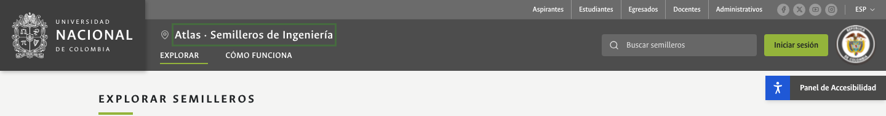
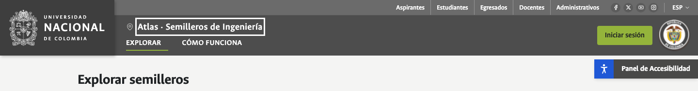
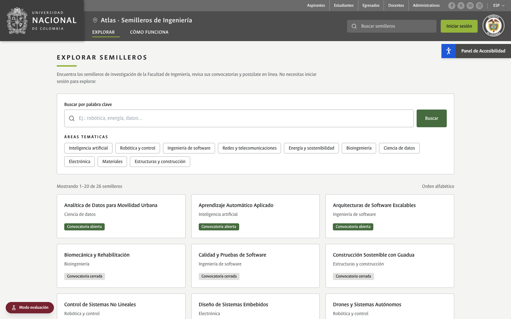
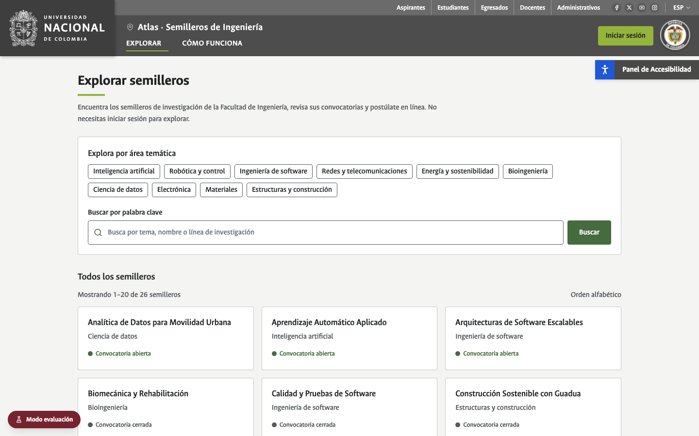
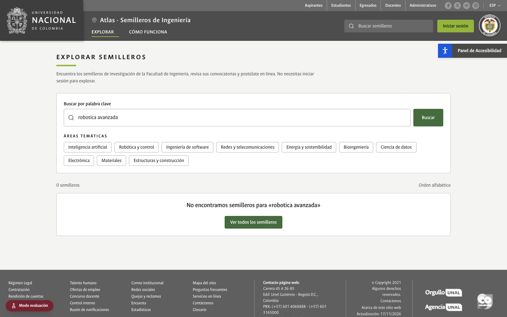
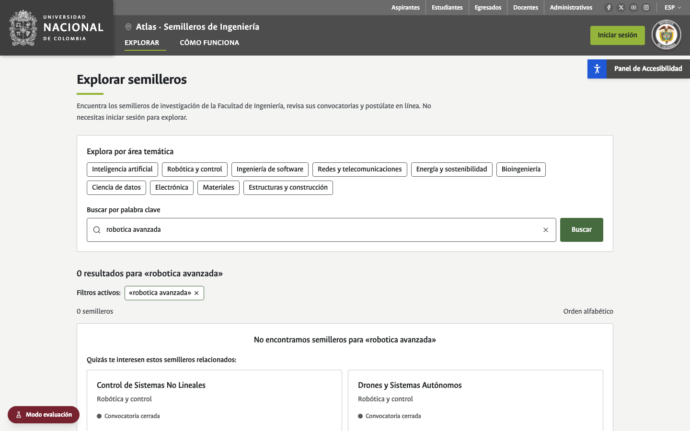

[← Índice](../README.md) · [Módulo II →](modulo-2-frontend.md)

# Módulo I: Prototipo de Alta Fidelidad

## 1.1 Prototipo interactivo navegable

**Enlace al prototipo: [https://atlas-sisinfo.vercel.app](https://atlas-sisinfo.vercel.app)**

No es una imagen estática: es una aplicación web navegable (React 18 + Vite + TypeScript + Tailwind CSS) sin backend, cuyo estado vive en memoria con datos de ejemplo y se reinicia al recargar. Para recorrerla:

- El botón **Modo evaluación** (abajo a la izquierda) cambia de cuenta de demostración en un clic (estudiante, director, segundo director, Vicedecanatura y un correo externo que se rechaza), muestra la bandeja de correos simulados, reinicia los datos y activa las etiquetas de historias de usuario (por ejemplo «HU-04») sobre los componentes que las cumplen.
- La ruta **/evaluacion** relaciona cada historia con la pantalla, la ruta y la cuenta donde se comprueba.
- Para correrlo en local: `npm install` y `npm run dev` (http://localhost:5173). `npm test` ejecuta las 26 pruebas automáticas.

**Cobertura.** El prototipo **cubre el 100 % de las historias de usuario priorizadas en el Hito 1**. El backlog tiene 36 historias (22 Must, 9 Should y 5 Could), y las 22 Must, que forman el MVP, tienen cada una una pantalla navegable: catálogo, búsqueda y ficha (HU-01, 02, 04); acceso institucional (HU-08, 09); convocatoria (HU-12); postulación en tres pasos y decisión del director (HU-15 a 19, 21); tablero de Vicedecanatura (HU-24 a 26); ficha y convocatoria del director (HU-29, 30, 32); y datos y autorizaciones del estudiante (HU-33 a 36). Las tareas habilitadoras Must se simulan en el prototipo: TH-01 (carga inicial de fichas precargadas) con los datos de ejemplo, y TH-02 (registro de autorizaciones y revocaciones) con el estado de la aplicación. SP-01 es una investigación con la DNED y no tiene pantalla.

## 1.2 Uso de IA en el diseño

**Herramienta.** Claude (Anthropic), el mismo asistente descrito en el [Informe de uso de IA](informe-uso-ia.md). El flujo fue: el equipo redactó el prompt inicial, Claude generó el prototipo y, después, el equipo detectó los problemas (con auditoría de accesibilidad, pruebas con usuarios y revisión del negocio) y decidió qué corregir; **Claude implementó esas correcciones** a partir de las instrucciones del equipo. Las capturas y los commits de esta sección son la evidencia.

### Prompt inicial

El prompt tenía ocho secciones. El primer mensaje pedía solo la base del sistema y avisaba que las pantallas reales se construirían en mensajes posteriores.

| Sección | Qué exigía |
|---|---|
| Stack | React 18, Vite, TypeScript, React Router, Tailwind, shadcn/ui, lucide-react y recharts. Sin Next.js. |
| 1. Identidad visual | Seis colores UNAL con reglas de uso (verde = acción, rojo = error, sin otros colores ni degradados), Ancízar Sans, esquinas de 4 px, contraste WCAG AA y foco visible. |
| 2 y 3. Header y footer | Réplica de unal.edu.co a partir de capturas, con menú por rol, buscador y Panel de Accesibilidad. |
| 4. Roles y sesión | Visitante, estudiante, director y Vicedecanatura; inicio de sesión simulado con Google, sin contraseñas. |
| 5. Datos | 26 semilleros ficticios con una mezcla definida y 32 postulaciones (17 en 2026-2 y 15 en 2026-1), una sin autorización. |
| 6. Reglas transversales | Correos simulados con aviso, estados de carga, vacío y error, privacidad v1.0, ningún dato sensible, responsive y teclado. |
| 7. Modo evaluación | Cambio de cuenta, bandeja de correos, etiquetas de historias y reinicio de datos. |
| 8. Rutas | 14 rutas y pantalla «No tienes permiso» para las no autorizadas. |

El prompt completo, tal como se envió, está en [prompt-inicial.md](prompt-inicial.md).

### Resultado de la IA

La primera versión (commit `fe315a0`) trajo 51 archivos y 8.253 líneas: 14 pantallas, 9 componentes, datos de ejemplo, estado global y 12 pruebas de flujo. Cumplió bien lo verificable en el código: 26 fichas con la mezcla pedida (14 verificadas, 3 con más de 180 días sin actualizar, solo 2 con contacto público), catálogo de 20 + 6 por página, 17 + 15 postulaciones con una sin autorización, roles y permisos por ruta, y el Modo evaluación. Además tomó decisiones propias que el equipo conservó: una convocatoria cuenta como abierta solo si la bandera está activa, la fecha de cierre no ha pasado y quedan cupos; y el contacto público se puede autorizar por separado para teléfono y WhatsApp.

### Refactorización humana (decidida por el equipo, implementada con Claude)

| Qué entregó la IA | Problema detectado | Corrección del equipo | Commit |
|---|---|---|---|
| Anillo de foco verde oscuro en toda la aplicación | Casi invisible sobre el header y el footer (1,38:1 y 1,04:1; mínimo 3:1) | Anillo blanco en `header` y `footer`, verde dentro de menús blancos | `7fa4970` |
| `Dialog` con `aria-modal="true"` | No atrapaba el foco; Tab salía hacia la página de fondo | Tab y Shift+Tab ciclan dentro del diálogo, con prueba automática | `7fa4970` |
| Errores de formulario como texto suelto | Sin `aria-invalid` ni `aria-describedby` | El componente `Campo` vincula error y ayuda con el control | `7fa4970` |
| Menú de usuario y pestañas con roles ARIA | Sin flechas, Inicio, Fin ni Escape | Teclado completo según el patrón ARIA | `7fa4970` |
| Borde de campos y placeholder en gris claro | 2,13:1 y 2,54:1 | Gris oscuro (6,97:1) y `gray-500` (4,83:1) | `7fa4970`, `483ab7c` |
| Encabezados en mayúsculas de 16 a 20 px, cuerpo de 14 px y estados como cajas con aspecto de botón | Lectura difícil, jerarquía débil y estados confundibles con botones | Tres niveles de 30, 20 y 18 px, cuerpo de 16 px y estados como texto de color con un punto | `483ab7c` |
| Enlaces del header y footer a la portada de unal.edu.co | El prototipo debía replicar el sitio | URL oficiales de cada enlace y red social | `839f468` |
| Buscador «Buscar semilleros» en el header | Duplicaba la búsqueda de Explorar y su placeholder medía 4,33:1 | Se eliminó del header | `839f468` |
| Escudo de 38 KB y fuentes que bloqueaban el render | Carga lenta | Imagen de 19 KB, fuentes sin bloqueo y tablero de carga diferida | `593bdb3` |
| Búsqueda, filtros y estado vacío de Explorar | Pruebas con usuarios (P01, P03, P08) | Botón «×», fila de filtros activos y sugerencias en el estado vacío | `1ceb0f5` |
| Explorar con la búsqueda como elemento principal y sin ayuda para saber qué buscar | Pruebas con usuarios (P02, P04) | Áreas temáticas primero y sugerencias mientras se escribe | `dbb461a` |
| Enlaces del pie de 22 px, foco que no seguía el cambio de paso, ejes del Tablero de 10 px y header móvil desbordado a 320 px | Revisión final con axe-core en el navegador | Enlaces de 24 px, foco al título de cada paso, ejes de 12 px y header compacto | `53464c2` |
| Botón «Reclamar ficha» y «Sin información» en requisitos | Pruebas con usuarios (P05, P06) | «Verificar mi ficha» y dos textos distintos para «sin requisitos» y «no cargados» | `1ceb0f5` |
| Formularios sin salida | Heurística 3 de Nielsen | «Cancelar» y aviso de cambios sin guardar | `3b8ecd6` |
| Ficha con descripción, líneas y contacto | Necesidad del negocio | Página web, logo y botón de WhatsApp del semillero | `956b068` |

Resultado medido tras las correcciones de accesibilidad: de 7 fallos reales de contraste a 0, y 0 violaciones de axe-core en el navegador en 29 revisiones de 14 pantallas.

### Evidencia visual: antes (primera versión generada, commit `fe315a0`) y después (versión actual)

Capturas tomadas con el mismo navegador y el mismo tamaño de ventana (1440 × 900), compilando cada versión del código.

**Foco de teclado en el header.** El prompt exigía «foco de teclado visible». En la primera versión el anillo verde oscuro casi no se distinguía sobre el gris del header (1,38:1); ahora es blanco (8,45:1).

| Antes | Después |
|---|---|
|  |  |

**Pantalla Explorar.** Cambios visibles: se quitó el buscador del header; las áreas temáticas pasaron arriba de la búsqueda (P02); los títulos pasaron de mayúsculas espaciadas a tres niveles legibles (30, 20 y 18 px); el cuerpo subió de 14 a 16 px; y los estados dejaron de ser cajas con aspecto de botón y son texto de color con un punto.

| Antes | Después |
|---|---|
|  |  |

**Búsqueda sin resultados (hallazgo P08 de las pruebas con usuarios).** Antes, la pantalla quedaba vacía; ahora aparecen botón para borrar, filtros activos y semilleros relacionados.

| Antes | Después |
|---|---|
|  |  |

### Lecciones

- La IA acierta en estructura, volumen y coherencia entre archivos: en la primera versión entregó 14 pantallas, el estado global, los datos de ejemplo y 12 pruebas.
- Lo que el prompt exigía y requería medición (contraste AA, foco visible, comportamiento de teclado de diálogos, menús y pestañas) no se cumplía en la primera versión. Solo la auditoría lo reveló, así que conviene pedirle a la IA la evidencia junto con el entregable.
- Los roles ARIA llegaron sin el comportamiento de teclado que prometen; un rol sin comportamiento es peor que no ponerlo.
- Hallazgos como P05 («Reclamar ficha» se entendía como «crear ficha») solo aparecieron al observar a personas usando el prototipo.

---

[← Índice](../README.md) · [Módulo II →](modulo-2-frontend.md)
