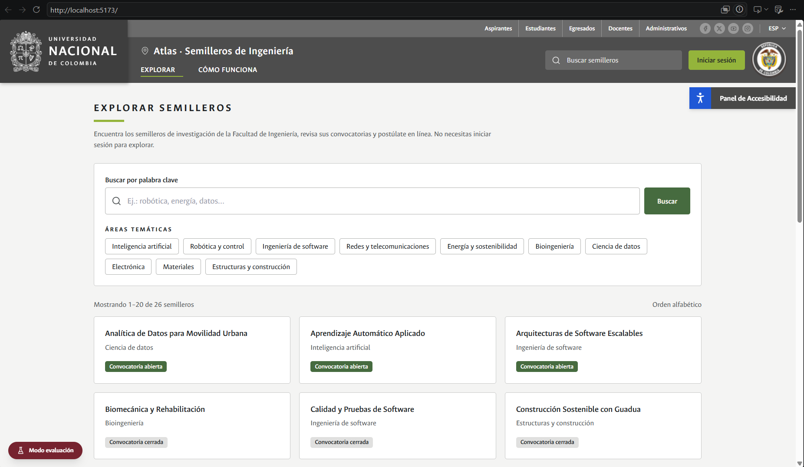
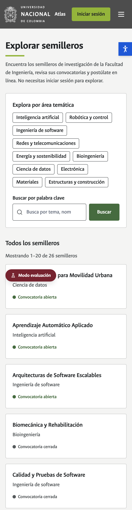

[← Índice](../README.md) · [← Módulo I](modulo-1-prototipo.md) · [Módulo III →](modulo-3-calidad.md)

# Módulo II: Arquitectura de Frontend y Componentización

El prototipo está construido en **React 18 + TypeScript + Vite + Tailwind CSS + React Router 6**. Esta sección muestra cómo se organiza en componentes, qué elementos se repiten, cómo se adapta la pantalla principal a escritorio y móvil, y cómo cumple 8 de las 10 heurísticas de Nielsen, con evidencia tomada del código.

---

## 2.1 Inventario de componentes

### 2.1.1 Estructura en React

La aplicación se organiza en cinco capas. Cada página corresponde a una ruta; los elementos que se repiten viven en `components/`; el estado compartido está en un único contexto de React.

```text
src/
├── main.tsx                 Punto de entrada: crea el enrutador y monta el estado global
├── App.tsx                  Tabla de rutas (públicas y protegidas por rol)
├── store.tsx                Estado global (React Context): sesión, semilleros, postulaciones,
│                            autorizaciones, correos simulados y avisos. Se consume con useStore()
├── types.ts                 Tipos del dominio (Semillero, Postulacion, Rol, Area…)
├── data/seed.ts             Datos de ejemplo: 26 semilleros y 32 postulaciones
├── lib/utils.ts             Funciones puras: fechas, orden alfabético sin tildes, validación de URL y WhatsApp
├── components/              Piezas reutilizables
│   ├── Layout.tsx           Marco de todas las páginas
│   ├── Header.tsx           Encabezado institucional y menú por rol
│   ├── Footer.tsx           Pie de página institucional
│   ├── A11yPanel.tsx        Panel de accesibilidad (tamaño de texto y alto contraste)
│   ├── DemoPanel.tsx        «Modo evaluación» del prototipo
│   ├── RequireRole.tsx      Protección de rutas por rol
│   ├── NoPermiso.tsx        Pantalla de acceso denegado o página inexistente
│   ├── UI.tsx               Primitivos: PageTitle, Badge, Dialog, Campo, Alerta, Toasts, HU
│   ├── Semillero.tsx        Piezas del dominio: TarjetaSemillero, BadgeConvocatoria, SelloFicha, Resaltar
│   └── CambiosSinGuardar.tsx  Aviso al salir de un formulario con cambios sin guardar
└── pages/                   Una vista por ruta (14)
```

Jerarquía en tiempo de ejecución:

```text
RouterProvider
└── StoreProvider (estado global)
    └── AppRoutes
        └── Layout
            ├── Header ─ menú según el rol de la sesión
            ├── <main> ─ página de la ruta activa
            │     └── RequireRole (solo en rutas privadas)
            │           └── Página ─ usa PageTitle, TarjetaSemillero, Campo, Dialog, Alerta…
            ├── Footer
            ├── Toasts, A11yPanel, DemoPanel
```

**Decisiones de estructura**

- **Páginas delgadas, componentes reutilizables.** Las páginas combinan primitivos (`Campo`, `Dialog`, `Alerta`) en lugar de repetir marcado y estilos.
- **Un solo estado global.** Sin backend, `store.tsx` simula la persistencia y las reglas de negocio (aceptar una postulación descuenta un cupo, revocar una autorización queda en el historial). Lo consumen 17 archivos mediante `useStore()`.
- **Protección declarativa de rutas.** `RequireRole` envuelve cada ruta privada: sin sesión redirige a `/ingresar` y con un rol distinto muestra `NoPermiso`.
- **Carga diferida.** El Tablero, que incluye la biblioteca de gráficos `recharts`, se carga solo cuando alguien lo visita (`React.lazy`).
- **Estilos centralizados.** La paleta UNAL está en `tailwind.config.js` y las clases de botones, tarjetas y campos en `src/index.css`.

### 2.1.2 Componentes reutilizables

| Componente | Archivo | Qué hace | Dónde se usa |
| --- | --- | --- | --- |
| `Layout` | `components/Layout.tsx` | Enlace «Saltar al contenido», `Header`, contenido de la ruta, `Footer`, avisos y paneles flotantes; vuelve al inicio de la página al cambiar de ruta. | Envuelve todas las rutas (`App.tsx`). |
| `Header` | `components/Header.tsx` | Encabezado fijo réplica de unal.edu.co: barra de perfiles y redes, escudo, menú principal según el rol, menú de usuario con teclado completo (flechas, Inicio, Fin, Escape) y menú hamburguesa en móvil. | `Layout` |
| `Footer` | `components/Footer.tsx` | Cuatro columnas de enlaces oficiales de la UNAL, contacto, derechos y sellos institucionales. | `Layout` |
| `A11yPanel` | `components/A11yPanel.tsx` | Diálogo para cambiar el tamaño del texto (85 % a 150 %) y activar alto contraste. | `Layout` |
| `DemoPanel` | `components/DemoPanel.tsx` | «Modo evaluación»: cambia de cuenta de demostración, muestra los correos simulados, activa las etiquetas de historias y reinicia los datos. | `Layout` |
| `RequireRole` | `components/RequireRole.tsx` | Deja pasar solo a los roles indicados; sin sesión, redirige a `/ingresar` y conserva la ruta de destino. | 9 rutas privadas en `App.tsx` |
| `NoPermiso` | `components/NoPermiso.tsx` | Mensaje de acceso denegado o página inexistente, con botón para volver al catálogo. | `RequireRole`, ruta `*` y 8 páginas que validan el recurso pedido |
| `PageTitle` | `components/UI.tsx` | Título `h1` de la página con la línea verde institucional y subtítulo opcional. | 12 páginas |
| `Badge` | `components/UI.tsx` | Indicador de estado: texto de color con un punto, sin caja, para que no parezca un botón. Cinco tonos. | Base de `BadgeConvocatoria`, `BadgeEstado` y `SelloFicha`; `DirectorPostulaciones`, `Tablero` |
| `Dialog` | `components/UI.tsx` | Ventana modal accesible: el foco entra al abrir, queda atrapado con Tab y Shift+Tab, Escape la cierra y el foco vuelve al botón de origen. | 8 diálogos: verificar ficha, cerrar convocatoria, decidir postulación, elegir cuenta, retirar postulación, revocar autorización, eliminar perfil y cambios sin guardar |
| `Campo` | `components/UI.tsx` | Etiqueta, control, ayuda y error de un campo; vincula error y ayuda al control con `aria-invalid` y `aria-describedby`. | `Postular`, `DirectorFicha`, `DirectorConvocatoria` |
| `Alerta` | `components/UI.tsx` | Mensaje informativo, de éxito o de error (`role="status"` o `role="alert"`). | 7 páginas |
| `Toasts` | `components/UI.tsx` | Avisos temporales («Correo enviado a…»), anunciados a lectores de pantalla (`aria-live`). | `Layout` |
| `HU` | `components/UI.tsx` | Etiqueta de historia de usuario (por ejemplo «HU-04»), visible solo con el Modo evaluación. | 10 archivos |
| `TarjetaSemillero` | `components/Semillero.tsx` | Tarjeta enlazada con nombre (resaltando el término buscado), área, logo opcional y estado de la convocatoria; recuerda la búsqueda de origen para poder volver a ella. | `Explorar` (catálogo y sugerencias), `Ficha` (relacionados) |
| `BadgeConvocatoria` | `components/Semillero.tsx` | «Convocatoria abierta» o «cerrada», calculado con bandera, fecha de cierre y cupos. | `TarjetaSemillero`, `Ficha`, `DirectorPanel`, `DirectorFicha`, `DirectorConvocatoria` |
| `BadgeEstado` | `pages/DirectorPostulaciones.tsx` | Estado de una postulación: Enviada, Aceptada, Rechazada o Retirada. | `DirectorPostulaciones`, `DirectorPostulacionDetalle`, `MiCuenta` |
| `SelloFicha` | `components/Semillero.tsx` | «Verificada» o «Precargada» (tomada de Hermes) con la fecha de actualización. | `Ficha`, `DirectorPanel`, `DirectorFicha` |
| `useCambiosSinGuardar` | `components/CambiosSinGuardar.tsx` | Avisa antes de salir de un formulario modificado: diálogo propio al navegar dentro de Atlas y aviso del navegador al cerrar o recargar. | `Postular`, `DirectorFicha`, `DirectorConvocatoria` |

### 2.1.3 Páginas

| Ruta | Página | Rol | Qué hace |
| --- | --- | --- | --- |
| `/` | `Explorar` | Todos | Catálogo con áreas temáticas, búsqueda con sugerencias mientras se escribe, filtros activos, semilleros relacionados si no hay resultados y paginación de 20. |
| `/semilleros/:id` | `Ficha` | Todos | Datos del semillero, página web, contacto autorizado (con botón de WhatsApp), convocatoria y semilleros relacionados. |
| `/ingresar` | `Ingresar` | Visitante | Aviso de privacidad v1.0 e inicio de sesión simulado con Google; rechaza correos fuera de `@unal.edu.co`. |
| `/como-funciona` | `ComoFunciona` | Todos | Los cuatro pasos para postularse. |
| `/evaluacion` | `Evaluacion` | Todos | Las 22 historias Must con su pantalla; «Abrir» inicia sesión con la cuenta adecuada y navega. |
| `/postular/:id` | `Postular` | Estudiante | Postulación en tres pasos: mayoría de edad, autorización de datos y formulario. |
| `/postulacion/:numero` | `Confirmacion` | Estudiante | Comprobante con número de postulación. |
| `/mi-cuenta` | `MiCuenta` | Estudiante | Cuatro pestañas: mis datos, mis postulaciones, autorizaciones y eliminar perfil. |
| `/director` | `DirectorPanel` | Director | Resumen de ficha, convocatoria y postulaciones nuevas. |
| `/director/ficha` | `DirectorFicha` | Director | Verificar la ficha precargada y editarla (incluye página web, logo y WhatsApp). |
| `/director/convocatoria` | `DirectorConvocatoria` | Director | Abrir o cerrar la convocatoria, fecha de cierre y cupos. |
| `/director/postulaciones` | `DirectorPostulaciones` | Director | Tabla de postulaciones recibidas, con las nuevas marcadas. |
| `/director/postulaciones/:id` | `DirectorPostulacionDetalle` | Director | Detalle y decisión (aceptar o rechazar) con confirmación. |
| `/vicedecanatura/tablero` | `Tablero` | Vicedecanatura | Indicadores agregados: crecimiento de postulaciones, fichas verificadas y postulaciones con autorización. |
| `*` | `NoPermiso` | Todos | Página inexistente. |

### 2.1.4 Elementos que se repiten

| Elemento | Implementación | Variantes y uso |
| --- | --- | --- |
| **Botones** | Clases `.btn-*` en `src/index.css` | `.btn-primary` (verde oscuro, acción principal; 12 archivos) · `.btn-outline` (secundaria, cancelar o volver; 13 archivos) · `.btn-danger` (rojo, acciones destructivas o de rechazo; 4 archivos) · `.btn-verde` (verde institucional, solo «Iniciar sesión» del header) |
| **Tarjetas** | Clase `.card` y componente `TarjetaSemillero` | `.card` agrupa contenido y formularios en 15 archivos; `TarjetaSemillero` se repite en el catálogo, las sugerencias y los relacionados |
| **Formularios** | Componente `Campo` y clases `.input` y `.label` | Postulación, edición de ficha, convocatoria, mis datos, inicio de sesión y búsqueda; los formularios largos usan además `useCambiosSinGuardar` |
| **Diálogos de confirmación** | Componente `Dialog` | 8 flujos (ver 2.1.2), siempre con una acción segura y una principal |
| **Indicadores de estado** | `Badge` y sus derivados | Convocatoria, verificación de ficha y estado de postulación con el mismo código de color: verde = positivo, gris = neutro, rojo = rechazo |
| **Mensajes** | `Alerta` y `Toasts` | Errores con salida, confirmaciones y correos simulados |

---

## 2.2 Diseño responsivo (pantalla principal: Explorar)

Se usan los puntos de quiebre de Tailwind: `sm` (640 px), `md` (768 px) y `lg` (1024 px). Por debajo de 640 px rige el diseño móvil.

### 2.2.1 Explorar (`src/pages/Explorar.tsx`)

| Elemento | Clases | Móvil (< 640 px) | Escritorio |
| --- | --- | --- | --- |
| Grilla de semilleros | `grid gap-4 sm:grid-cols-2 lg:grid-cols-3` | 1 tarjeta por fila | 2 columnas desde 640 px y 3 desde 1024 px |
| Sugerencias sin resultados | `grid gap-3 sm:grid-cols-2` | 1 por fila | 2 columnas |
| Texto «Orden alfabético» | `hidden sm:block` | Oculto, para dejar espacio al contador | Visible a la derecha del contador |
| Contenedor | `mx-auto max-w-6xl px-4` | Ocupa todo el ancho con margen de 16 px | Se centra con un ancho máximo |
| Búsqueda | `flex gap-2` y `relative flex-1` | El campo se encoge y el botón «Buscar» conserva su tamaño | Campo ancho |
| Áreas temáticas, filtros activos y paginación | `flex flex-wrap gap-2` | Bajan a la línea siguiente | Caben en una o dos líneas |

### 2.2.2 Marco común (`Header`, `A11yPanel`, `Footer`)

| Componente | Clases | Móvil | Escritorio |
| --- | --- | --- | --- |
| Barra de perfiles y redes | `hidden md:block` | Oculta | Visible desde 768 px |
| Escudo y nombre | `hidden md:flex` / `md:hidden`, `min-[380px]:block` | Escudo compacto y nombre corto «Atlas»; por debajo de 380 px el nombre se oculta y el header se compacta para caber en 320 px sin desplazamiento horizontal | Bloque oscuro que sobresale, con el nombre completo «Atlas · Semilleros de Ingeniería» |
| Menú principal | `hidden md:block` | Se reemplaza por el botón hamburguesa (`md:hidden`) | Menú horizontal |
| Sello de Colombia | `hidden md:block` | Oculto | Visible |
| Panel de Accesibilidad | `hidden sm:flex` en el texto | Solo el icono | Icono y texto |
| Pie de página | `sm:grid-cols-2 lg:grid-cols-[…]` | 1 columna | 2 columnas desde 640 px y 7 con separadores desde 1024 px |

### 2.2.3 Evidencia visual

Capturas de la versión actual: escritorio a 1440 × 900 px y móvil a 390 px de ancho (iPhone 14), con la página desplazada hasta las primeras tarjetas.

| Escritorio (1440 px) | Móvil (390 px) |
| :---: | :---: |
|  |  |

---

## 2.3 Heurísticas de usabilidad de Jakob Nielsen

Se documentan **8 de las 10 heurísticas**, cada una con evidencia del código actual.

### 1. Visibilidad del estado del sistema

La interfaz informa en qué paso está el usuario, cuántos resultados hay y qué acaba de pasar.

- **Progreso de la postulación** (`Postular.tsx`): marca el paso actual, los terminados con ✓ y lo anuncia con `aria-current="step"`.
```tsx
<li
  key={t}
  aria-current={n === actual ? 'step' : undefined}
  className={clsx('flex items-center gap-2 border-b-4 pb-1', n === actual ? 'border-unal-verde-oscuro text-unal-verde-oscuro' : hecho ? 'border-unal-verde text-unal-texto' : 'border-transparent text-unal-gris-oscuro')}
>
  {hecho ? <Check size={14} /> : <span>{n}.</span>} {t}
</li>
```
- **Contador de resultados en vivo** (`Explorar.tsx`): se actualiza mientras se escribe y lo anuncian los lectores de pantalla (`aria-live`).
```tsx
<div className="mt-3 flex items-center justify-between text-sm text-unal-gris-oscuro" aria-live="polite">
  <p data-testid="contador">
    {filtrados.length === 0
      ? '0 semilleros'
      : `Mostrando ${desde + 1}–${desde + visibles.length} de ${filtrados.length} semilleros`}
  </p>
```
- **Avisos temporales** (`UI.tsx`, `Toasts`): confirman acciones como «Correo enviado a…».

### 2. Correspondencia entre el sistema y el mundo real

Usa el lenguaje de la universidad (Hermes, Vicedecanatura de Investigación y Extensión, programas curriculares, Ley 1581 de 2012) y fechas en formato colombiano (`dd/mm/aaaa`).

- **Origen de la ficha** (`Semillero.tsx`, `SelloFicha`): explica que una ficha precargada viene de Hermes y aún no la confirma el director.
```tsx
<Badge tone="gris" punto={false} title="Información tomada de fuentes públicas de Hermes; aún no confirmada por el director">
  <FileClock size={14} aria-hidden /> Precargada
</Badge>
```
- **Fechas** (`lib/utils.ts`):
```ts
export function fmtFecha(iso: string): string {
  const [datePart] = iso.split('T')
  const [y, m, d] = datePart.split('-')
  return `${d}/${m}/${y}`
}
```

### 3. Control y libertad del usuario

Hay salida en cada flujo: «Cancelar» en los formularios, aviso antes de perder cambios, cierre de diálogos con Escape y acciones reversibles (retirar una postulación, revocar una autorización).

- **Aviso de cambios sin guardar** (`CambiosSinGuardar.tsx`): si el usuario intenta salir de un formulario modificado, puede seguir editando o salir sin guardar.
```tsx
<Dialog
  titulo="Tienes cambios sin guardar"
  onClose={() => blocker.reset()}
  acciones={
    <>
      <button className="btn-outline" onClick={() => blocker.reset()}>Seguir editando</button>
      <button className="btn-danger" onClick={() => blocker.proceed()}>Salir sin guardar</button>
    </>
  }
>
```
- **Retirar una postulación enviada** (`MiCuenta.tsx`):
```tsx
{p.estado === 'Enviada' && <button className="btn-outline" onClick={() => setRetirando(p.id)}>Retirar postulación</button>}
```
- **Volver a los resultados** (`Ficha.tsx`): la ficha recuerda la búsqueda, el filtro y la página de origen.

### 4. Consistencia y estándares

Una sola paleta institucional (`tailwind.config.js`), las mismas clases para cada tipo de botón, tarjeta y campo, y el encabezado y pie oficiales de la UNAL.

- **Clases compartidas** (`src/index.css`):
```css
@layer components {
  .section-title { @apply text-xl font-semibold leading-snug text-unal-texto; }
  .btn { @apply inline-flex items-center justify-center gap-2 rounded px-4 py-2 text-sm font-semibold transition-colors disabled:cursor-not-allowed disabled:opacity-50; }
  .btn-primary { @apply btn bg-unal-verde-oscuro text-white hover:bg-[#3a5a34]; }
  .btn-verde { @apply btn bg-unal-verde text-unal-texto hover:bg-[#86a534]; }
  .btn-outline { @apply btn border border-unal-gris-oscuro bg-white text-unal-texto hover:bg-gray-100; }
  .btn-danger { @apply btn bg-unal-rojo text-white hover:bg-[#8e1829]; }
  .card { @apply rounded border border-unal-gris-claro/70 bg-white p-5; }
  .input { @apply w-full rounded border border-unal-gris-oscuro bg-white px-3 py-2 text-sm placeholder:text-gray-500; }
  .label { @apply mb-1 block text-sm font-semibold; }
}
```
- El rojo se reserva para acciones destructivas y errores, y el verde para la acción principal, en todas las pantallas.

### 5. Prevención de errores

Se deshabilitan las acciones que no proceden, se pide confirmación antes de lo irreversible y se advierte antes de que el usuario cometa el error.

- **Confirmación escrita para eliminar el perfil** (`MiCuenta.tsx`):
```tsx
<button
  className="btn-danger"
  disabled={confirmacion !== 'ELIMINAR'}
  onClick={() => { setEliminando(false); navigate('/'); eliminarPerfil() }}
>
  Eliminar definitivamente
</button>
```
- **No se puede aceptar sin cupos** (`DirectorPostulacionDetalle.tsx`), y se explica cómo resolverlo:
```tsx
<button className="btn-primary" disabled={sinCupos} onClick={() => setConfirmar('Aceptada')}>Aceptar</button>
// …
{p.estado === 'Enviada' && sinCupos && (
  <p className="mt-2 text-right text-sm text-unal-gris-oscuro" role="note">
    No puedes aceptar: los cupos están llenos. Aumenta los cupos en <Link to="/director/convocatoria">Convocatoria</Link> para aceptar más postulaciones.
  </p>
)}
```
- **Límite de caracteres y advertencia sobre datos sensibles** (`Postular.tsx`):
```tsx
<textarea id="f-msg" rows={5} maxLength={MAX_MENSAJE} value={form.mensaje}
  onChange={(e) => set('mensaje', e.target.value.slice(0, MAX_MENSAJE))} className="input" aria-describedby="msg-ayuda" />
<div id="msg-ayuda" className="mt-1 flex flex-wrap justify-between gap-2 text-xs">
  <span className="text-unal-gris-oscuro">No incluyas datos sensibles (salud, religión, origen étnico, orientación sexual, situación económica).</span>
  <span data-testid="contador-mensaje" className="font-semibold">{form.mensaje.length}/{MAX_MENSAJE}</span>
</div>
```

### 6. Reconocimiento antes que recuerdo

El usuario elige en lugar de recordar: el formulario llega prellenado, los programas y la disponibilidad son listas cerradas, el término buscado se resalta y los filtros activos quedan a la vista.

- **Prellenado con los datos del perfil** (`Postular.tsx`):
```tsx
const [form, setForm] = useState({
  nombre: perfil?.nombre ?? sesion?.nombre ?? '',
  programa: perfil?.programa ?? '',
  semestre: perfil?.semestre ?? '',
  disponibilidad: '',
  mensaje: '',
})
```
- **Sugerencias mientras se escribe** (`Explorar.tsx`): desde la segunda letra se proponen áreas, semilleros y líneas, para que el usuario reconozca lo que existe en vez de adivinar términos.
- **Filtros activos visibles y removibles** (`Explorar.tsx`): «Filtros activos: «robótica» × · Robótica y control ×».
- **Resaltado del término buscado** (`Semillero.tsx`, `Resaltar`):
```tsx
<mark className="bg-unal-verde/40 px-0.5">{texto.slice(i, i + nq.length)}</mark>
```

### 7. Ayudar a reconocer, diagnosticar y recuperarse de errores

Los mensajes dicen qué pasó y ofrecen una salida inmediata.

- **Correo fuera del dominio institucional** (`Ingresar.tsx`):
```tsx
<Alerta tono="error">
  <p className="font-semibold">Solo puedes entrar con tu correo @unal.edu.co</p>
  <div className="mt-3 flex flex-wrap gap-2">
    <button className="btn-outline" onClick={() => { setRechazo(false); setSelector(true) }}>Intentar con otra cuenta</button>
    <Link to="/" className="btn-outline">Volver al catálogo</Link>
  </div>
</Alerta>
```
- **Ficha de otro director** (`DirectorFicha.tsx`): explica a quién pedir la corrección y abre el correo ya redactado.
```tsx
<p className="font-semibold">Tu correo no coincide con el del director de esta ficha.</p>
<p className="mt-2 text-unal-texto">
  Solo el director registrado puede verificarla. Si crees que hay un error, pide la corrección a la Vicedecanatura de Investigación y Extensión…
</p>
<a className="btn-primary" href={`mailto:${CORREO_VICE}?subject=${encodeURIComponent(`Corrección de ficha: ${s.nombre}`)}`}>Escribir a la Vicedecanatura</a>
```
- **Búsqueda sin resultados** (`Explorar.tsx`): en lugar de una pantalla vacía, propone hasta 4 semilleros relacionados y las áreas temáticas.

### 8. Ayuda y documentación

Una página «Cómo funciona», textos de ayuda junto a los campos (`Campo` con `hint`) y orientación a un director que entra con un correo no asociado.

- **Guía en cuatro pasos** (`ComoFunciona.tsx`):
```tsx
const PASOS = [
  ['Explora', 'Revisa el catálogo de semilleros de Ingeniería sin iniciar sesión y busca por tema o palabra clave.'],
  ['Revisa la ficha', 'Mira la línea de investigación, los requisitos y si el semillero tiene convocatoria abierta.'],
  ['Postúlate', 'Inicia sesión con tu correo @unal.edu.co, autoriza el uso de tus datos y envía el formulario.'],
  ['Recibe respuesta', 'El director acepta o rechaza desde Atlas y te avisamos por correo.'],
]
```

---

> **Declaración de uso de IA:** El análisis de código, el inventario de componentes, la revisión del diseño responsivo y la verificación de las heurísticas de Nielsen de este módulo se realizaron con la herramienta de inteligencia artificial **Antigravity (Google DeepMind · modelo Gemini)**, a partir de la inspección de los archivos en `src/`.
>
> **Actualización con Claude (Anthropic).** Después de las correcciones de accesibilidad y de las pruebas con usuarios, el código cambió y el análisis original quedó desactualizado. Con Claude se actualizó esta sección contra el código vigente: se retiró el buscador del header (eliminado en `839f468`), se agregaron `CambiosSinGuardar` y el árbol de estructura del proyecto, se reemplazaron los fragmentos de código que habían cambiado (indicadores de estado, diálogo con foco atrapado, clases CSS, pasos de la postulación, verificación de ficha), se quitaron los números de línea para que las referencias no se rompan con cada cambio y se tomaron de nuevo las capturas de escritorio y móvil.

---

[← Índice](../README.md) · [← Módulo I](modulo-1-prototipo.md) · [Módulo III →](modulo-3-calidad.md)
