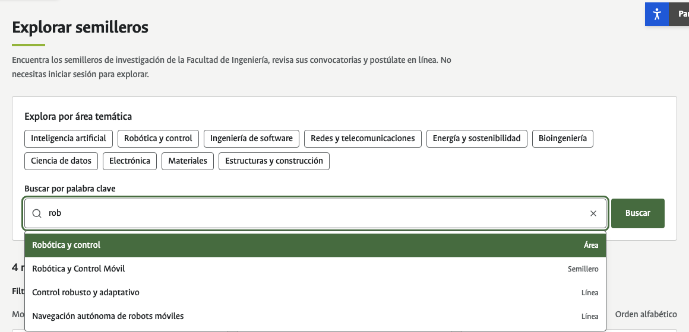
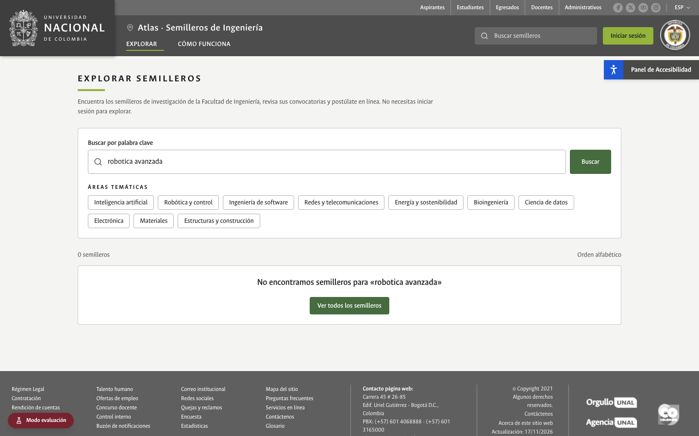
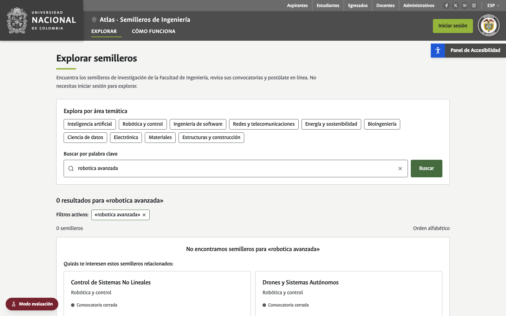

[← Índice](../README.md) · [← Módulo II](modulo-2-frontend.md) · [Módulo IV →](modulo-4-persistencia.md)

# Módulo III: QC de Usabilidad y Accesibilidad

## 3.1 Reporte de validación RITE

**Documentos completos:** [Reporte de validación de usabilidad](reporte-validacion-usabilidad.md) (tareas, registros, ficha RITE, análisis y referencias) · [Prueba de prototipo - Atlas .xlsx](../Prueba%20de%20prototipo%20-%20Atlas%20.xlsx) (registros, cuestionario y cálculos)

**Videos de las sesiones:** [carpeta en Google Drive](https://drive.google.com/drive/folders/1zzHP633ZDwt_1zEWPy7KW0j9YW8DsSB1?usp=sharing)

### 3.1.1 Diseño de la prueba

| Aspecto | Detalle |
|---|---|
| Participantes | **11 usuarios reales** (el mínimo pedido es 2): 10 estudiantes de pregrado (U1 a U11; el código U8 no se asignó) y 1 docente director de semillero (D1). Los estudiantes cursaban octavo semestre, salvo uno de décimo, y 6 de los 10 habían participado antes en un semillero. |
| Fechas | 12 y 15 de noviembre de 2026 |
| Modalidad | Mixta: sesiones presenciales y remotas, sobre el prototipo desplegado (`atlas-sisinfo.vercel.app`) |
| Consentimiento | Cada participante dio su consentimiento verbal, al inicio de la grabación, para ser grabado y para el uso de sus respuestas. Los participantes se identifican solo por código. |
| Protocolo | Tareas sin pistas. Por tarea se registraron el tiempo, los clics y si el usuario necesitó ayuda; la ficha RITE recogió las frases literales. Al final, cada estudiante respondió un cuestionario Likert de 1 a 5. |
| Regla RITE | Un hallazgo de gravedad 4 (catástrofe) se corrige antes del siguiente usuario; los de gravedad 1 a 3 se priorizan para la siguiente iteración. |

**Rúbrica de gravedad:** 1 = problema estético · 2 = problema pequeño de usabilidad · 3 = problema importante de usabilidad · 4 = catástrofe de usabilidad.

### 3.1.2 Tareas

| Tarea | Instrucción al usuario | Se considera completada cuando… | Historias |
|---|---|---|---|
| T1. Buscar | Encuentra un semillero relacionado con un tema que te interese (por ejemplo, robótica). | Abre la ficha de un semillero desde el catálogo o el buscador. | HU-01, HU-02 |
| T2. Informarse | Averigua quién dirige ese semillero, cómo contactarlo y qué requisitos pide. | Identifica en la ficha al director, su correo y los requisitos. | HU-04 |
| T3. Convocatoria | Averigua si tiene convocatoria abierta, hasta cuándo puedes aplicar y cuántos cupos hay. | Dice la fecha de cierre y los cupos, o reconoce que está cerrada. | HU-12 |
| T4. Postularse | Postúlate al semillero. | Pasa por el inicio de sesión, la mayoría de edad y la autorización de datos, envía el formulario y ve «Postulación enviada» con un número. | HU-08, HU-15, HU-16, HU-17 |
| TD1. Verificar ficha | Entra como director y confirma que la ficha de tu semillero es correcta. | Ve el panel de su semillero y la ficha pasa a «Verificada» con fecha. | HU-09, HU-29 |
| TD2. Editar | Actualiza la descripción y los requisitos de tu semillero. | Guarda y ve el cambio reflejado en la ficha. | HU-30 |
| TD3. Convocatoria | Abre una convocatoria de dos semanas con 5 cupos. | La convocatoria queda abierta con la fecha y los cupos correctos. | HU-32 |
| TD4. Decidir | Revisa la postulación que llegó y responde al estudiante. | Abre la postulación, ve solo los datos del formulario y registra aceptar o rechazar. | HU-19 |

### 3.1.3 Resultados

**Estudiantes (n = 10).** Todos completaron las 4 tareas sin ayuda.

| Tarea | Completada sin ayuda | Tiempo: mediana (mín.–máx.) | Clics: mediana (mín.–máx.) |
|---|---|---|---|
| T1. Buscar | 10 de 10 | 38,5 s (10–98) | 3,5 (1–21) |
| T2. Informarse | 10 de 10 | 5 s (1–12) | 0 (0–1) |
| T3. Convocatoria | 10 de 10 | 3 s (2–10) | 0 (0–0) |
| T4. Postularse | 10 de 10 | 55 s (25–82) | 16 (15–20) |

**Director (n = 1).** Completó las 4 tareas; necesitó ayuda en 2.

| Tarea | Resultado | Tiempo | Clics |
|---|---|---|---|
| TD1. Verificar ficha | Con ayuda | 120 s | 7 |
| TD2. Editar | Con ayuda | 40 s | 4 |
| TD3. Convocatoria | Sin ayuda | 50 s | 12 |
| TD4. Decidir | Sin ayuda | 30 s | 5 |

**Cuestionario (estudiantes, escala 1 a 5).** Mide cuatro constructos: facilidad de uso y utilidad percibidas, del modelo de aceptación tecnológica (TAM), y calidad y satisfacción, del modelo de éxito de sistemas de información de DeLone y McLean, siguiendo la integración de ambos propuesta por Legramante et al. (2023).

| Constructo | Media |
|---|---|
| Facilidad de uso percibida | 4,50 |
| Utilidad percibida | 4,57 |
| Calidad percibida | 4,33 |
| Satisfacción | 4,50 |

### 3.1.4 Análisis

- **Ningún hallazgo fue de gravedad 4**, así que, según la regla RITE, no hubo que modificar el prototipo entre un usuario y el siguiente.
- **La búsqueda concentró los problemas.** De los 8 hallazgos, 6 corresponden a T1 (P01, P02, P03, P04, P07 y P08). La mitad de los estudiantes tardó más de 45 s en T1, y cada uno de ellos originó un hallazgo de búsqueda. Su facilidad de uso percibida promedió **4,23**, frente a **4,77** de los otros cinco.
- **Más clics, menos facilidad percibida.** La correlación de Spearman entre los clics totales y la facilidad de uso percibida fue **ρ = −0,74 (p = 0,014; n = 10)**, significativa al 5 %. Se eligió Spearman porque la muestra es pequeña y las respuestas son ordinales. Las demás correlaciones no fueron significativas: clics con calidad (ρ = −0,42; p = 0,23), con utilidad (ρ = −0,39; p = 0,26) y con satisfacción (ρ = 0,06; p = 0,88), y tiempo con facilidad (ρ = 0,11; p = 0,76).
- **El director aportó hallazgos cualitativos valiosos.** Necesitó ayuda en las dos tareas sobre su ficha, lo que originó P05.

**Limitaciones.** Es una prueba piloto: con 10 estudiantes y un solo director, los resultados cuantitativos son exploratorios y no se pueden generalizar. Las respuestas del director al cuestionario no se incluyeron en el análisis estadístico.

---

## 3.2 Problema detectado vs. cambio aplicado en el prototipo

Los cambios se implementaron después de la ronda de pruebas, en dos tandas: P01, P03, P05, P06 y P08 en el commit `1ceb0f5`, y P02 y P04 en el commit `dbb461a`. Todos se verificaron con las pruebas automáticas del proyecto (`npm test`), que incluyen una prueba específica para P02 y otra para P04.

| ID | Usuario · tarea | Problema detectado | Grav. | HU | Cambio aplicado en el prototipo | Estado |
|---|---|---|---|---|---|---|
| P01 | U2 · T1 | Al hacer una nueva búsqueda, la consulta anterior seguía en el campo y no sabía cómo empezar de nuevo. *«Si busco algo acá, de pronto que se eliminen las anteriores».* | 2 | HU-02 | Botón «×» dentro del campo que borra la búsqueda y devuelve el foco al campo. | **Aplicado** |
| P02 | U4 · T1 | No sabía si buscar por tema o por nombre; la barra de búsqueda pesa más que las áreas. *«Que la barra de búsqueda sea algo secundario y no lo principal».* | 3 | HU-01, HU-02 | Las áreas temáticas pasaron arriba, como forma principal de explorar («Explora por área temática»), y la búsqueda por palabra quedó debajo como alternativa. El texto de ejemplo del campo dice ahora «Busca por tema, nombre o línea de investigación», lo que resuelve la duda de si buscar por tema o por nombre. | **Aplicado** |
| P03 | U6 · T1 | Creía que elegir un área anulaba la palabra clave. *«Que cuando uno selecciona por área no invalide el filtro por palabra».* | 3 | HU-01, HU-02 | El prototipo ya combinaba ambos filtros; el problema era que no se veía. Se agregó una fila «Filtros activos» que muestra la palabra y el área a la vez, con un botón para quitar cada una y la nota «se aplican los dos a la vez». La hipótesis inicial (panel lateral) se descartó porque no atacaba la causa. | **Aplicado** |
| P04 | U7 · T1 | Buscaba «a ciegas» sin saber qué términos existen. *«Que con solo escribir algunas palabras ya empiece a mostrar, como Google».* | 2 | HU-02 | Desde la segunda letra, una lista muestra hasta 6 sugerencias (áreas, semilleros y líneas de investigación) que coinciden desde el inicio de una palabra y sin importar las tildes. Elegir un área la aplica como filtro, un semillero abre su ficha y una línea la busca. Se maneja con el mouse o con el teclado (flechas, Enter y Escape), según el patrón ARIA de combobox. | **Aplicado** |
| P05 | D1 · TD1 | No entendía «Reclamar ficha» (*«creo que es crear ficha… la palabra suya fue verificar»*) y el teléfono que guardó no aparecía en la ficha. | 2 | HU-29, HU-30 | Se usó la palabra del propio director: el botón, el título y el diálogo dicen ahora **«Verificar mi ficha»**. El teléfono no aparecía porque no había marcado «Autorizo publicar este dato»; ahora, al guardar, un aviso explica que el dato quedó registrado pero no es público hasta autorizarlo. | **Aplicado** |
| P06 | U10 · T2 | «Sin información» en Requisitos no dejaba saber si no hay requisitos o si no se cargaron. | 2 | HU-04 | Dos textos distintos: en una ficha verificada, «Sin requisitos previos: entrada libre»; en una precargada, «El director aún no ha cargado esta información». Esto ajusta, solo para el campo Requisitos, el criterio 2 de HU-04 (un campo vacío muestra «Sin información»). | **Aplicado** |
| P07 | U10 · T1 | Las áreas ocupan mucho espacio y «te pierdes los semilleros»; el diseño le parece muy sobrio. | 2 | HU-01 | No se cambia. Se clasifica como 2 y no como 1 (estético) porque el usuario también señaló que las áreas le restaban visibilidad a los semilleros; esa parte se atendió junto con P02: los botones de área son ahora más compactos y ocupan menos espacio. La sobriedad visual se mantiene a propósito, por coherencia con la identidad institucional de la UNAL. | **Descartado con justificación** |
| P08 | U11 · T1 | Una búsqueda sin coincidencia exacta mostraba una pantalla vacía. *«Tampoco hay. ¿Qué hago?».* | 3 | HU-02 | En lugar de la pantalla vacía, se sugieren hasta 4 semilleros relacionados (coincidencia parcial sin tildes) y las áreas temáticas. | **Aplicado** |

**Resumen:** 7 hallazgos aplicados (incluidos los 3 de gravedad 3) y 1 descartado con justificación.

**Evidencia visual (P02 y P04).** Las áreas aparecen antes que la búsqueda, y al escribir «rob» se sugieren el área, el semillero y las líneas relacionadas:

**Evidencia visual (P01, P03 y P08).** Búsqueda sin coincidencia exacta antes y después del cambio:

| Antes | Después |
|---|---|
|  |  |

**Segunda ronda pendiente.** Los cambios se verificaron con pruebas automáticas, pero todavía no con usuarios. Para cerrar el ciclo RITE, se propone repetir T1 y T2 con 2 estudiantes nuevos y TD1 con el mismo director, y comparar con la ronda 1 (T1: mediana de 38,5 s y 3,5 clics; TD1: 120 s con ayuda).

---

## 3.3 Auditoría de accesibilidad (WCAG 2.2, nivel AA)

**Inclusión (ABET Student Outcome 2).** La auditoría busca que Atlas pueda usarlo cualquier estudiante de la Facultad, incluidas personas con baja visión, daltonismo o que no usan mouse. Es un factor de bienestar y de contexto social en el diseño del sistema de información.

**Método.**
- **Contraste:** razón de contraste (fórmula WCAG) de 35 combinaciones de texto, componentes y fondos.
- **Tipografía:** revisión de la escala tipográfica.
- **Código:** revisión de cada patrón interactivo (diálogos, menús, pestañas, formularios, buscador y foco).
- **Prueba automática:** axe-core 4.10 en el navegador (Chromium) sobre el prototipo compilado, con las reglas de WCAG 2.0, 2.1 y 2.2 nivel AA. Fueron **29 revisiones de 14 pantallas distintas**: las pantallas de las 22 historias Must con su cuenta de demostración, más estados como la lista de sugerencias abierta, la búsqueda sin resultados y la página inexistente.
- **Desplazamiento horizontal:** comprobado a 320, 360, 390 y 430 px de ancho.

### 3.3.1 Resultado: antes y después de corregir

| Indicador | Antes | Después |
|---|---|---|
| Violaciones automáticas (axe-core) | 2 tipos: gráfico del Tablero sin nombre accesible y 21 enlaces del pie de 22 px de alto (mínimo 24 px, criterio 2.5.8) | **0 en las 29 revisiones** |
| Fallos de contraste | 7 | **0** |
| Hallazgos de prioridad alta | 4 | **0** |
| Hallazgos de prioridad media | 5 | **0** |
| Texto de cuerpo / mínimo | 14 px / 12 px | **16 px / 14 px** |
| Header móvil a 320 px | Desbordado (botón de menú cortado) | **Sin desplazamiento horizontal** |

### 3.3.2 Contraste de color

Todo el texto de lectura supera 4,5:1; el valor más bajo es 4,83:1 (texto de ejemplo de los campos).

| Elemento | Antes | Después | Criterio |
|---|---|---|---|
| Anillo de foco sobre el header y el pie | 1,38:1 y 1,04:1 | 8,45:1 y 6,39:1 (anillo blanco) | 2.4.7, 1.4.11 |
| Borde de los campos y de los botones de área temática | 2,13:1 | 6,97:1 | 1.4.11 |
| Texto de ejemplo de los campos | 2,54:1 | 4,83:1 | 1.4.3 |
| Iconos de redes sociales | 2,38:1 | 6,69:1 | 1.4.11 |
| Texto principal, enlaces, botones, errores, header y pie | — | Entre 5,33:1 y 16:1 | 1.4.3 |

### 3.3.3 Tamaños de fuente y de los objetivos

- Cuerpo, botones y campos a **16 px**; texto secundario a **14 px**; títulos en tres niveles (30, 20 y 18 px); ejes del gráfico del Tablero a **12 px** (antes 10 y 11 px).
- Unidades relativas: el zoom del navegador funciona y el viewport no lo bloquea.
- El Panel de Accesibilidad escala el texto del 85 % al 150 % y ofrece un modo de alto contraste.
- Todos los enlaces y botones miden al menos **24 px** de alto (criterio 2.5.8 de WCAG 2.2).
- Única excepción de tamaño: el logotipo del header (9 y 11 px), que WCAG exime.

### 3.3.4 Navegación por teclado

| Comprobación | Estado |
|---|---|
| Enlace «Saltar al contenido», regiones con nombre (`header`, `nav`, `main`, `footer`), un `h1` por página y títulos sin saltos | Cumple |
| Foco visible en todo el sitio, también sobre el header y el pie | Cumple (corregido) |
| Diálogos: el foco entra, queda atrapado con Tab, Escape cierra y el foco vuelve | Cumple (corregido) |
| Menú de usuario y pestañas de «Mis datos» con flechas, Inicio, Fin y Escape | Cumple (corregido) |
| Buscador con sugerencias: flechas, Enter y Escape (patrón ARIA de combobox) | Cumple |
| Errores de formulario vinculados al campo (`aria-invalid`, `aria-describedby`) | Cumple (corregido) |
| Al pasar de un paso a otro en la postulación, el foco va al título del nuevo paso | Cumple (corregido) |
| Sin `tabindex` positivos; controles nativos (`button`, `a`, `input`) | Cumple |

Las correcciones de foco, diálogos, errores, pasos de la postulación y sugerencias tienen pruebas automáticas (`npm test`).

### 3.3.5 Pendientes

1. **Pruebas con personas:** recorrido completo con teclado por un usuario, lectores de pantalla (VoiceOver o NVDA) y zoom al 200 % en todas las pantallas.
2. **Mayúsculas sostenidas** en la navegación y las pestañas: cuestan más de leer, pero no es un criterio WCAG. Queda como decisión de diseño del equipo.

---

[← Índice](../README.md) · [← Módulo II](modulo-2-frontend.md) · [Módulo IV →](modulo-4-persistencia.md)
