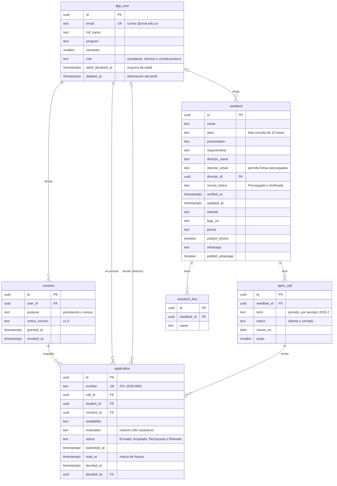
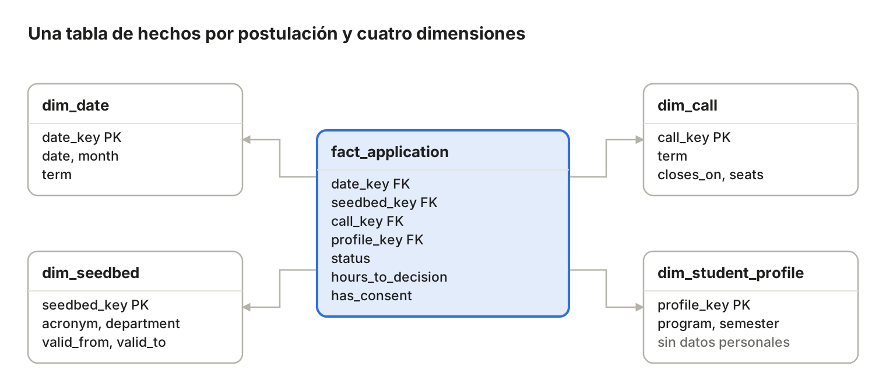
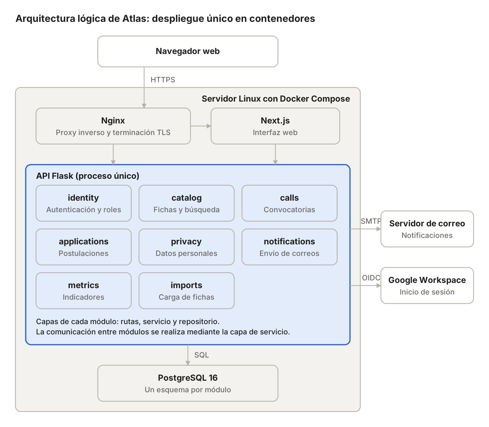
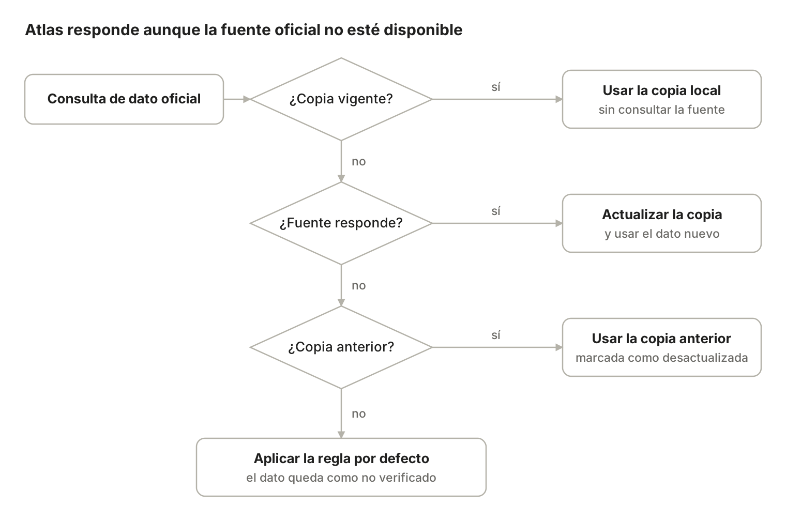

[← Índice](../README.md) · [← Módulo III](modulo-3-calidad.md) · [Informe de uso de IA →](informe-uso-ia.md)

# Módulo IV: Persistencia de soporte

Este módulo presenta el esquema de datos mínimo y el mapa de API que soportan el prototipo de Atlas, junto con la arquitectura que los sustenta. Atlas se plantea como un monolito modular sobre PostgreSQL, desplegado en contenedores y dimensionado para 100 usuarios concurrentes. El límite de 100 usuarios concurrentes se estima a partir de la población de la Facultad de Ingeniería, cerca de 10.000 estudiantes según sus más de 1.000 admitidos por semestre. Si el 30 % entra durante una convocatoria de dos semanas, con tres sesiones de 10 minutos cada uno y el 20 % del tráfico diario en la hora pico, resultan unos 30 usuarios simultáneos. Con toda la sede Bogotá (28.064 estudiantes de pregrado en 2024-2) serían 84, de modo que 100 deja margen incluso en ese escenario.

## 4.1 Esquema de datos mínimo

Seis tablas alimentan todas las pantallas del prototipo. El diagrama muestra solo esas tablas y los campos que cada pantalla lee o escribe.



| Tabla | Pantallas que alimenta | Contenido |
| --- | --- | --- |
| `app_user` | Inicio de sesión, menú por rol, Mis datos, postulación (datos prellenados) | Correo, nombre, programa, semestre, rol, declaración de mayoría de edad y fecha de eliminación |
| `seedbed` | Explorar, Ficha, Panel y Editar ficha del director, Tablero | Ficha completa: área temática, presentación, requisitos, director, estado (precargada o verificada), página web, logo y contacto con su autorización de publicación |
| `research_line` | Ficha, Editar ficha, búsqueda | Líneas de investigación del semillero |
| `open_call` | Ficha (bloque de convocatoria), Convocatoria del director | Periodo, estado, fecha de cierre y cupos. Los cupos ocupados se calculan contando las postulaciones aceptadas. |
| `application` | Postulación, Comprobante, Mis postulaciones, Postulaciones del director, Tablero | Número, disponibilidad, mensaje, estado, fechas de envío, lectura y decisión, y la autorización que la respalda |
| `consent` | Postulación (paso 2), Autorizaciones de Mis datos, Tablero | Finalidad, versión del aviso, fecha de otorgamiento y de revocación |

**Fuera del diagrama.** Tres tablas de soporte no alimentan pantallas pero las necesita el backend: `outbox_email` (correos pendientes), `audit_event` (auditoría de accesos y acciones) y `change_log` (historial de cambios, ver 4.1.1). Cuatro tablas de extensión dejan listo el esquema para información que la universidad ya registra en Hermes y que el MVP aún no muestra: `member` (integrantes), `project`, `product` y `classification` (sede, dependencia, planes de estudio y áreas OCDE). Atlas no se conecta a Hermes; las fichas se cargan por archivo. Además, `seedbed` conserva tres campos de la carga institucional que ninguna pantalla muestra: sigla (`acronym`), dependencia (`department`) y código de registro (`col_code`); la capa analítica usa los dos primeros.

### Reglas de integridad de la base de datos

**Control de postulaciones.** La base de datos impide que un estudiante se postule más de una vez a la misma convocatoria (índice único parcial sobre `call_id` y `student_id` para las postulaciones enviadas o aceptadas; tras un retiro o un rechazo puede volver a postularse) y que un semillero tenga más de una convocatoria abierta al mismo tiempo.

**Validación de autorizaciones.** Al registrar una postulación, el sistema verifica en la misma transacción que `consent_id` corresponda a una autorización vigente del estudiante, con finalidad «postulación». Así no puede existir una postulación sin consentimiento.

**Registro de revocaciones.** Las autorizaciones no se eliminan al revocarlas: se registra la fecha en `revoked_at`. Revocar la autorización de postulación retira además las postulaciones que aún no tienen decisión. El historial sirve como soporte del cumplimiento de la Ley 1581 de 2012.

**Valores cerrados.** El área temática, el rol, el estado de la ficha y el de la postulación solo admiten los valores definidos (restricciones `CHECK`).

**Uso de JSONB.** Se usa solo donde la información no tiene estructura fija, como los atributos adicionales de `seedbed.extra` (columnas de extensión) y los valores registrados en `change_log`.

### 4.1.1 Capa analítica

El modelo transaccional conserva solo el estado actual de cada registro, lo que no basta para analizar tendencias. Se proponen dos mecanismos complementarios.

**Historial de cambios.** Un disparador registra en `change_log` cada modificación de `seedbed`, `open_call` y `application`: entidad, campo, valor anterior, valor nuevo y fecha. La tabla solo admite inserciones. Con ella se reconstruye, por ejemplo, cuánto tiempo permanece una postulación en cada estado o cómo evoluciona una ficha. No se registran cambios de datos personales, para respetar el derecho de supresión.

**Esquema estrella.** Un esquema `analytics`, en la misma base, expone vistas materializadas con una tabla de hechos por postulación y cuatro dimensiones. `dim_seedbed` se construye desde `change_log` como dimensión de cambio lento de tipo 2, de modo que cada postulación se analiza con los atributos que el semillero tenía en ese momento.



Los indicadores del cuadro de mando se calculan sobre este esquema: crecimiento de postulaciones, tiempo de respuesta del director y postulaciones con autorización. Las vistas se refrescan cada noche y no contienen nombres ni correos. Al residir en la misma base no requieren un proceso de carga adicional; si el volumen crece, el mismo modelo se traslada a una bodega de datos para separar la capa transaccional de la analítica.

## 4.2 Mapa de API

La API expone 28 puntos de contacto REST bajo `/api/v1`, en formato JSON. La sesión se mantiene en una cookie HttpOnly. La columna «Pantalla» indica dónde la usa el prototipo.

| Método y ruta | Función | Rol | Pantalla |
| --- | --- | --- | --- |
| **Sesión** | | | |
| `GET /auth/login` | Redirige a Google para autenticar | Público | Ingresar |
| `GET /auth/callback` | Valida la respuesta de Google, verifica el dominio `unal.edu.co` y crea la sesión | Público | Ingresar |
| `GET /me` | Devuelve el perfil y el rol | Autenticado | Header (menú por rol) |
| `POST /auth/logout` | Cierra la sesión | Autenticado | Menú de usuario |
| **Catálogo y fichas** | | | |
| `GET /seedbeds` | Lista el catálogo con búsqueda (`q`), área (`area`) y página (`page`) | Público | Explorar |
| `GET /search/suggestions` | Devuelve hasta 6 sugerencias (áreas, semilleros y líneas) para el texto escrito (`q`) | Público | Explorar |
| `GET /seedbeds/{id}` | Devuelve la ficha con su convocatoria vigente y semilleros relacionados | Público | Ficha |
| `POST /seedbeds/{id}/verification` | Verifica la ficha precargada (pasa a «Verificada») | Director | Verificar mi ficha |
| `PATCH /seedbeds/{id}` | Actualiza la ficha: descripción, líneas, requisitos, página web y contacto con su autorización | Director | Editar ficha |
| `PUT /seedbeds/{id}/logo` | Sube o reemplaza el logo (PNG, JPG o WebP, máximo 2 MB) | Director | Editar ficha |
| **Convocatorias** | | | |
| `POST /seedbeds/{id}/calls` | Abre una convocatoria | Director | Convocatoria |
| `PATCH /calls/{id}` | Cierra la convocatoria o modifica fecha y cupos | Director | Convocatoria |
| **Postulación** | | | |
| `POST /me/adult-declaration` | Registra la declaración de mayoría de edad | Estudiante | Postulación, paso 1 |
| `POST /me/consents` | Registra una autorización (postulación o avisos) | Estudiante | Postulación, paso 2 |
| `POST /calls/{id}/applications` | Crea la postulación; falla si no hay autorización vigente | Estudiante | Postulación, paso 3 |
| `GET /me/applications` | Lista las postulaciones del estudiante | Estudiante | Mis postulaciones |
| `GET /me/applications/{number}` | Devuelve el comprobante de una postulación | Estudiante | Comprobante |
| `POST /applications/{id}/withdrawal` | Retira una postulación aún sin decidir | Estudiante | Mis postulaciones |
| **Revisión del director** | | | |
| `GET /seedbeds/{id}/applications` | Lista las postulaciones recibidas, con las no leídas marcadas | Director | Postulaciones |
| `GET /applications/{id}` | Devuelve el detalle de una postulación (solo los datos del formulario) | Director | Detalle de postulación |
| `PATCH /applications/{id}` | Marca la postulación como leída (`read_at`) | Director | Detalle de postulación |
| `POST /applications/{id}/decision` | Registra la aceptación o el rechazo y encola el correo al estudiante | Director | Detalle de postulación |
| **Privacidad** | | | |
| `GET /me/data` | Devuelve los datos personales y el historial de autorizaciones | Estudiante | Mis datos |
| `PATCH /me/data` | Corrige nombre, programa y semestre | Estudiante | Mis datos |
| `POST /me/consents/{id}/revocation` | Revoca una autorización; el registro se conserva con `revoked_at` | Estudiante | Autorizaciones |
| `DELETE /me` | Elimina el perfil | Estudiante | Eliminar perfil |
| **Vicedecanatura** | | | |
| `GET /metrics` | Devuelve los indicadores agregados, sin datos personales | Vicedecanatura | Tablero |
| `POST /admin/seedbeds/import` | Carga fichas desde un archivo CSV | Vicedecanatura | (fuera del prototipo) |

### 4.2.1 Uso de los verbos HTTP

| Verbo | Uso en Atlas | Idempotente |
| --- | --- | --- |
| `GET` | Consulta sin efectos sobre los datos. Por eso marcar una postulación como leída es un `PATCH` aparte y no un efecto de abrirla. | Sí |
| `POST` | Crea un recurso o registra una acción del negocio: postular, verificar, decidir, retirar, revocar | No; las restricciones de unicidad y de estado impiden duplicados |
| `PATCH` | Actualiza parte de un recurso | Sí en Atlas, porque asigna valores absolutos y no incrementos |
| `PUT` | Reemplaza el logo completo | Sí |
| `DELETE` | Elimina el perfil | Sí |

Las acciones con reglas propias (verificar, decidir, retirar, revocar) se modelan como `POST` a un subrecurso y no como `DELETE` o `PATCH` genéricos. Así quedan explícitas, se auditan y conservan su historial: revocar una autorización no la borra, porque el registro es soporte legal.

Para la ficha se usa `PATCH` y no `PUT` porque las actualizaciones son parciales. `PUT` reemplaza el recurso completo: obligaría al cliente a enviar todos los campos y sobrescribiría los que administra otro actor, como los que provienen de la carga institucional. `PUT` es idempotente por definición y `PATCH` no lo garantiza; Atlas conserva esa propiedad al restringir `PATCH` a asignaciones de valor. El logo sí usa `PUT`, porque siempre se reemplaza el archivo completo.

## 4.3 Arquitectura de soporte

El navegador se comunica únicamente con Nginx, que enruta las peticiones bajo `/api` hacia Flask y las demás hacia Next.js. El backend es un solo proceso dividido en ocho módulos de dominio. Cada módulo es dueño de sus tablas y solo accede a los datos de otro a través de su capa de servicio, lo que permite extraerlo como servicio independiente sin reescribirlo.



### 4.3.1 Decisiones y compromisos

| Decisión | Alternativa | Justificación | Costo asumido |
| --- | --- | --- | --- |
| Monolito modular | Microservicios | La carga se atiende en una máquina y las operaciones críticas se resuelven en una transacción local. | Los módulos escalan en conjunto. |
| Flask | Django | No impone ORM: permite SQL explícito y un Blueprint por módulo. El equipo domina Python. | Sin panel de administración ni autenticación incluidos. |
| PostgreSQL | Base documental | El dominio es relacional y exige integridad y unicidad. Ofrece JSONB y búsqueda insensible a tildes. | El equipo administra respaldos y actualizaciones. |
| Next.js | Aplicación de página única estática | El catálogo es público; el renderizado en servidor reduce el tiempo de carga. | Un contenedor adicional. |
| Nginx y Docker Compose | Kubernetes | Entrada única con TLS y despliegue reproducible en cualquier nube o en servidores de la universidad. | Una sola máquina es un punto único de falla. |
| Autenticación con Google Workspace | Contraseñas propias | Atlas no almacena credenciales y reutiliza la cuenta institucional. | Dependencia de Google. |

Todos los componentes son software libre y el diseño no asume una nube específica, lo que mantiene bajo el costo de operación y evita la dependencia de un proveedor.

**Prototipo y producción.** El prototipo del Módulo I está hecho con React y Vite, sin backend, para iterar rápido. En producción se propone Next.js para que el catálogo público se renderice en el servidor (carga inicial más rápida e indexable por buscadores). Como Next.js también usa React, los componentes y páginas del prototipo se reutilizan; lo que cambia es el enrutamiento y que el estado simulado de `store.tsx` se reemplaza por llamadas a esta API.

### 4.3.2 Principios SOLID

| Principio | Aplicación en Atlas |
| --- | --- |
| Responsabilidad única | Cada capa tiene una sola razón de cambio: `routes` traduce HTTP, `service` aplica las reglas del negocio y `repository` ejecuta SQL. |
| Abierto/cerrado | Un nuevo proveedor de identidad o canal de notificación se agrega como una clase que implementa la interfaz, sin modificar las existentes. |
| Sustitución de Liskov | Toda implementación de `IdentityProvider` cumple el mismo contrato: devuelve un correo verificado o un error. Google, el directorio de la universidad o un doble de prueba son intercambiables. |
| Segregación de interfaces | Las interfaces son pequeñas y específicas (`IdentityProvider`, `EmailSender`). Cada módulo expone a los demás solo las funciones de servicio que necesitan. |
| Inversión de dependencias | Los servicios dependen de interfaces y reciben las implementaciones al construir la aplicación, lo que permite probarlos sin base de datos ni servicios externos. |

### 4.3.3 Estructura de carpetas

```text
atlas/
├── docker-compose.yml
├── nginx/
│   └── nginx.conf
├── frontend/                      # Next.js
│   ├── app/                       
│   ├── components/
│   └── lib/api.ts                
├── backend/                       # Flask
│   ├── app/
│   │   ├── __init__.py          
│   │   ├── config.py
│   │   ├── shared/             
│   │   └── modules/
│   │       ├── identity/
│   │       │   ├── routes.py
│   │       │   ├── service.py
│   │       │   ├── repository.py
│   │       │   └── providers/     
│   │       ├── catalog/
│   │       ├── calls/
│   │       ├── applications/
│   │       ├── privacy/
│   │       ├── notifications/
│   │       ├── metrics/
│   │       └── imports/
│   ├── migrations/                # versioned SQL, including analytics views
│   └── tests/
└── infra/  
```

Todos los módulos repiten la estructura de `identity`.

### 4.3.4 Autenticación y control de acceso

La autenticación se delega en Google Workspace mediante OpenID Connect, con la cuenta institucional; el equipo validó el flujo en una prueba de concepto. El backend verifica la firma del token y que el dominio sea `unal.edu.co`, porque el filtro de dominio que presenta Google puede omitirse. 

### 4.3.5 Escalabilidad

La arquitectura escala por etapas y ninguna exige reescribir el sistema. El criterio para avanzar es que el catálogo responda en 500 ms o menos en el percentil 95. Las etapas, en orden, son: escalar verticalmente la máquina; trasladar PostgreSQL a una máquina dedicada o a un servicio administrado; replicar el backend detrás de un balanceador, posible porque la API no conserva estado; y separar módulos en servicios, empezando por notificaciones, que ya opera desacoplado. La alta disponibilidad y el ambiente de producción se excluyen de este hito porque no son necesarios para validar el MVP.

### 4.3.6 Interoperabilidad con fuentes oficiales (posterior al MVP)

Si la universidad habilita el acceso a datos oficiales, por ejemplo para confirmar si una persona es estudiante o docente, Atlas los consulta con una copia local de respaldo. El diseño asume que la fuente puede fallar o actualizarse con poca frecuencia, y garantiza que Atlas siempre responda.



Solo se acude a la fuente cuando la copia local venció. Si la fuente no responde, se usa la última copia disponible; si nunca hubo una, se aplica la regla actual, que deduce el rol a partir del correo registrado en la ficha.

---

[← Índice](../README.md) · [← Módulo III](modulo-3-calidad.md) · [Informe de uso de IA →](informe-uso-ia.md)
